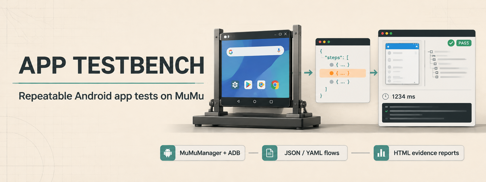
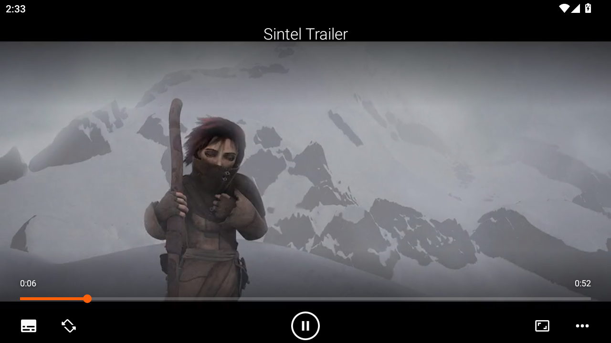

# App TestBench

[简体中文](README.md) | **English** | [Agent](docs/agent-deployment.md)



**Repeatable Android app tests on MuMu, with screenshots, UI trees, and logs retained on failure.**

App TestBench is a Windows CLI for Android app test automation. It drives MuMu Player through `MuMuManager.exe` and `adb`, describes installs, launches, taps, text input, waits, assertions, screenshots, UI dumps, and logcat collection in JSON/YAML flows, and produces a self-contained HTML report, `result.json`, and optional JUnit XML.

It does not ask a vision model to improvise every tap. Each step is explicitly declared in a flow, pass/fail is decided by assertions, and failed runs retain the evidence needed by QA, developers, and CI.


> Independent open-source project. Not affiliated with NetEase or the MuMu team. Use it only with devices, apps, and accounts you are authorized to test.

## v0.1.1

- Package and CLI version: `0.1.1`. The published `v0.1.0` tag is unchanged.
- Two live MuMu cases passed: Fennec local web session **71/71 steps**, VLC HTTP playback **30/30 steps**.
- Coverage includes first-run UI, system prompts, ADB reverse, asynchronous waits, text input, search, detail navigation, cold-start persistence, orientation, HTTP Range, audio/video decoding, and log evidence.
- Failed `run --json` now returns both `error` and the complete `data` payload, keeps exit code `1`, and validates against the published `cli-v1.schema.json`.
- No telemetry, cloud upload, or account system.

## Live cases

### Fennec: login, asynchronous search, detail, and session restoration


Fennec F-Droid opens a local FieldDesk QA site exposed through `adb reverse`. The flow completes first-run onboarding, handles a translation prompt, signs in, waits for asynchronous JavaScript state, opens a search result and detail record, force-stops the browser, cold-launches it, verifies that the `localStorage` session and query were restored, then logs out.

**Result: 71/71 steps passed in 99.141 seconds.** This covers a real browser/WebView, Android password-save UI, dynamic waits, cold-start persistence, and UI assertions.

[Reproduction](examples/fennec-local-web-session/README.md) · [Case details](docs/cases.md)

### VLC: HTTP byte-range playback with Android codec evidence



VLC opens a SHA256-pinned MP4 through `adb reverse`. A dedicated range server returns `206 Partial Content`; the flow completes VLC onboarding and the first-play tutorial, plays real video, and records HTTP, demux, H.264/AAC, and Android MediaCodec evidence in logcat.

**Result: 30/30 steps passed in 40.547 seconds.** The screenshot contains a real video frame, title, and the `0:05 / 0:52` timeline, not a blank page or desktop-only capture.

[Reproduction](examples/vlc-http-playback/README.md) · [Case details](docs/cases.md)

### Failure reports retain diagnostics


A failed flow exits with code `1`, emits a structured `error`, retains the complete `data` payload, and preserves a failure screenshot, UI tree, logcat, HTML report, and JUnit. The public image comes from a live failure run; local paths and the ADB serial were redacted before rendering.

## Why MuMu is the default runtime

Starting an Android environment for a one-off demo is easy. Reproducing the same failure a week later is the hard part. MuMu provides mature instance management, a real Android system, an ADB channel, and configurable virtual devices. App TestBench adds test orchestration, assertions, waits, evidence, and machine-readable results.

| Approach | Good fit | Main limitation |
| --- | --- | --- |
| Manual testing on a physical device | Final acceptance and hardware-specific behavior | Expensive to repeat; evidence is manual |
| Vision-model screen-by-screen clicking | Exploration and demos | Environment, model, and decisions are hard to reproduce |
| One-off ADB scripts | A single action or short task | Weak structure, assertions, reports, and failure evidence |
| App TestBench + MuMu | Frequent smoke/regression, app/WebView tests, defect handoff | Windows + MuMu first; physical-device validation still matters |

App TestBench treats MuMu as a reliable Android runtime backend instead of building an improvised emulator. Test authors retain control of coordinates and selectors; the tool owns repeatable execution and evidence delivery.

## Use cases for authorized testing

- **App-only or WebView-only behavior.** When a web surface is incomplete or an authorized test environment places stricter limits on browser automation, use the native app as the legitimate test surface when the app, account, and data belong to your organization.
- **Authenticated regression with dedicated test accounts.** Sign in normally on an isolated MuMu instance, then verify authenticated pages, permissions, and business behavior.
- **Browser and WebView state persistence.** Verify login state, query state, cookie lifetime, and cold-start recovery without exporting or forging cookies/tokens.
- **Media, permissions, and system UI.** Exercise runtime permissions, first-play tutorials, orientation, HTTP Range, MediaCodec, and real rendered frames.
- **Compatibility checks.** Record whether behavior depends on MuMu, Android image, resolution, app build, or cold/warm launch state.
- **Small-team smoke and regression testing.** Start with flows, HTML, JSON, and JUnit instead of building a large test platform.
- **Failure reproduction and defect handoff.** Keep the screenshot, UI tree, logcat, timings, and error in one report.

These use cases do not include bypassing login, CAPTCHA, anti-automation, anti-scraping, risk controls, rate limits, paywalls, or access controls. See [`docs/use-cases.md`](docs/use-cases.md) and [`RESPONSIBLE_USE.md`](RESPONSIBLE_USE.md).

## How a flow runs

1. Parse JSON/YAML and strictly validate actions, fields, package names, URIs, ports, and types.
2. Discover `MuMuManager.exe`, `adb.exe`, the target instance, and the ADB serial.
3. Optionally wait for `sys.boot_completed`, then execute setup.
4. Run install, launch, input, waits, assertions, and evidence collection in order.
5. On failure, stop the main section, retain error text, screenshots, UI trees, and logcat, then run teardown.
6. Generate self-contained HTML, `result.json`, and optional JUnit XML.

| Layer | Responsibility |
| --- | --- |
| Discovery | MuMuManager, ADB, instance, port, and version |
| Device operations | install, launch, open, close, clear-data, orientation, reverse-port, tap, swipe, text, keyevent |
| Evidence | screenshot, dump-ui, logcat |
| Flow semantics | setup, steps, teardown, wait, wait_for_text, UI assertions |
| Delivery | HTML, JSON, JUnit, process exit code |

## Quick start

### Requirements

- Windows 10/11
- Python 3.10+
- MuMu Player with at least one running instance and ADB debugging enabled
- `MuMuManager.exe` and `adb.exe` discoverable or supplied explicitly

Common MuMuManager locations:

```text
<MuMu root>\shell\MuMuManager.exe
<MuMu root>\nx_main\MuMuManager.exe
```

### Install

```powershell
git clone https://github.com/albertwickous-droid/app-testbench.git
cd app-testbench
py -3.11 -m venv .venv
.\.venv\Scripts\Activate.ps1
python -m pip install -e ".[dev]"
app-testbench --version
```

Or install a built wheel:

```powershell
python -m pip install .\dist\app_testbench-0.1.1-py3-none-any.whl
```

### Discover the environment

```powershell
app-testbench doctor --json
```

If discovery fails, provide the tool paths explicitly:

```powershell
$mumuPlayer = "<path to MuMuPlayer>"
app-testbench doctor `
  --mumumanager (Join-Path $mumuPlayer "nx_main\MuMuManager.exe") `
  --adb (Join-Path $mumuPlayer "nx_device\12.0\shell\adb.exe") `
  --json
```

### Run the live cases

```powershell
.\examples\fennec-local-web-session\run.ps1
.\examples\vlc-http-playback\run.ps1
```

Each script downloads and verifies a pinned APK, starts its local test service, runs doctor and the flow, writes JUnit, and stops only the service it started. APKs, video, original screenshots, logcat, and run directories stay under the Git-ignored `runs/` directory.

## Commands

```powershell
# Install, launch, open a URI, close
app-testbench install .\app.apk --expected-package com.example.app
app-testbench launch com.example.app
app-testbench open "https://example.test/" --package com.example.app --mime-type text/html
app-testbench close com.example.app

# Device state
app-testbench clear-data com.example.app
app-testbench orientation landscape
app-testbench reverse-port 18765 --local-port 18765

# Input
app-testbench tap 540 1200
app-testbench swipe 540 1600 540 500 --duration-ms 500
app-testbench text "qa@example.test"
app-testbench keyevent ENTER

# Evidence
app-testbench screenshot --output .\artifacts\home.png
app-testbench dump-ui --output .\artifacts\home.xml
app-testbench logcat --output .\artifacts\logcat.txt --lines 2000
```

Every device command supports `--json`. Success and failure both use a versioned envelope suitable for CI and agents.

## JSON/YAML flows

```yaml
version: 1
name: login-smoke
device:
  instance: 0
  package: com.example.app
  wait_for_boot: true
  boot_timeout: 60
report:
  title: Login smoke
  capture_screenshots: failures
  collect_logcat: true
  include_ui_xml: true
setup:
  - action: install
    apk: ${APP_APK}
    expected_package: com.example.app
    expected_version_code: 42
steps:
  - action: launch
  - action: wait_for_text
    text: Login
    timeout: 20
  - action: tap
    x: 540
    y: 1200
  - action: text
    text: qa@example.test
  - action: assert_ui_contains
    text: Welcome
  - action: screenshot
    label: welcome
teardown:
  - action: close
  - action: logcat
    label: final
    lines: 2000
```

```powershell
app-testbench validate .\app-testbench-flow.yaml --json
app-testbench run .\app-testbench-flow.yaml `
  --output .\runs `
  --junit-xml .\artifacts\junit.xml `
  --wait-for-boot --boot-timeout 60
```

See [`docs/flow-reference.md`](docs/flow-reference.md) for the full action reference.

## Output and evidence

A run creates:

```text
runs/<timestamp>-<flow-name>/
├── report.html
├── result.json
├── screenshots/
├── ui/
└── logs/
```

The HTML report embeds styles, scripts, screenshots, and log excerpts; it works offline with no CDN. `result.json` records the environment, steps, timings, errors, and relative artifact paths. JUnit maps one testcase to each flow action.

## Codex skill

The repository includes [`skills/app-testbench/SKILL.md`](skills/app-testbench/SKILL.md). With the skill installed, an agent can:

1. Run `doctor --json`.
2. Install the APK and verify package/version identity.
3. Inspect screenshots and UI trees, then write or repair a flow.
4. Run passing and failing paths.
5. Return the report, JSON, JUnit, and raw evidence paths.

```powershell
app-testbench skill-path
Copy-Item -Recurse .\skills\app-testbench "$HOME\.codex\skills\" -Force
```

English deployment and publishing runbook: [`docs/agent-deployment.md`](docs/agent-deployment.md).

## Exit codes and JSON contract

| Code | Meaning |
| --- | --- |
| `0` | Success |
| `1` | Execution failure, such as an assertion, ADB, or MuMuManager operation |
| `2` | Invalid CLI argument, flow configuration, or required tool |
| `130` | User interruption |

Failed `run --json` example:

```json
{
  "schema_version": "1.0",
  "ok": false,
  "command": "run",
  "generated_at": "2026-11-16T02:35:17+08:00",
  "error": {
    "type": "step_failure",
    "message": "Flow step '...' failed: ...",
    "hint": "Visible text: ..."
  },
  "data": {
    "status": "failed"
  }
}
```

Schemas live in `src/app_testbench/schemas/`. v0.1.1 did not relax the schema: the failure envelope is validated by a regression test and by a live MuMu failure run.

## Validation status

See [`docs/validation.md`](docs/validation.md) for the complete record.

- MuMu Player 6.8.8.0 / Android 12 / ADB 1.0.41.
- 1280×720 with a Simplified Chinese system language.
- Fennec 160.0.0: 71 passed, 0 failed, 0 skipped, 99.141 seconds.
- VLC 3.7.2: 30 passed, 0 failed, 0 skipped, 40.547 seconds.
- Failure contract: exit 1, schema valid, failure screenshot, UI tree, logcat, HTML, and JUnit all retained.
- APKs, video, complete run directories, unfiltered logcat/UI XML, and virtual environments are excluded from Git.

## Security and privacy

- Reports can contain accounts, chats, orders, internal pages, tokens, URLs, or device identifiers. Treat them as sensitive by default.
- Review `runs/`, screenshots, UI XML, and logcat before sharing.
- The project has no telemetry and does not upload artifacts.
- Do not commit real accounts, production tokens, cookies, personal APKs, or user data.
- Do not test devices, apps, or accounts without authorization.
- `install`, `clear-data`, `close`, `orientation`, and `reverse-port` mutate emulator or app state; declare them explicitly in flows.

See [`SECURITY.md`](SECURITY.md) for vulnerability reporting.

## Limitations

- The first release targets **Windows + MuMu Player + ADB**. Other emulators may reuse ADB operations, but instance management is not verified.
- No OCR or image-template matching. Coordinates come from the test author, screenshots, or the UI tree.
- `text` supports printable ASCII only. Chinese input requires a separately authorized and tested ADBKeyboard/clipboard approach.
- MuMu upgrades may change paths, ports, or MuMuManager output formats.
- `wait_for_text` depends on `uiautomator dump`; game engines, custom-rendered controls, and incomplete accessibility trees may not expose text.
- Live cases prove only the app, version, resolution, language, and MuMu image recorded here. Recalibrate for another environment.
- Physical devices remain the final acceptance environment.

## Development

```powershell
.\.venv\Scripts\Activate.ps1
python -m ruff format .
python -m ruff check .
python -m ruff format --check .
python -m pytest -q
python -m build
python -m twine check dist/*
```

CI uses deterministic fake `adb` and `MuMuManager` backends to verify command construction, flows, reports, and schemas. Live MuMu results are recorded separately and are never represented as CI results.

## Publishing and promotion

- [`docs/publishing.md`](docs/publishing.md)
- [`docs/github-repository-setup.md`](docs/github-repository-setup.md)
- [`docs/releases/v0.1.1.md`](docs/releases/v0.1.1.md)
- [`docs/promotion.md`](docs/promotion.md)
- [`docs/launch-copy.md`](docs/launch-copy.md)
- [`RELEASE_CHECKLIST.md`](RELEASE_CHECKLIST.md)

## Support and contributing

- Usage, bugs, and feature requests: [`SUPPORT.md`](SUPPORT.md)
- Contribution workflow: [`CONTRIBUTING.md`](CONTRIBUTING.md)
- Code of conduct: [`CODE_OF_CONDUCT.md`](CODE_OF_CONDUCT.md)
- Security reports: [`SECURITY.md`](SECURITY.md)

## Legal, responsibility, and usage boundaries

The project is released under the **MIT License**:

- [`LICENSE`](LICENSE): MIT permissions, warranty disclaimer, and liability limitation
- [`DISCLAIMER.md`](DISCLAIMER.md): disclaimer, third-party relationships, and responsibility boundaries
- [`RESPONSIBLE_USE.md`](RESPONSIBLE_USE.md): authorized testing, misuse boundaries, and safe-operation responsibility
- [`PRIVACY.md`](PRIVACY.md): local data handling, sensitive evidence, and retention responsibility
- [`THIRD_PARTY_NOTICES.md`](THIRD_PARTY_NOTICES.md): third-party trademarks, dependencies, and non-affiliation
- [`SECURITY.md`](SECURITY.md): security boundaries and vulnerability reporting

The software is provided "as is" without a guarantee of compatibility with every MuMu, Android, or app version. Users are responsible for confirming legal authorization and compliance for devices, accounts, applications, data, and automation activity.

## License

MIT © 2026 App TestBench contributors

## Disclaimer

MuMu Player, Android, ADB, Python, GitHub, Mozilla, VLC, Sintel/Blender Foundation, and related trademarks belong to their respective owners. App TestBench is an independent open-source project. It does not distribute MuMu installers, APKs, or video files, bypass application security controls, or provide unauthorized access to third-party accounts or devices.