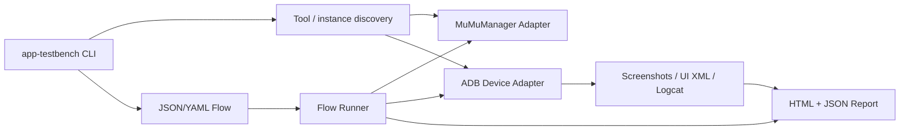

# App TestBench

[简体中文](README.md) | **English**


**Repeatable Android app tests on MuMu, with screenshots, UI dumps, and logs when a step fails.**

App TestBench is a Windows command-line tool for automated Android app testing. It drives MuMu Player through `MuMuManager.exe` and `adb`, with commands for installation, launch, tapping, input, screenshots, UI hierarchy dumps, and logcat collection. Tests are described in JSON/YAML flows, and each run produces a self-contained HTML report plus a machine-readable `result.json`.

It addresses three practical needs: running the same test repeatedly, identifying the exact failing step with useful evidence, and exposing results in a form that CI or an agent can consume.


> Independent open-source project, not affiliated with NetEase or MuMu. Use it only with devices, applications, and accounts you are authorized to test.

## v0.1.0 status

- The first release supports Windows 10/11, MuMu Player, and ADB.
- Automated tests use deterministic fake `adb` and `MuMuManager` backends and cover command construction, flows, reports, and failure semantics.
- GitHub CI passes on Windows and Ubuntu with Python 3.10, 3.11, and 3.12.
- A live smoke test passed 7/7 steps on MuMu Player 6.8.8.0 and Android 12 using the Android Settings app; see [`docs/validation.md`](docs/validation.md) for the exact scope.
- CI and one live smoke test do not claim compatibility with every MuMu release, Android image, or business app.
- The tool has no telemetry, cloud upload, or account system.

## Why MuMu is the default runtime

Starting a temporary Android environment for a demo is easy on Windows. Reproducing the same failure several days later is harder. App TestBench reuses MuMu's existing instance management, Android system, and ADB connection rather than maintaining another non-standard Android environment inside the test tool. It adds tool discovery, flow validation, waits, assertions, timeouts, and evidence collection so that environment problems, version differences, and test-step failures can be investigated separately.

This design is intended for frequent smoke and regression runs. Physical devices are still appropriate for final acceptance. Compared with an ad-hoc environment driven only by visual model clicks, App TestBench executes explicit commands and flow actions; the tradeoff is that v0.1 has no OCR or image-template matching, and text inside WebViews, game engines, or custom-rendered surfaces may not be available in the UI hierarchy.

| Approach | Good fit | Main limitation |
| --- | --- | --- |
| Manual physical-device testing | Final acceptance and hardware-dependent behavior | Expensive to repeat; evidence is assembled by hand |
| Ad-hoc AI environment / vision-only tapping | Fast demos | Environment and model behavior are difficult to reproduce |
| One-off ADB scripts | A single action or short-lived task | Steps, assertions, and failure evidence are usually ad hoc |
| App TestBench + MuMu | Frequent smoke, regression, compatibility checks, and evidence handoff | v0.1 is Windows + MuMu focused; final device validation is still required |

## How a flow runs

The runner locates MuMuManager, ADB, and the selected instance, then executes installation, actions, waits, and assertions in order. When a step fails, later steps stop and the error, duration, screenshot, UI hierarchy, and current logcat are written to the run directory. The finished run produces an HTML report.

| Layer | Responsibility |
| --- | --- |
| Tool discovery | Locate MuMuManager, ADB, instances, and ADB ports |
| Device actions | Install, launch, close, tap, swipe, input, screenshots, UI dumps, logcat |
| Flow orchestration | JSON/YAML actions, environment variables, waits, assertions, setup/teardown |
| Evidence output | Per-step timing, errors, screenshots, UI XML, logs, `result.json`, `report.html`, optional JUnit XML |

`report.html` opens offline and can be handed to developers, QA, or product staff for review. `result.json` is intended for CI, scripts, and agents.

## Use cases for authorized testing

App TestBench is designed for apps, accounts, devices, and environments **you are authorized to test**:

- **Incomplete web coverage:** when a capability exists only in the native app or behaves differently from the web experience, test the app flow with an authorized test account.
- **Authenticated regression:** sign in with a dedicated test account in an isolated MuMu instance through the normal login flow, then reuse that test instance's authenticated state for later flows.
- **Instance and version coverage:** switch MuMu instances, installed app versions, and boot states to isolate regressions that appear only in a specific environment.
- **Small-team smoke testing:** describe critical journeys in JSON/YAML and generate offline reports with screenshots, UI hierarchy, logcat, and timing.
- **Defect handoff:** keep the failing step, screenshot, UI hierarchy, and logs in one report so developers, QA, and product staff do not have to reconstruct the scene from messages.
- **AI-assisted authoring:** AI or Codex can draft flows, explain failures, and summarize reports; explicit assertions and raw evidence still determine pass/fail.

> Every scenario requires authorization. App TestBench is not for bypassing login, CAPTCHA, anti-automation, anti-scraping, risk controls, rate limits, paywalls, or regional restrictions. It does not provide cookie/token export, session forgery, or unauthorized access.

See [`docs/use-cases.md`](docs/use-cases.md) for detailed boundaries.

## Features

- `doctor` checks MuMuManager, ADB, instances, ADB connections, and versions
- Instance lifecycle: list, start, stop, restart
- App operations: install APK, launch, force-stop
- Input: tap, swipe, printable-ASCII text, keyevent
- Evidence: screenshot, UI dump, logcat
- JSON/YAML flows with validation, setup, steps, teardown, waits, and assertions
- Self-contained HTML report plus machine-readable `result.json`
- Optional JUnit XML export with one testcase per flow action
- Opt-in boot readiness gate using `sys.boot_completed`
- Post-install package identity and version verification
- `--json` on every command, including structured failures and versioned JSON Schema contracts
- Packaged Codex skill and `app-testbench skill-path`

## Requirements

- Windows 10/11
- Python 3.10+
- MuMu Player with at least one instance
- ADB debugging enabled in that instance
- `MuMuManager.exe` and `adb.exe` discoverable, or supplied explicitly

Common MuMuManager locations:

```text
C:\Program Files\Netease\MuMuPlayer-12.0\shell\MuMuManager.exe
C:\Program Files\Netease\MuMuPlayer-12.0\nx_main\MuMuManager.exe
```

Directory layouts vary between MuMu releases. `doctor` searches common locations and registry installation entries. If that fails, provide explicit paths or environment variables.

## Install

From source:

```powershell
git clone https://github.com/albertwickous-droid/app-testbench.git
cd app-testbench

py -3.11 -m venv .venv
.\.venv\Scripts\Activate.ps1
python -m pip install -e .
```

If the package is available on PyPI:

```powershell
python -m pip install app-testbench
app-testbench --version
```

First run:

```powershell
app-testbench doctor
app-testbench instance list
```

Explicit paths when auto-discovery fails:

```powershell
app-testbench doctor `
  --mumumanager "C:\Program Files\Netease\MuMuPlayer-12.0\shell\MuMuManager.exe" `
  --adb "C:\Program Files\Netease\MuMuPlayer-12.0\shell\adb.exe" `
  --instance 0
```

Environment overrides:

```powershell
$env:APP_TESTBENCH_MUMU_MANAGER = "C:\path\to\MuMuManager.exe"
$env:APP_TESTBENCH_ADB = "C:\path\to\adb.exe"
$env:APP_TESTBENCH_INSTANCE = "0"
$env:APP_TESTBENCH_JSON = "1"
```

## Commands

> Global options work before or after the subcommand.

```powershell
# Install, launch, close
app-testbench --instance 0 install .\app.apk
app-testbench --instance 0 install .\app.apk `
  --expected-package com.example.app --expected-version-code 42 --expected-version-name 1.2.3
app-testbench --instance 0 launch com.example.app
app-testbench --instance 0 close com.example.app

# Input
app-testbench --instance 0 tap 540 1200
app-testbench --instance 0 swipe 540 1600 540 500 --duration-ms 500
app-testbench --instance 0 text "hello world"
app-testbench --instance 0 keyevent ENTER

# Evidence
app-testbench --instance 0 screenshot --output .\artifacts\home.png
app-testbench --instance 0 dump-ui --output .\artifacts\home.xml
app-testbench --instance 0 logcat --output .\artifacts\logcat.txt --lines 2000

# Machine-readable output
app-testbench doctor --json
app-testbench instance list --json
```

`text` uses Android native `input text`. The first release supports printable ASCII only. Unicode input such as Chinese or Japanese requires ADBKeyboard or clipboard automation and is rejected explicitly instead of silently dropping characters.

## Flows

Generate a template:

```powershell
app-testbench init --output .\mumu-flow.yaml
```

Example:

```yaml
version: 1
name: login-smoke
device:
  instance: 0
  package: com.example.app
  wait_for_boot: true
  boot_timeout: 60

report:
  capture_screenshots: all
  collect_logcat: true

setup:
  - name: Install APK
    action: install
    apk: ./app.apk
    expected_version_code: 42
    expected_version_name: 1.2.3

steps:
  - name: Launch app
    action: launch

  - name: Wait for login screen
    action: wait_for_text
    text: Login
    timeout: 20
    interval: 0.5

  - name: Tap email field
    action: tap
    x: 540
    y: 620

  - name: Enter email
    action: text
    text: qa@example.com

  - name: Capture login screen
    action: screenshot
    label: login

  - name: Assert login button
    action: assert_ui_contains
    text: Sign in

teardown:
  - name: Close app
    action: close
```

String values can use environment variables:

```yaml
device:
  package: ${APP_PACKAGE}
setup:
  - action: install
    apk: ${APK_PATH}
```

Validate and run:

```powershell
app-testbench validate .\mumu-flow.yaml
app-testbench run .\mumu-flow.yaml --output .\runs --junit-xml .\artifacts\junit.xml
app-testbench run .\mumu-flow.yaml --output .\runs --wait-for-boot --boot-timeout 60
```

A run directory contains:

```text
runs/20261111-153000-login-smoke/
├── report.html          # self-contained, screenshots embedded
├── result.json          # machine-readable result
├── screenshots/
├── ui/
└── logs/
```

Open `report.html` in a browser for offline review. See [`docs/flow-reference.md`](docs/flow-reference.md) for the complete DSL.

### Report preview


> Synthetic preview using a fictional flow, placeholder account, and mock screenshot. It does not represent real application data.

## Codex skill

The repository includes:

```text
skills/app-testbench/SKILL.md
```

Install it for the current user:

```powershell
Copy-Item -Recurse .\skills\app-testbench "$HOME\.codex\skills\" -Force
```

After installing the pip package, locate the packaged copy:

```powershell
app-testbench skill-path
```

Example agent request:

> Install `app.apk` into MuMu instance 0, launch `com.example.app`, walk through login, home, search, and detail pages, capture each step, collect UI and logcat on failure, and produce an HTML report.

The skill runs `doctor` first, uses `--json` to inspect structured results, and avoids guessing coordinates without evidence.

## Architecture



Design choices:

- **Real backends first:** instance lifecycle goes through MuMuManager; app interaction goes through ADB.
- **Strict flow allowlist:** unknown fields and action typos fail before execution.
- **Safe argument passing:** host processes receive argument arrays, not shell-concatenated commands.
- **Evidence on failure:** failed steps attempt a diagnostic screenshot and final logcat.
- **Self-contained reports:** CSS, JavaScript, and screenshots are embedded without CDN dependencies.

See [`docs/architecture.md`](docs/architecture.md) for details.

## Exit codes

| Code | Meaning |
| --- | --- |
| `0` | Success |
| `1` | Execution failure, such as a failed assertion or an ADB / MuMuManager operation |
| `2` | Invalid CLI argument, JSON/YAML flow configuration, or unavailable required tool |
| `130` | User interruption |

With `--json`, both success and failure are emitted as structured JSON for agents and CI.

## Security and privacy

- **Reports contain evidence and may contain sensitive data.** Screenshots may include accounts, chats, orders, or personal information; logcat may contain tokens, URLs, and device identifiers.
- Review `runs/`, screenshots, UI XML, and logs before sharing or opening an issue.
- The project has no telemetry and does not upload artifacts.
- Do not commit real accounts, production tokens, cookies, personal APKs, or user data.
- Do not test devices, applications, or accounts without authorization.
- `instance stop`, `close`, and `install` mutate local or emulator state; declare them explicitly in flows.
- Report text is escaped, but the HTML report remains a sensitive local artifact, not an access-control boundary.

See [`SECURITY.md`](SECURITY.md) for vulnerability reporting.

## Limitations

- The first release targets **Windows + MuMu Player + ADB**. Other emulators may reuse ADB operations, but instance management is not verified.
- No OCR, image-template matching, or visual localization. Coordinates come from user-authored flows or UI assertions.
- Native `input text` has limited Unicode support; non-ASCII text is rejected in this release.
- MuMu upgrades may change directories, ports, or MuMuManager output formats.
- `wait_for_text` depends on `uiautomator dump`; WebViews, game engines, or custom-rendered surfaces may not expose readable text.
- `launch` uses a Launcher Intent by default. Use `--activity` for multi-Activity or special launch cases.

## Development

```powershell
py -3.11 -m venv .venv
.\.venv\Scripts\Activate.ps1
python -m pip install -e ".[dev]"

python -m ruff check .
python -m ruff format --check .
python -m pytest -q
python -m build
python -m twine check dist/*
```

Or run:

```powershell
.\scripts\check.ps1
```

The default suite uses deterministic fake `adb` and `MuMuManager` executables. It verifies the CLI, flow semantics, report generation, and process boundary. A live MuMu integration test must run on a Windows host with a real instance and is not simulated by CI.

### Optional daily maintenance automation

The canonical scheduler is **Codex native Scheduled**: it runs in the local project at 04:00 Asia/Shanghai, applies low-risk fixes, and verifies the project. New capability ideas are written as research proposals and are never added without approval. The Windows Task Scheduler task `app-testbench-daily-optimizer` is retained only as a fallback and is currently disabled so both schedulers cannot edit the same worktree concurrently.

The workflow never commits, pushes, publishes, or operates other applications. After maintenance it closes MuMu: before 05:00 it waits until 05:00, and at or after 05:00 it closes immediately. Cleanup evidence is written to `cleanup.json`. See [`docs/automation.md`](docs/automation.md) for the native prompt and fallback controls.

## Publishing and promotion

See:

- [`docs/publishing.md`](docs/publishing.md)
- [`docs/github-repository-setup.md`](docs/github-repository-setup.md)
- [`docs/agent-deployment.md`](docs/agent-deployment.md): deployment runbook for agents
- [`docs/releases/v0.1.0.md`](docs/releases/v0.1.0.md)
- [docs/promotion.md](docs/promotion.md)
- [docs/launch-copy.md](docs/launch-copy.md)
- [RELEASE_CHECKLIST.md](RELEASE_CHECKLIST.md)

## Support and contributing

- Usage, bugs, and feature requests: [`SUPPORT.md`](SUPPORT.md)
- Contribution workflow: [`CONTRIBUTING.md`](CONTRIBUTING.md)
- Code of conduct: [`CODE_OF_CONDUCT.md`](CODE_OF_CONDUCT.md)
- Security reports: [`SECURITY.md`](SECURITY.md)

## Legal, responsibility, and usage boundaries

This project is released under the **MIT License**. Full notices:

- [`LICENSE`](LICENSE): MIT permissions, warranty disclaimer, and liability limitation
- [`DISCLAIMER.md`](DISCLAIMER.md): disclaimer, third-party relationships, and responsibility boundaries
- [`RESPONSIBLE_USE.md`](RESPONSIBLE_USE.md): authorized testing, misuse boundaries, and safe-operation responsibility
- [`PRIVACY.md`](PRIVACY.md): local data handling, sensitive evidence, and retention responsibility
- [`THIRD_PARTY_NOTICES.md`](THIRD_PARTY_NOTICES.md): third-party trademarks, dependencies, and non-affiliation
- [`SECURITY.md`](SECURITY.md): vulnerability reporting and security boundaries

The software is provided “as is” and does not guarantee compatibility with every MuMu, Android, or application version. Users are responsible for confirming legal authorization and compliance for devices, accounts, applications, data, and automation activity.

## License

MIT © 2026 App TestBench contributors

## Disclaimer

MuMu Player, Android, ADB, Python, GitHub, OpenAI/Codex, and related trademarks belong to their respective owners. App TestBench is an independent open-source tool. It does not include MuMu installers, bypass application security, or provide unauthorized access to third-party accounts or devices.

See [`THIRD_PARTY_NOTICES.md`](THIRD_PARTY_NOTICES.md) and [`DISCLAIMER.md`](DISCLAIMER.md) for the complete notices.
