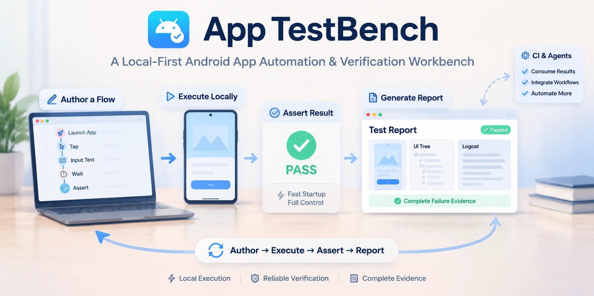
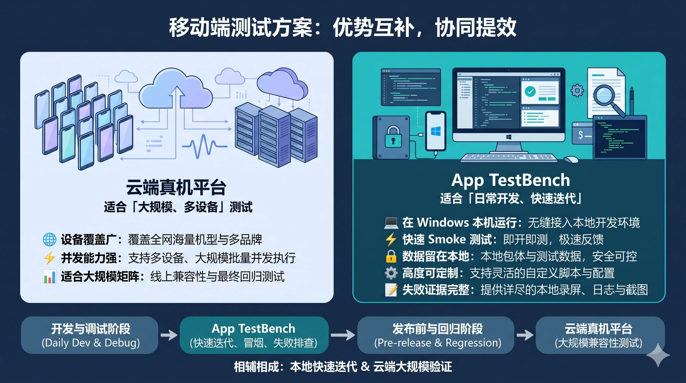
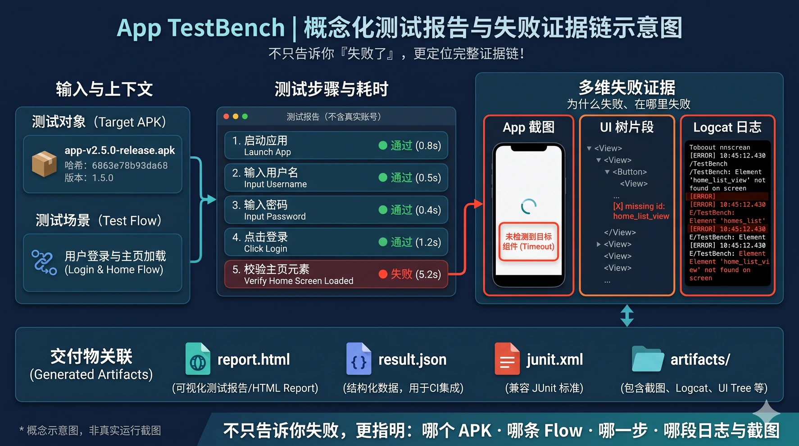
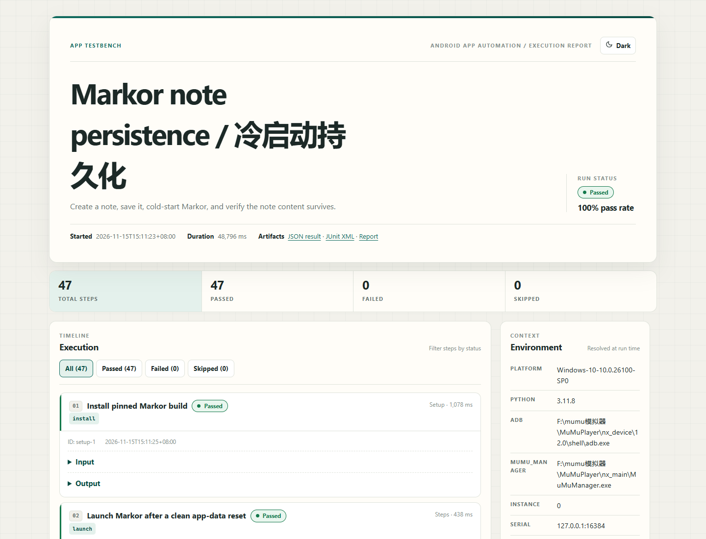

# App TestBench

[简体中文](README.md) | **English** | [Agent](docs/agent-deployment.md)



*Above: a workflow illustration from authoring a flow to local execution, assertions, and report generation; actual screens and artifacts come from real runs.*

> **A local-first Android smoke and regression workbench for individual developers and small teams.**

Start without a device cloud: install an APK, run a flow, and produce HTML/JUnit evidence on your Windows machine. APKs, screenshots, UI trees, and logcat stay local by default. The goal is not “more devices”; it is a faster, more controlled last mile with complete failure evidence.

**As coding agents ship more changes, app regression cannot still depend on someone clicking through the UI by hand.** App TestBench turns install, launch, tap, input, wait, and assertion steps into explicit JSON/YAML flows. It runs them on a mature MuMu runtime and preserves the screenshot, UI tree, logcat, and HTML report when a run fails.

The runner does not ask a vision model to guess the next screen. Each step passes or fails on UI text, Activity, logcat, or file assertions. The same failure can be replayed, compared, and handed off instead of ending as “cannot reproduce”.


> Independent open-source project. Not affiliated with or endorsed by NetEase or the MuMu team. Test only apps, accounts, devices, and data that you own or are explicitly authorized to test.

## Why now

Trend check: 2026-11-19

| Change | Impact on testing | How this project responds |
| --- | --- | --- |
| [GitHub Octoverse 2026 (2026-10-28)](https://github.blog/news-insights/octoverse/octoverse-commits-pushes-reach-new-highs-in-2026-as-developers-build-with-agents/) reports that by September 2026, developers start more than 40% of pull requests with an agent | Changes arrive faster, so manual regression, reproduction, and evidence collection become the bottleneck | Explicit flows, assertions, exit codes, and structured results support high-frequency regression |
| [Android Emulator 37.2.13 (2026-10-28)](https://developer.android.com/studio/releases/emulator#37-2-13) continues to ship graphics, stability, and resource-release fixes | Runtime and toolchain drift can make a failure hard to explain | Use MuMu as the mature execution layer, then pin the environment with `doctor`, fixed APKs, and evidence reports |

## Fast path: what do you want to do?

| Goal | Start here | Result |
| --- | --- | --- |
| Check whether the environment works | `app-testbench doctor` | MuMu, ADB, and instance status |
| Test your own APK | Run `install → launch → screenshot → dump-ui` | Confirm the single-device actions first |
| Produce a complete test report | Follow the five-minute path: `init → validate → run` | HTML + `result.json` + evidence |
| See a real case first | `.\examples\ankidroid-deck-persistence\run.ps1` | Download a pinned APK, run 49 steps, generate a report |
| Feed CI or an agent | `run --json`, or read the [Agent runbook](docs/agent-deployment.md) | Structured results, exit codes, and JUnit |

## Who is it for?

| User or scenario | Fit |
| --- | --- |
| Individual developers and indie builders | **Best fit**: one Windows machine plus MuMu is enough for daily smoke tests, regression checks, and defect reproduction without setting up a device cloud |
| Small engineering / QA teams, especially 1–10 people | **Good fit**: developers, QA, and agents can share flows, HTML, JUnit, and CI results |
| Teams sensitive to APK, account, screenshot, or log location | **Good fit**: the tool has no built-in cloud upload and keeps raw evidence local by default |
| Small teams with frequent regression | **Good fit**: no upload, queue, metering, or platform setup in the daily loop |
| Compatibility matrices across dozens or hundreds of devices | **Not a standalone fit**: pair it with a cloud device farm or physical-device lab |
| High-concurrency device pools or large-scale load testing | **Not a fit**: this is not a device cloud |
| Bypassing login, CAPTCHA, anti-bot controls, rate limits, or access controls | **Not supported** |

## App TestBench vs. a cloud device farm

A cloud device farm optimizes **device coverage and concurrency**. App TestBench optimizes the **last mile of verification**. They solve different problems and can be used together.



*Illustration: cloud farms emphasize device coverage and concurrency, while App TestBench emphasizes fast local verification, local data retention, and evidence handoff. They can be used together.*

| Dimension | Cloud device farm | App TestBench |
| --- | --- | --- |
| Device coverage | **Strong**: cross-brand, cross-OS, cross-model validation | **Not competing**: currently Windows + MuMu first |
| Concurrency | **Strong**: large parallel runs | **Not competing**: optimized for one machine or a small number of parallel runs |
| Setup cost | Sign-up, APK upload, device configuration, quotas, and billing | Install locally and start from commands |
| Data location | APK, screenshots, and logs are usually uploaded to the platform | Local by default; no built-in cloud upload |
| Recurring cost | Priced by device, concurrency, or time | No cloud-device usage fee; uses local compute |
| Fast smoke tests | Upload, queueing, and result retrieval can take longer than the test | Local execution writes artifacts directly |
| Customization | Constrained by platform APIs, UI, and execution boundaries | Flows, scripts, CI, and agents remain customizable |
| Evidence handoff | Usually viewed or exported inside the platform | HTML + `result.json` + JUnit + screenshots / UI tree / logcat |
| Chinese apps / MuMu scenarios | Not always a focused optimization area | An explicit, current runtime differentiator |

> “Local by default” means App TestBench does not upload run artifacts itself. The app under test, system components, and any CI or cloud service you connect may still use the network. Local prerequisites are Windows, Python, and MuMu; the optimization applies to every verification loop after setup.

### Three direct promises

| Promise | What you actually get |
| --- | --- |
| **Five-minute first run** | With MuMu and Python already installed: install an APK → run a flow → get HTML/JUnit without an account, server, or cloud quota; `validate` does not touch the device, while `run` does |
| **Failure evidence you can hand off** | While the device is still reachable, the failed step, timing, screenshot, UI tree, logcat, `result.json`, and HTML remain in the same run directory by default |
| **Ready for agents and CI** | `--json`, Draft 2020-12 schemas, stable exit codes, JUnit XML, and environment interpolation |



*Concept illustration, not a real run screenshot: it shows how the APK, flow, failed step, screenshot, UI tree, logcat, and HTML/JUnit evidence relate.*

**Why choose it:** if the pain is “I rerun the same app journey every day and do not want to upload, queue, or pay by the minute”, the local-first path is shorter. If the pain is “I need dozens of device models in one run”, a cloud device farm is still the better tool.

**Explicit non-goals:** a device-cloud platform, a large test-management suite, or a general AI / RPA platform.

## Supported capabilities

App TestBench does not compete on device-matrix breadth. It completes one verification workflow: author → execute → assert → diagnose → report → consume from CI or an agent.

| Area | What is supported | What you get |
| --- | --- | --- |
| Environment and instances | `doctor`, MuMu instance list/start/stop/restart, ADB discovery, instance or serial selection | A known-good toolchain and device before a run |
| APK and app lifecycle | APK install, package/version verification, launch, URI open, force-stop, clear data, orientation | Install, cold launch, deep links, reset, and orientation in one flow |
| UI interaction | Coordinate tap, text/content-desc tap, swipe, printable-ASCII text, clear text, key events, Back, Home | Reusable steps instead of manual interaction |
| Waits and assertions | `wait_for_text`, `wait_for_activity`, UI contains/not-contains, logcat contains, visible ANR recovery | A test that can pass or fail on an actual condition |
| Evidence | Screenshots, UI hierarchy, logcat, failure diagnostics, step status and timing | A clear record of what failed and what the app showed |
| Flow orchestration | JSON/YAML, `setup`/`steps`/`teardown`, environment interpolation, `continue_on_error`, boot readiness gate | Install, test, cleanup, and evidence in one repeatable document |
| Local test services | `reverse-port` for host-to-device ports and `open` for URIs | WebView, download, media, and local QA fixture coverage |
| Reports and CI | Self-contained HTML, `result.json`, optional JUnit XML, structured failure JSON | Humans read the report; CI and agents read the result |
| Agent support | Packaged Codex skill, English agent runbook, strict schemas, five reproducible live cases | A stable operating procedure instead of guessed coordinates |

## Five-minute path

> First-time users should follow this one path. Continue only after each step’s success condition; save the full command table for later.

### 1. Install

Requirements: Windows 10/11, Python 3.10+, and MuMu Player installed with ADB debugging enabled.

```powershell
git clone https://github.com/albertwickous-droid/app-testbench.git
cd app-testbench
python -m venv .venv
.\.venv\Scripts\Activate.ps1
python -m pip install .
app-testbench --version
```

Continue when the command reports `app-testbench 0.1.1`.

### 2. Check MuMu, ADB, and the instance

Start the dedicated test instance first; skip the first command if it is already running:

```powershell
app-testbench instance start 0 --wait 60
app-testbench doctor
```

**Continue when:** `doctor` succeeds and reports that `MuMuManager`, `adb`, the instance, and the ADB connection are ready.

If discovery fails, stop here and pass explicit paths:

```powershell
app-testbench doctor `
  --mumumanager "C:\path\to\MuMuManager.exe" `
  --adb "C:\path\to\adb.exe" `
  --instance 0
```

Supported environment variables: `APP_TESTBENCH_MUMUMANAGER`, `APP_TESTBENCH_ADB`, `APP_TESTBENCH_INSTANCE`, and `APP_TESTBENCH_SERIAL`.

### 3. Confirm the APK and first screen with single commands

Replace the example package and APK path, then run the shortest four-command check:

```powershell
app-testbench install .\app.apk --expected-package com.example.app
app-testbench launch com.example.app
app-testbench screenshot --output .\artifacts\home.png
app-testbench dump-ui --output .\artifacts\home.xml
```

**Continue when:** `artifacts\home.png` shows the app’s first screen and `artifacts\home.xml` is not empty.

If you do not know the package or version yet, omit `--expected-package` first. Add `--expected-version-code` and `--expected-version-name` only when you want strict version checks.

### 4. Generate the first report

Generate the starter file instead of building YAML from scratch:

```powershell
app-testbench init --output .\first-flow.yaml
```

Open `first-flow.yaml` and usually change only these values:

| Find | Template value | Replace with |
| --- | --- | --- |
| `device.instance` | `0` | Your MuMu instance; change it only when it is not `0` |
| `device.package` | `com.example.app` | Your APK package name |
| `setup[].apk` | `./app.apk` | APK path relative to the YAML file |
| `wait_for_text.text` | `Login` | Stable text on your app’s first screen |

Validate first, then run:

```powershell
app-testbench validate .\first-flow.yaml
app-testbench run .\first-flow.yaml --output .\runs --junit-xml .\runs\first-flow-junit.xml
```

**Continue when:** `validate` prints `Flow is valid` and `run` exits with code `0`. `validate` does not touch the device; `run` performs the actions.

<details>
<summary>Prefer not to use init? Expand the minimal valid flow</summary>

```yaml
version: 1
name: first-app-smoke
device:
  instance: 0
  package: com.example.app
setup:
  - action: install
    apk: ./app.apk
    expected_package: com.example.app
steps:
  - action: launch
  - action: wait_for_text
    text: Login
    timeout: 20
  - action: screenshot
    label: first-screen
```

</details>

CI and agents use the same command with `--json`. Exit codes are `0` success, `1` execution failure, `2` configuration error, `3` environment not ready, and `130` interruption.

### 5. Open the artifacts

```text
runs/<timestamp>-first-app-smoke/
├── report.html       # self-contained; opens offline
├── result.json       # machine-readable result
├── screenshots/
├── ui/
└── logs/
```

Open `report.html` first. The desktop step rail scrolls independently, Light/Dark themes are available, and screenshots, UI snippets, and logcat are embedded without a CDN, external script, or external stylesheet.



*Illustration: the report opens offline and supports Light/Dark themes; a real run replaces it with that run’s screenshots, UI tree, and logcat.*

## Advanced: command lookup

> Return here after the first successful run. Every field, alias, default, and validation rule is in [`docs/flow-reference.md`](docs/flow-reference.md).

<details>
<summary>Expand the CLI and flow action table</summary>

| I want to... | Direct command | Flow action |
| --- | --- | --- |
| Check the environment | `app-testbench doctor` | Run before the flow |
| Start/stop/restart an instance | `app-testbench instance start 0` | Usually prepared outside the flow |
| Install and verify an APK | `app-testbench install .\app.apk --expected-package com.example.app` | `action: install` with `expected_*` |
| Launch an app or specific Activity | `app-testbench launch com.example.app [--activity .MainActivity]` | `action: launch` + `activity` |
| Open a URI or deep link | `app-testbench open "https://example.test/" --package com.example.app` | `action: open` |
| Force-stop or clear an app | `app-testbench close com.example.app` / `clear-data com.example.app` | `action: close` / `clear_app_data` |
| Change orientation | `app-testbench orientation landscape` | `action: orientation` |
| Tap or swipe | `app-testbench tap 540 1200` / `swipe ...` | `action: tap` / `swipe` |
| Tap by text or content description | Prefer a flow | `action: tap_text`: text / content-desc, exact / contains, index, timeout |
| Enter ASCII text or clear input | `app-testbench text "qa@example.test"` | `action: text` / `clear_text` |
| Wait for text or Activity | Use a flow | `action: wait_for_text` / `wait_for_activity` |
| Assert UI or logcat | Use a flow | `assert_ui_contains`, `assert_ui_not_contains`, `assert_logcat_contains` |
| Capture screenshot / UI / logcat | `screenshot` / `dump-ui` / `logcat` | `action: screenshot` / `dump_ui` / `logcat` |
| Map a local test server | `app-testbench reverse-port 18765 --local-port 18765` | `action: reverse_port` |
| Generate a report / feed CI | `app-testbench run .\flow.yaml` | `run` generates it; add `--json` for CI/agents |

</details>

## When something fails

| Symptom | Do this first |
| --- | --- |
| MuMuManager or ADB is not found | Pass `--mumumanager` / `--adb` or set the matching environment variables; see the doctor command above |
| No device is available | Start the MuMu instance, then run `app-testbench doctor`; do not restart ADB at random |
| The expected text cannot be found | Use `screenshot` and `dump-ui` to inspect the current screen; prefer `tap_text` when possible, coordinates last |
| Input succeeds but the next step fails | Add `wait_for_text` or `wait_for_activity` before the next action instead of using a long fixed sleep |
| Chinese or other Unicode input fails | Native `text` supports printable ASCII only; use an approved ADBKeyboard, clipboard, or IME path |
| The flow breaks after an app update | Recapture the screen and UI tree; update text, Activity, coordinates, and waits |
| A failed run has no obvious cause | Open the failed step in the report and inspect its screenshot, UI tree, and logcat before changing assertions |

> `clear-data` removes app-local state; `reverse-port` and `orientation` change device state. Use them only on a dedicated test instance.

## Live cases: evidence, not just "it can tap"

All five public cases were run on a real MuMu instance. Each uses a pinned APK with SHA256 verification, and every public app screenshot comes from the actual run.

| Case | Risk covered | Observed result |
| --- | --- | --- |
| [Wikipedia search, article, and cold-start persistence](examples/wikipedia-research-session/) | Live network app, onboarding, dynamic search, WebView article, saved item, force-stop/restore | **63/63 passed, 113.563 s** |
| [Firefox browser state, download, and tabs](examples/firefox-webapp-session/) | Cookie + LocalStorage, scoped test state, file download, two tabs, cold-start restore | **66/66 passed, 143.016 s** |
| [VLC media, Activity, and logcat](examples/vlc-media-playback/) | Native player Activity, byte-range MP4, decoded frames, media logs, orientation | **43/43 passed, 50.579 s** |
| [AnkiDroid deck, card, and cold start](examples/ankidroid-deck-persistence/) | Onboarding, dialogs, card entry, database persistence, post-restart assertions | **49/49 passed, 75.203 s** |
| [Markor note save, search, and cold start](examples/markor-note-persistence/) | Multi-page onboarding, editor input, file save, exact search, body recovery | **46/46 passed, 80.203 s** |

Each wrapper downloads and verifies a pinned APK, uses case-owned test data, and keeps APKs, raw screenshots, UI XML, logcat, and complete run directories under the ignored `runs/` tree.

```powershell
# Run one case at a time on a free test instance.
.\examples\wikipedia-research-session\run.ps1
.\examples\firefox-webapp-session\run.ps1
.\examples\vlc-media-playback\run.ps1
.\examples\ankidroid-deck-persistence\run.ps1
.\examples\markor-note-persistence\run.ps1
```

See [`docs/cases.md`](docs/cases.md) for versions, screenshots, observed results, evidence boundaries, and known limits.

## Why build on MuMu

Starting a temporary Android environment on Windows is easy. Making the same failure explainable a week later requires a known instance, Android image, ADB path, and retained evidence.

MuMu Player provides the mature instance lifecycle, Android runtime, and ADB connectivity. App TestBench does not reimplement that layer. It adds test orchestration, dynamic waits, assertions, failure diagnostics, and report delivery.

| Approach | Good for | Main limitation |
| --- | --- | --- |
| Manual testing on a physical device | Final acceptance and hardware behavior | Repetition cost and manually assembled evidence |
| A temporary ADB script | One action | No waits, assertions, failure context, or common result format |
| Vision-model screen clicking | Exploratory automation | Environment and per-step decisions are difficult to reproduce |
| An ad-hoc AI-built Android environment | A quick demo | Toolchain instability and hard-to-diagnose failures |
| **App TestBench + MuMu** | Frequent smoke tests, regression, WebView/browser journeys, defect handoff | v0.1.1 is Windows + MuMu first; physical-device acceptance still matters |

## Authorized scenarios and boundaries

Use App TestBench only in environments you are authorized to test. Typical fits include:

- the web version is incomplete or behaves differently, while the organization permits native-app testing;
- desktop-web automation is constrained and the team has an approved native-app test environment or test API;
- an isolated MuMu instance signs in to a dedicated test account through the normal UI, then verifies authenticated pages and permissions;
- a flow needs to verify Cookie, LocalStorage, downloads, tabs, and state after a cold start;
- a defect needs a repeatable handoff across QA, development, and product;
- behavior must be compared across instances, Android images, resolutions, app builds, or cold/warm starts.

The system, account, data, and device must be owned or explicitly authorized for testing. App TestBench does not steal cookies, export tokens, solve CAPTCHAs, evade risk controls, or bypass access controls. If a web restriction is part of the product's security design, use an organization-approved native test environment or test API rather than treating this tool as a bypass.

More examples and boundaries are in [`docs/use-cases.md`](docs/use-cases.md), [`RESPONSIBLE_USE.md`](RESPONSIBLE_USE.md), and [`DISCLAIMER.md`](DISCLAIMER.md).

## Outputs and CI

Each `run` creates a unique output directory. When possible, a failure retains:

- the failed step and original error;
- a failure screenshot;
- the UI hierarchy;
- recent logcat;
- completed and skipped steps with timings;
- a consistent `result.json`, HTML report, and JUnit state.

Every device command supports `--json`. A failed `run --json` still returns the complete `data` payload and a structured `error`. The JSON contracts are packaged Draft 2020-12 schemas.

## Known limits

- v0.1.1 is Windows + MuMu Player first. It does not claim every MuMu, Android, ADB, resolution, or language combination.
- Selectors and coordinates are calibrated for pinned apps, languages, and `720x1280`; app updates require flow maintenance.
- Native `text` input supports printable ASCII only; Chinese input is not covered.
- Games, Canvas surfaces, custom-rendered UI, and incomplete accessibility trees may not be readable through `uiautomator dump`.
- The VLC case is not a DRM, HLS/DASH, subtitle, or audio-track compatibility certification.
- A passing automated run is not production release approval. Physical devices, OEM behavior, and production accounts still require separate acceptance.
- Reports and logs can contain environment data. Redact them before publishing.

## Documentation

- [Five live cases and screenshots](docs/cases.md)
- [Complete flow action reference](docs/flow-reference.md)
- [Architecture](docs/architecture.md)
- [Use cases](docs/use-cases.md)
- [Validation record](docs/validation.md)
- [Agent deployment runbook](docs/agent-deployment.md)
- [Publishing and maintenance](docs/publishing.md)
- [Changelog](CHANGELOG.md)

## Contributing

Reproducible bug reports, new flows, documentation fixes, and code improvements are welcome. Read [`CONTRIBUTING.md`](CONTRIBUTING.md), [`SECURITY.md`](SECURITY.md), and [`CODE_OF_CONDUCT.md`](CODE_OF_CONDUCT.md) before opening an issue or pull request. Never submit real accounts, cookies, tokens, API keys, private addresses, or unredacted customer data in an issue, PR, screenshot, or log.

## License and third-party notices

MIT. MuMu, ADB, Android, test apps, and test media remain subject to their own licenses and trademark rules. See [`THIRD_PARTY_NOTICES.md`](THIRD_PARTY_NOTICES.md).
