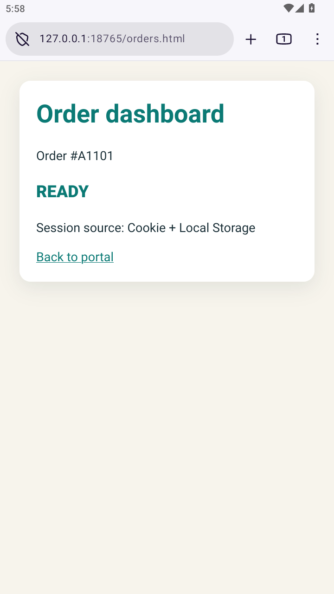

# App TestBench

[简体中文](README.md) | **English** | [Agent](docs/agent-deployment.md)


**A failed regression should leave evidence, not just “cannot reproduce.”**

App TestBench runs repeatable Android app tests on MuMu Player. A JSON/YAML flow covers install, launch, taps, text input, waits, assertions, screenshots, UI trees, and logcat, then produces a self-contained HTML report, `result.json`, and optional JUnit XML. On failure, the run keeps the scene instead of scattering evidence across chat, screen recordings, and temporary folders.


> Independent open-source project. Not affiliated with NetEase or the MuMu team. Use it only with apps, accounts, devices, and data you own or are explicitly authorized to test.

## Not just an emulator remote control

The deliverable is a repeatable test flow and a handoff-ready result, not a pile of ADB commands:

- **Explicit flow steps**: no vision model improvising the next tap on every run.
- **Deterministic verdicts**: Activity, UI text, logcat, or downloaded file content can decide pass/fail.
- **Failure evidence**: the failed step, screenshot, UI tree, logcat, timings, error, and HTML are retained.
- **CI-friendly output**: exit codes, versioned JSON envelopes, `result.json`, and JUnit.
- **Agent-ready authoring**: the bundled Codex skill can write and repair flows; the deterministic runner still owns the verdict.

## Why MuMu is the runtime foundation

Starting an Android environment for a one-off demo is easy. Reproducing the same failure a week later is the hard part. MuMu Player provides mature instance management, an Android runtime, and ADB connectivity. App TestBench does not rebuild that layer or bet reliability on a hastily assembled emulator or a vision model. It adds orchestration, dynamic waits, assertions, failure diagnostics, and report delivery.

| Approach | Good fit | Main tradeoff |
| --- | --- | --- |
| Manual physical-device testing | Final acceptance and hardware behavior | Expensive to repeat; evidence is manual |
| One-off ADB script | A single action | Weak waits, assertions, failure context, and result format |
| Vision-model screen clicking | Exploration | Environment, model, and decisions are hard to reproduce |
| AI-assembled Android environment | Fast demos | Unstable system/tooling and hard-to-debug behavior |
| **App TestBench + MuMu** | Frequent smoke/regression, App/WebView tests, reproducible defect handoff | Windows + MuMu first; physical-device acceptance still matters |

## v0.1.1: three live cases

Every result below comes from a real MuMu run. Public images are captured from actual app pages, APKs are pinned by version and SHA256, and wrappers can re-download and verify them.

| Case | Risk covered | Result |
| --- | --- | --- |
| [Wikipedia search, article, and cold-start persistence](examples/wikipedia-research-session/) | Network app, onboarding, dynamic search, WebView, saved items, restore after force-stop | **63/63 passed, 113.563 s** |
| [Firefox browser state, download, and tabs](examples/firefox-webapp-session/) | Cookie + LocalStorage, scoped session, file download, two tabs, cold-start restore | **66/66 passed, 143.016 s** |
| [VLC media playback, Activity, and logcat](examples/vlc-media-playback/) | Native player Activity, byte-range MP4, decoded frames, codec/AudioTrack logs, orientation | **43/43 passed, 50.579 s** |

### Wikipedia: live content and saved-item restore


The flow completes onboarding, switches to English content, searches `Ada Lovelace`, opens the real article WebView, creates `QA Reading List`, and saves the article. It then force-stops and cold-launches the app and verifies that the article and description still exist in the saved list.

[Runbook](examples/wikipedia-research-session/README.md) · [Evidence](docs/cases.md)

### Firefox: browser state is more than an open page



A local QA fixture with no password field uses only the synthetic username `qa-runner` and verifies both Cookie and LocalStorage. The flow also downloads a case-owned text file, reads it back outside the browser, opens a second tab, and cold-launches Fennec to verify session and tab restoration.

[Runbook](examples/firefox-webapp-session/README.md) · [Evidence](docs/cases.md)

### VLC: assertions beyond the UI tree


The VLC case plays a real MP4 through a local byte-range HTTP server, waits for `VideoPlayerActivity`, and separately asserts that libVLC opened the media input and Android initialized `android_audiotrack`. It proves the execution layer can verify native Activities, decoded frames, subsystem logs, and orientation changes, not only visible text.

[Runbook](examples/vlc-media-playback/README.md) · [Evidence](docs/cases.md)

### When a run fails, the evidence stays together


This is a real failed run rendered through the HTML reporter. The failed step, error summary, surrounding steps, screenshots, UI tree, logcat, and timings live in one result. Local tool paths and the test ADB serial were redacted before publication.

## Supported use cases (authorized testing only)

- **The web surface is incomplete, but the app is the real product path.** Validate the native app on an organization-approved MuMu instance and dedicated account when desktop web lacks capability or mobile behavior differs.
- **Keep a session without touching a real user's browser.** Sign in to a dedicated test account through the normal UI, then verify post-login pages, permissions, queries, and business behavior. The tool does not bypass authentication or export/copy/forge cookies or tokens.
- **Browser and WebView behavior.** Cookie, LocalStorage, downloads, tabs, translation prompts, cold-start restore, asynchronous loading, and mobile layout.
- **Native Activities and media.** Players, cameras, system intents, decoder startup, audio/video output, and orientation.
- **Regression and defect handoff.** Turn “it failed around here” into a reproducible report with step, screenshot, UI tree, logcat, timings, and error.
- **Small-team smoke tests.** Stabilize critical journeys and wire them into CI without adopting a large test platform first.
- **Agent-assisted authoring.** Let Codex/AI draft flows, inspect failures, and repair selectors; explicit assertions and raw evidence still decide the result.

**Boundary:** do not use this project to bypass login, CAPTCHA, anti-automation, anti-scraping, risk controls, rate limits, paywalls, regional restrictions, or access controls. When a web restriction is part of the product or security design, use an approved native test environment, test account, or test API rather than treating this project as a bypass.

## Install

Requirements:

- Windows 10/11
- Python 3.10+
- MuMu Player with at least one running instance and ADB debugging enabled

```powershell
git clone https://github.com/albertwickous-droid/app-testbench.git
cd app-testbench
py -3.11 -m venv .venv
.\.venv\Scripts\Activate.ps1
python -m pip install -e ".[dev]"
app-testbench --version
app-testbench doctor --json
```

If discovery fails, pass explicit tool paths:

```powershell
$mumuRoot = "<your MuMu root>"
app-testbench doctor `
  --mumumanager (Join-Path $mumuRoot "nx_main\MuMuManager.exe") `
  --adb (Join-Path $mumuRoot "nx_device\12.0\shell\adb.exe") `
  --json
```

`doctor` checks MuMuManager, ADB, MuMu version, instance state, and ADB connectivity. It diagnoses; it does not launch or stop MuMu automatically.

## Run the live cases

```powershell
.\examples\wikipedia-research-session\run.ps1
.\examples\firefox-webapp-session\run.ps1
.\examples\vlc-media-playback\run.ps1
```

Each wrapper downloads a pinned APK from a trusted source, verifies SHA256, runs `doctor`, executes the flow with JUnit, and writes all evidence under ignored `runs/` storage. APKs, MP4 files, raw screenshots, UI XML, logcat, and complete run directories do not enter the public repository.

## Minimal flow

```yaml
version: 1
name: settings-smoke
device:
  instance: 0
  package: com.example.app
  wait_for_boot: true
  boot_timeout: 60
report:
  title: Settings smoke test
  clear_logcat: true
  include_ui_xml: true
setup:
  - action: install
    apk: ${APP_APK}
    expected_package: com.example.app
steps:
  - action: launch
  - action: wait_for_text
    text: Settings
    timeout: 30
  - action: tap_text
    text: About
    match: exact
  - action: wait_for_activity
    activity: com.example.app/.AboutActivity
    timeout: 10
  - action: screenshot
    label: about
  - action: dump_ui
    label: about
  - action: assert_logcat_contains
    text: AboutActivity
    lines: 5000
teardown:
  - action: close
  - action: logcat
    label: final
    lines: 3000
```

```powershell
app-testbench validate .\flow.yaml --json
app-testbench run .\flow.yaml `
  --output .\runs `
  --junit-xml .\artifacts\junit.xml `
  --wait-for-boot
```

Use `wait_for_activity` when a WebView, player, camera, or deep link must reach a specific native component. Use `assert_logcat_contains` when the UI tree cannot expose the subsystem behavior you need to verify.

## Common CLI

```powershell
# Install, launch, open a URI, close
app-testbench install .\app.apk --expected-package com.example.app
app-testbench launch com.example.app
app-testbench open "https://example.test/" --package com.example.app --mime-type text/html
app-testbench close com.example.app

# Device and state
app-testbench doctor --json
app-testbench instance list --json
app-testbench clear-data com.example.app
app-testbench orientation landscape
app-testbench reverse-port 18765 --local-port 18765

# Interaction
app-testbench tap 540 1200
app-testbench swipe 540 1600 540 500 --duration-ms 500
app-testbench text "qa@example.test"
app-testbench keyevent ENTER

# Evidence
app-testbench screenshot --output .\artifacts\home.png
app-testbench dump-ui --output .\artifacts\home.xml
app-testbench logcat --output .\artifacts\logcat.txt --lines 3000
```

All device commands support `--json`. A failed `run --json` exits with code `1` and returns a structured `error` plus the complete `data` payload.

## Output and evidence

```text
runs/<timestamp>-<flow-name>/
├── report.html       # self-contained; screenshots embedded as data URIs
├── result.json       # versioned machine-readable result
├── screenshots/
├── ui/
└── logs/
```

A failed run attempts to retain:

- the failed step and error;
- a failure screenshot;
- the UI tree;
- recent logcat;
- completed/skipped steps and timings;
- a consistent `result.json`, HTML report, and JUnit state.

The HTML report loads no CDN, external script, or external stylesheet. It can be opened and archived offline.

## Codex skill and agents

The repository ships [`skills/app-testbench/SKILL.md`](skills/app-testbench/SKILL.md). After installation, Codex or a compatible agent can follow a stable sequence:

1. `doctor --json` to check MuMu, ADB, and the instance.
2. Install the APK and verify package identity and SHA256.
3. Use real screenshots and UI trees to author or repair the flow.
4. Run passing and failing paths and inspect `result.json`.
5. Return the HTML, JUnit, and raw evidence paths.

For deployment or reproduction by an agent, read the [Agent runbook](docs/agent-deployment.md). It states the permission boundary, environment checks, live-case execution, release verification, and cleanup requirements in execution order.

## Fixes in v0.1.1

- Failed `run --json` now emits `ok=false`, a structured `error`, and the complete `data` payload while keeping exit code `1`.
- A regression test validates the failed envelope against the packaged `cli-v1.schema.json`; the Schema was not relaxed.
- Added `wait_for_activity`, which polls an Activity component and keeps the last observed value.
- Added `assert_logcat_contains`, which makes subsystem behavior testable when the UI tree cannot expose it.
- Retained `tap_text`, `clear_text`, `wait_for_text.recover_anr`, `open`, `reverse-port`, `orientation`, and the existing evidence pipeline.
- Replaced the earlier simple persistence cases with three live cases spanning a network app, a browser, and native media.

See [`docs/validation.md`](docs/validation.md) for actual gate results and [`CHANGELOG.md`](CHANGELOG.md) for the release record.

## Known limits

- The first release is Windows + MuMu Player first; not every MuMu, Android, ADB, resolution, or language combination is claimed.
- Selectors and coordinates are calibrated for pinned apps, language, and `720x1280`; app upgrades require flow maintenance.
- Native `text` input currently supports printable ASCII only; Chinese input needs a future IME/ADBKeyboard path.
- Games, custom canvases, and incomplete accessibility trees may not be readable through `uiautomator dump`.
- The media case is not a DRM, HLS/DASH, subtitle, or audio-track compatibility certification.
- A passing automation run is not production release approval; physical devices and production accounts still need separate acceptance.

## Responsibility and security

- [Responsible Use](RESPONSIBLE_USE.md)
- [Disclaimer](DISCLAIMER.md)
- [Privacy](PRIVACY.md)
- [Security](SECURITY.md)
- [Third-Party Notices](THIRD_PARTY_NOTICES.md)

The project has no telemetry, cloud upload, or account system. Screenshots, logs, APKs, and account data can still be sensitive in your environment; redact before publishing.

## Documentation

- [Live cases and screenshots](docs/cases.md)
- [Flow action reference](docs/flow-reference.md)
- [Architecture](docs/architecture.md)
- [Use cases](docs/use-cases.md)
- [Validation record](docs/validation.md)
- [Launch copy](docs/launch-copy.md)
- [GitHub repository setup](docs/github-repository-setup.md)
- [Publishing](docs/publishing.md)

## License

MIT. Third-party apps, MuMu, ADB, Android, and test media remain subject to their respective licenses and trademarks. See [THIRD_PARTY_NOTICES.md](THIRD_PARTY_NOTICES.md).
