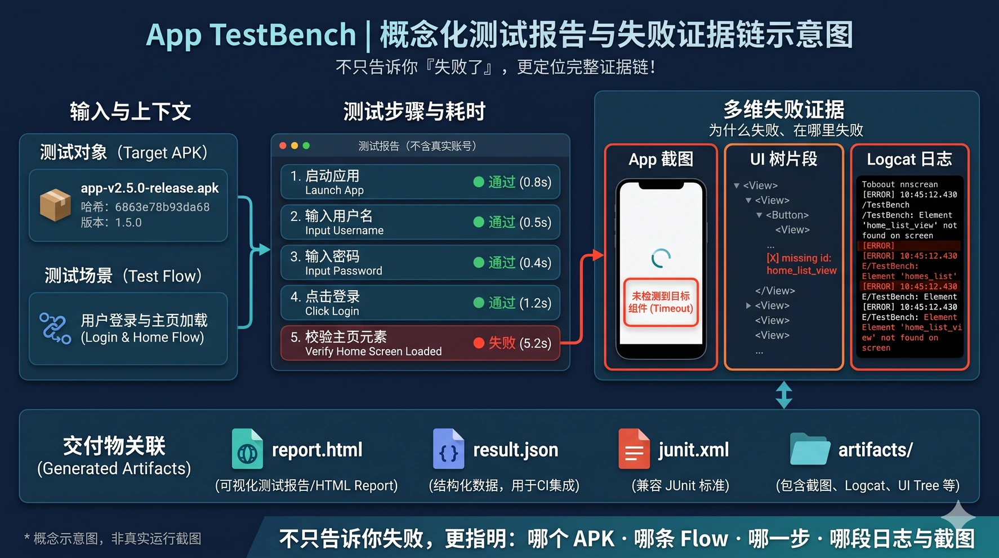

# App TestBench

**简体中文** | [English](README.en.md) | [Agent](docs/agent-deployment.md)


*上图：编写 flow → 本机执行 → 断言 → 报告的工作流示意；实际界面和产物以运行结果为准。*

> **面向个人开发者和小微团队的本地优先 Android 快速验证工作台。**

不用先接入云真机：在本机 MuMu 上安装 APK、执行 flow、生成 HTML/JUnit；APK、截图、UI 树和 logcat 默认都留在本机。它不追求“设备更多”，而是让最后一公里验证**开始更快、过程更可控、失败证据更完整**。

**当代码越来越多由 Agent 提交，App 回归不能还靠人肉点屏幕。** App TestBench 把安装、启动、点击、输入、等待和断言写成明确的 JSON/YAML flow，在成熟的 MuMu 运行时上执行，并把截图、UI 树、logcat 和 HTML 报告留在失败现场。

它不依赖视觉模型逐屏猜下一步。每一步由 UI 文本、Activity、logcat 或文件内容负责判定通过或失败；因此同一问题可以回放、比较和交接，而不是只剩一句“复现不了”。


> 独立开源项目，与网易 / MuMu 官方无隶属关系。只测试你拥有或明确获授权测试的应用、账号、设备和数据。

## 0.2.0 的五个可展示钩子

> 不是“又一个 ADB 包装器”，而是把本地 App 验证做成可编排、可观察、可交接的工作流。

| 钩子 | 一句话卖点 | 直接证据 |
| --- | --- | --- |
| **一条 flow 变成一组测试** | `suite` + `tags` 顺序跑多条 flow，每个 flow 保留独立证据；`run --data` 让一份 CSV/JSON/YAML 生成多条 case | 聚合 HTML/JUnit + `suite-result.json` / `data-result.json` |
| **每一步都能实时看见** | `--events-jsonl` 立即输出 flow/step start/end 事件，Agent 和 CI 不用等整条 flow 结束 | NDJSON 事件流 + `events-v1.schema.json` |
| **失败不是一句报错** | 截图、UI 树、logcat、步骤耗时、失败步骤和 SHA-256 manifest 一次留下 | 自包含 HTML + `result.json` + `manifest.json` |
| **先看计划，再碰设备** | `--dry-run` 解析 flow、实例、变量和预期命令；`--vars-file` / `--var` 固定输入 | 不连接 MuMu/ADB、不创建 run 目录 |
| **Agent/CI 原生接口** | 结构化 JSON、稳定退出码、JUnit XML 和四个 Draft 2020-12 schema | 适合自动修复、回归和结果归档 |

这不是设备云替代品：需要几十/几百种机型时，仍应配合云真机或真机实验室；它的优势是把个人/小团队的本地验证循环做短、做稳、做得可交接。

## 为什么是现在

趋势核验：2026-11-19

| 变化 | 对测试工作的影响 | 本项目的回应 |
| --- | --- | --- |
| [GitHub Octoverse 2026（2026-10-28）](https://github.blog/news-insights/octoverse/octoverse-commits-pushes-reach-new-highs-in-2026-as-developers-build-with-agents/) 显示，截至 2026 年 9 月，开发者使用 Agent 发起超过 40% 的 Pull Request | 代码进入得更快，人工回归、复现和证据整理更容易成为瓶颈 | 用明确的 flow、断言、退出码和结构化结果承接高频回归 |
| [Android Emulator 37.2.13（2026-10-28）](https://developer.android.com/studio/releases/emulator#37-2-13) 仍在持续修复图形、稳定性和资源释放问题 | 运行时与工具链持续变化，环境漂移会让失败难以解释 | 以 MuMu 作为成熟执行底座，并用 `doctor`、固定 APK 和证据报告固定现场 |

## 最短路径：你现在想做什么？

| 目标 | 直接从这里开始 | 结果 |
| --- | --- | --- |
| 先确认环境能不能用 | `app-testbench doctor` | 看到 MuMu、ADB 和实例状态 |
| 测自己的 APK | 安装后执行 `install → launch → screenshot → dump-ui` | 先确认单步动作可用 |
| 生成一份完整测试报告 | 按下方 5 分钟主线执行 `init → validate → run` | HTML + `result.json` + 证据 |
| 批量跑一组 flow | `app-testbench suite .\suite.yaml --tag smoke` | 多个独立 run + 聚合 HTML/JUnit |
| 用数据跑同一流程 | `app-testbench run .\flow.yaml --data .\cases.csv` | 每行一条 case + `data-result.json` |
| 让 Agent 实时看步骤 | `app-testbench run .\flow.yaml --events-jsonl .\events.ndjson` | 即时 NDJSON 事件流 |
| 先看一个真实案例 | `.\examples\ankidroid-deck-persistence\run.ps1` | 下载固定 APK，跑 49 步并生成报告 |
| 接入 CI 或 Agent | `run --json`，或阅读 [Agent runbook](docs/agent-deployment.md) | 结构化结果、退出码和 JUnit |

## 适合哪些用户和团队

| 用户或场景 | 适合度 |
| --- | --- |
| 个人开发者 / 独立开发者 | **最适合**：一台 Windows 电脑 + MuMu，就能做日常 smoke、回归和缺陷复现，不用先配置设备云 |
| 小微团队，尤其是 1–10 人的研发 / QA 小组 | **适合**：flow、HTML、JUnit 和 CI 结果可由开发者、测试和 Agent 共用 |
| 对 APK、账号、截图和日志位置敏感 | **适合**：工具本身无内置云上传，原始证据默认落本机 |
| 人少但回归频繁 | **适合**：省掉上传、排队、计费和平台配置 |
| 需要几十 / 几百种机型的兼容矩阵 | **不适合单独承担**：应与云真机或真机实验室配合 |
| 需要高并发设备池或大规模压测 | **不适合**：当前不是设备云 |
| 想绕过登录、验证码、反爬、风控或访问控制 | **不适合**：不提供规避能力 |

## 和云真机怎么选

云真机平台优化的是**设备覆盖和并发规模**；App TestBench 优化的是**最后一公里验证速度**。两者不是替代关系。


*示意图：云真机侧重设备覆盖与并发，App TestBench 侧重本地快速验证、数据留存和证据交付；两者可以配合使用。*

| 维度 | 云真机平台 | App TestBench |
| --- | --- | --- |
| 设备覆盖 | **强**：适合跨品牌、跨系统、跨机型验证 | **不正面竞争**：当前以 Windows + MuMu 为主 |
| 并发规模 | **强**：适合大规模并行测试 | **不正面竞争**：优先单机或少量并行快速反馈 |
| 开始成本 | 注册、上传 APK、配置设备、配额和计费 | 本地安装后，用命令直接启动 |
| 数据位置 | APK、截图和日志通常上传到平台 | 默认留在本机；工具无内置云上传 |
| 日常成本 | 按设备、并发或时长计费 | 不产生云真机资源费，使用本机算力 |
| 快速 smoke | 上传、排队、回收结果可能比测试本身更慢 | 本地执行，产物直接落盘 |
| 定制能力 | 受平台 API、界面和执行边界约束 | flow、脚本、CI 和 Agent 都可定制 |
| 证据交接 | 通常在平台内查看或导出 | HTML + `result.json` + JUnit + 截图 / UI 树 / logcat |
| 中文 App / MuMu 场景 | 通常不是专项优化重点 | 明确的当前差异化运行时 |

> “默认留在本机”是指 App TestBench 本身不主动上传运行产物；被测 App、系统组件以及你接入的 CI / 云服务仍可能联网。本地准备成本是 Windows、Python 和 MuMu，优化的是准备完成后的每次验证循环。

### 三个直接承诺

| 承诺 | 你实际得到什么 |
| --- | --- |
| **5 分钟跑通** | 在已安装 MuMu 和 Python 的前提下，装 APK → 跑 flow → 出 HTML/JUnit；不需要账号、服务器或云配额；`validate` 不碰设备，`run` 才执行 |
| **失败现场可带走** | 设备仍可连接时，失败步骤、耗时、截图、UI 树、logcat、`result.json` 和 HTML 默认留在同一次运行目录 |
| **Agent 和 CI 可直接使用** | `--json`、Draft 2020-12 schema、稳定退出码、JUnit XML 和环境变量插值 |



*概念示意图，不是实际运行截图：展示 APK、flow、失败步骤、截图、UI 树、logcat 与 HTML/JUnit 之间的证据关系。*

**为什么选它：** 如果你的痛点是“每天都要反复跑同一条 App 流程，但不想上传、排队、按分钟计费”，本地优先方案的路径更短；如果你的痛点是“一次覆盖几十种机型”，云真机仍然更合适。

**明确不做：** 云真机平台、大型测试管理套件、泛 AI / RPA 平台。

## 能做什么

App TestBench 不追求“设备矩阵全面”，而是把一条验证链路做完整：编写 → 执行 → 断言 → 诊断 → 报告 → CI / Agent 消费。

| 能力类别 | 已支持的功能 | 可得到的结果 |
| --- | --- | --- |
| 环境与实例 | `doctor`、MuMu 实例列表/启动/停止/重启、ADB 路径发现、指定实例或 serial | 执行前确认工具链、实例和 ADB 状态 |
| APK 与 App 生命周期 | 安装 APK、包名/版本核验、启动、打开 URI、关闭、清空数据、横竖屏 | 安装、冷启动、深链和清理都能进入同一条流程 |
| 基础 UI 操作 | 坐标点击 `tap`、按文本或 `content-desc` 点击 `tap_text`、滑动、ASCII 输入、清空输入、按键、返回、Home | 用可复用步骤代替手工操作 |
| 等待与断言 | `wait_for_text`、`wait_for_activity`、UI 包含/不包含、logcat 包含、可见 ANR 恢复 | 把“应该到页面了”变成明确的通过/失败条件 |
| 证据收集 | 截图、UI 树、logcat、失败诊断、步骤耗时和状态 | 失败后仍能说明“在哪一步、看到了什么、日志是什么” |
| 流程编排 | JSON/YAML、`setup`/`steps`/`teardown`、环境变量、`continue_on_error`、开机就绪门禁 | 把安装、测试、清理和证据收集组合起来 |
| 可复现执行 | `--vars-file` / `--var`、`--dry-run`、Flow 级超时、`wait_for_boot` | 固定输入、先看计划，再触碰设备 |
| 批量与复用 | Flow `include`/`template`、`tags`、`suite` 顺序编排、CSV/JSON `--data` 数据驱动 | 多个 flow 或数据行各自生成独立证据，并聚合 JUnit/HTML |
| 本地测试服务 | `reverse-port` 映射宿主机端口、`open` 打开 URI | 覆盖 WebView、下载、媒体和本地 QA fixture |
| 报告与 CI | 自包含 HTML、`result.json`、可选 JUnit XML、失败 JSON envelope、NDJSON 事件流 | 人看报告，CI/Agent 实时消费过程 |
| Agent 协助 | 打包的 Codex skill、Agent runbook、严格 schema、五个可复现案例 | Agent 按步骤执行，不靠猜坐标和临时环境 |

## 5 分钟跑通

> 第一次使用只走这一条路径。每步达到“继续条件”再往下，不要先去翻完整命令表。

### 1. 安装

前提：Windows 10/11、Python 3.10+、已安装 MuMu Player 并启用 ADB 调试。

```powershell
git clone https://github.com/albertwickous-droid/app-testbench.git
cd app-testbench
python -m venv .venv
.\.venv\Scripts\Activate.ps1
python -m pip install .
app-testbench --version
```

看到 `app-testbench 0.2.0` 即可继续。

### 2. 检查 MuMu、ADB 和实例

先启动专用测试实例；如果实例已经在运行，跳过第一条命令：

```powershell
app-testbench instance start 0 --wait 60
app-testbench doctor
```

**继续条件**：`doctor` 返回成功，并显示 `MuMuManager`、`adb`、实例和 ADB 连接均就绪。

如果自动发现失败，不要继续后面的步骤，直接显式传入路径：

```powershell
app-testbench doctor `
  --mumumanager "C:\path\to\MuMuManager.exe" `
  --adb "C:\path\to\adb.exe" `
  --instance 0
```

对应环境变量：`APP_TESTBENCH_MUMUMANAGER`、`APP_TESTBENCH_ADB`、`APP_TESTBENCH_INSTANCE`、`APP_TESTBENCH_SERIAL`。

### 3. 用单个命令确认 APK 和页面

把示例包名与 APK 路径换成你要测的值，先跑最短的四条命令：

```powershell
app-testbench install .\app.apk --expected-package com.example.app
app-testbench launch com.example.app
app-testbench screenshot --output .\artifacts\home.png
app-testbench dump-ui --output .\artifacts\home.xml
```

**继续条件**：`artifacts\home.png` 能看到 App 首屏，`artifacts\home.xml` 不是空文件。

如果包名或版本还不知道，先去掉 `--expected-package`。需要严格校验版本时，再补 `--expected-version-code` 和 `--expected-version-name`。

### 4. 生成第一份报告

先生成模板，不要从空文件手拼 YAML：

```powershell
app-testbench init --output .\first-flow.yaml
```

打开 `first-flow.yaml`，通常只需要改这几处：

| 找到 | 模板值 | 改成 |
| --- | --- | --- |
| `device.instance` | `0` | 你的 MuMu 实例；不是 `0` 时才需要改 |
| `device.package` | `com.example.app` | 你的 APK 包名 |
| `setup[].apk` | `./app.apk` | APK 路径，相对于 YAML 文件所在目录 |
| `wait_for_text.text` | `Login` | 你的 App 首屏上稳定存在的文字 |

然后先校验，再执行：

```powershell
app-testbench validate .\first-flow.yaml
app-testbench run .\first-flow.yaml --output .\runs --junit-xml .\runs\first-flow-junit.xml
```

**继续条件**：`validate` 输出 `Flow is valid`，`run` 退出码为 `0`。`validate` 不连接设备；真正执行设备动作的是 `run`。

<details>
<summary>不想用 init？展开可校验的最小 flow</summary>

```yaml
version: 1
name: first-app-smoke
device:
  instance: 0
  package: com.example.app
setup:
  - action: install
    apk: ./app.apk
    expected_package: com.example.app
steps:
  - action: launch
  - action: wait_for_text
    text: Login
    timeout: 20
  - action: screenshot
    label: first-screen
```

</details>

CI 或 Agent 使用同一命令并加 `--json`。退出码：`0` 成功，`1` 执行失败，`2` 配置错误，`3` 环境未就绪，`130` 中断。

### 5. 打开产物

```text
runs/<timestamp>-first-app-smoke/
├── report.html       # 自包含 HTML，可离线打开
├── result.json       # 结构化结果
├── screenshots/
├── ui/
└── logs/
```

先打开 `report.html`。右侧步骤栏可滚动，Light / Dark 可切换，截图、UI 片段和 logcat 已内嵌，不依赖 CDN、外部脚本或外部样式表。


*示意：报告可离线打开，支持 Light / Dark；真实运行会替换为本次测试的截图、UI 树和 logcat。*

## 进阶：按目标查命令

> 第一次运行跑通后再看这里。完整字段、别名和边界见 [`docs/flow-reference.md`](docs/flow-reference.md)。

<details>
<summary>展开 CLI 与 flow action 对照表</summary>

| 我想…… | 直接用命令 | 在 flow 中使用 |
| --- | --- | --- |
| 检查环境 | `app-testbench doctor` | 开跑前执行 |
| 启动/停止/重启实例 | `app-testbench instance start 0` | 通常在 flow 外准备 |
| 安装并验证 APK | `app-testbench install .\app.apk --expected-package com.example.app` | `action: install` + `expected_*` |
| 启动 App / 指定 Activity | `app-testbench launch com.example.app [--activity .MainActivity]` | `action: launch` + `activity` |
| 打开网页或深链 | `app-testbench open "https://example.test/" --package com.example.app` | `action: open` |
| 关闭 / 清空 App | `app-testbench close com.example.app` / `clear-data com.example.app` | `action: close` / `clear_app_data` |
| 切换横竖屏 | `app-testbench orientation landscape` | `action: orientation` |
| 坐标点击 / 滑动 | `app-testbench tap 540 1200` / `swipe ...` | `action: tap` / `swipe` |
| 按文字或描述点击 | 优先用 flow | `action: tap_text`：text / content-desc、exact / contains、index、timeout |
| 输入 ASCII / 清空输入 | `app-testbench text "qa@example.test"` | `action: text` / `clear_text` |
| 等待文字 / Activity | 用 flow | `action: wait_for_text` / `wait_for_activity` |
| 断言 UI / logcat | 用 flow | `assert_ui_contains`、`assert_ui_not_contains`、`assert_logcat_contains` |
| 截图 / UI 树 / logcat | `screenshot` / `dump-ui` / `logcat` | `action: screenshot` / `dump_ui` / `logcat` |
| 映射本机测试服务 | `app-testbench reverse-port 18765 --local-port 18765` | `action: reverse_port` |
| 生成报告 / 接入 CI | `app-testbench run .\flow.yaml` | `run` 自动生成；加 `--json` 给 CI/Agent |
| 批量跑多条 flow | `app-testbench suite .\suite.yaml --tag smoke` | suite manifest；每个 flow 独立证据 |
| 一行数据一个用例 | `app-testbench run .\flow.yaml --data .\cases.csv` | 复用同一 flow，聚合 data 结果与 JUnit |
| 实时消费步骤事件 | `app-testbench run .\flow.yaml --events-jsonl .\events.ndjson` | NDJSON 事件流，适合 Agent/CI |

</details>

## 出错时先看这里

| 现象 | 先做什么 |
| --- | --- |
| 找不到 `MuMuManager` 或 `adb` | 用 `--mumumanager` / `--adb`，或设置对应环境变量；见上面的 doctor 命令 |
| 没有可连接设备 | 启动 MuMu 实例，再执行 `app-testbench doctor`；不要先随机重启 ADB |
| 找不到页面文字 | 用 `screenshot` 和 `dump-ui` 看当前页面；能稳定定位时优先 `tap_text`，最后才用坐标 |
| 写入成功但下一步失败 | 在点击前加 `wait_for_text` 或 `wait_for_activity`，不要用固定长等待硬撑 |
| 中文输入失败 | 原生 `text` 只支持可打印 ASCII；需要单独接入 ADBKeyboard、剪贴板或专用 IME |
| App 升级后 flow 失效 | 重新采样页面和 UI 树，更新文字、Activity、坐标和等待条件 |
| 测试失败但不知道原因 | 打开报告中的失败步骤，先看截图、UI 树和 logcat，再改断言或 flow |

> `clear-data` 会删除该 App 的本地状态；`reverse-port` 和 `orientation` 会改变设备状态。只在专用测试实例中使用。

## 真实案例：不是“能点”，而是能证明

五个公开案例均来自真实 MuMu 运行，固定 APK 版本并校验 SHA256；截图来自实际 App 页面，不是生成图。

| 案例 | 覆盖的风险 | 实测结果 |
| --- | --- | --- |
| [Wikipedia 搜索、文章与冷启动持久化](examples/wikipedia-research-session/) | 网络 App、首次引导、动态搜索、WebView 文章、收藏、force-stop 后恢复 | **63/63 通过，113.563 秒** |
| [Firefox 浏览器状态、下载与标签页](examples/firefox-webapp-session/) | Cookie + LocalStorage、受控测试态、文件下载、双标签页、冷启动恢复 | **66/66 通过，143.016 秒** |
| [VLC 媒体播放、Activity 与 logcat](examples/vlc-media-playback/) | 原生播放器 Activity、byte-range MP4、真实解码帧、媒体日志、横竖屏 | **43/43 通过，50.579 秒** |
| [AnkiDroid 牌组、卡片与冷启动](examples/ankidroid-deck-persistence/) | 首次引导、系统对话框、卡片输入、数据库持久化、重启后内容断言 | **49/49 通过，75.203 秒** |
| [Markor 笔记保存、搜索与冷启动](examples/markor-note-persistence/) | 多页引导、编辑器输入、文件保存、精确搜索、重启后正文恢复 | **46/46 通过，80.203 秒** |

每个案例都有 PowerShell 准备脚本，会下载并校验固定 APK，使用案例自己的测试数据，并把 APK、原始截图、UI XML、logcat 和完整运行目录放在被忽略的 `runs/` 下。

```powershell
# 选择其中一个运行
.\examples\wikipedia-research-session\run.ps1
.\examples\firefox-webapp-session\run.ps1
.\examples\vlc-media-playback\run.ps1
.\examples\ankidroid-deck-persistence\run.ps1
.\examples\markor-note-persistence\run.ps1
```

截图、版本、证据边界和已知限制见 [`docs/cases.md`](docs/cases.md)。

## 为什么以 MuMu 为执行底座

Windows 上临时启动一个 Android 环境做演示并不难。难的是让同一条失败在一周后仍然具备可解释的实例、Android 镜像、ADB 通道和证据。

MuMu Player 负责成熟的实例管理、Android 运行环境和 ADB 连接；App TestBench 不重造这层运行时，而是补齐测试编排、动态等待、断言、失败诊断和报告交付。

| 做法 | 适合 | 主要问题 |
| --- | --- | --- |
| 人工点真机 | 最终验收、硬件能力 | 重复成本高，证据依赖人工整理 |
| 一段临时 ADB 脚本 | 单个动作 | 缺断言、等待、失败现场和统一结果 |
| 视觉模型逐屏点击 | 探索型自动化 | 环境、模型和每次决策难以复现 |
| AI 临时搭 Android 环境 | 快速演示 | 系统与工具链不稳定，出了问题难定位 |
| **App TestBench + MuMu** | 高频冒烟、回归、WebView/浏览器、可复现缺陷交付 | 首版聚焦 Windows + MuMu，硬件终验仍需真机 |

## 适用场景与合规边界

适合在**已获授权**的测试环境中使用：

- Web 端功能不完整、移动端独有，而组织允许在 Android App 上执行正常测试；
- Web 端自动化限制较多，团队需要回到组织批准的原生 App 测试环境或测试 API；
- 在隔离 MuMu 实例中通过正常 UI 登录专用测试账号，验证登录后的页面和权限；
- 验证 Cookie、LocalStorage、下载、标签页和冷启动后的测试态；
- 复现开发、测试和产品之间难以交接的步骤；
- 比较不同实例、Android 镜像、分辨率、App 版本或冷热启动状态。

这些场景的前提是：被测系统、账号、数据和设备都由你拥有或明确授权测试。App TestBench 不提供 cookie 窃取、token 导出、验证码破解、风控规避或访问控制绕过。若 Web 端限制属于产品安全设计，应使用组织批准的原生测试环境或测试接口，而不是把本工具当作绕过手段。

更多场景和权责边界见 [`docs/use-cases.md`](docs/use-cases.md)、[`RESPONSIBLE_USE.md`](RESPONSIBLE_USE.md) 和 [`DISCLAIMER.md`](DISCLAIMER.md)。

## 输出与 CI

`run` 会自动创建唯一运行目录。失败时尽量保留：

- 失败步骤和原始错误；
- 失败截图；
- UI 树；
- 最近 logcat；
- 已完成和跳过步骤及耗时；
- 一致的 `result.json`、HTML 和 JUnit 状态。

所有设备命令都支持 `--json`。`run --json` 失败时仍返回完整 `data`，并提供结构化 `error`；JSON 契约使用仓库内打包的 Draft 2020-12 schema。

## 已知限制

- 首版以 Windows + MuMu Player 为主；没有承诺所有 MuMu、Android、ADB、分辨率和语言组合都可用。
- 选择器和坐标通常针对固定 App、语言和 `720x1280` 校准；App 升级后需要维护 flow。
- 原生 `text` 只支持可打印 ASCII；中文输入尚未覆盖。
- 游戏、Canvas、自绘界面或不完整的 accessibility tree 可能无法通过 `uiautomator dump` 读取。
- VLC 案例不构成 DRM、HLS/DASH、字幕或音轨兼容性认证。
- 自动化通过不等于生产发布批准；物理设备、OEM 差异和生产账号仍需单独验收。
- 报告和日志可能包含测试环境信息，发布前必须脱敏。

## 文档

- [五个真实案例与截图](docs/cases.md)
- [Flow action 完整参考](docs/flow-reference.md)
- [架构说明](docs/architecture.md)
- [使用场景](docs/use-cases.md)
- [验证记录](docs/validation.md)
- [Agent 部署手册](docs/agent-deployment.md)
- [发布与维护](docs/publishing.md)
- [更新记录](CHANGELOG.md)

## 参与贡献

欢迎提交可复现的问题、flow 案例、文档修正和代码改进。提交前请阅读 [`CONTRIBUTING.md`](CONTRIBUTING.md)、[`SECURITY.md`](SECURITY.md) 和 [`CODE_OF_CONDUCT.md`](CODE_OF_CONDUCT.md)。不要在 issue、PR、截图或日志中提交真实账号、cookie、token、API key、私网地址或未脱敏的客户数据。

## 许可证与第三方声明

MIT。MuMu、ADB、Android 及测试 App 和媒体分别受其自身许可证与商标规则约束。详见 [`THIRD_PARTY_NOTICES.md`](THIRD_PARTY_NOTICES.md)。
