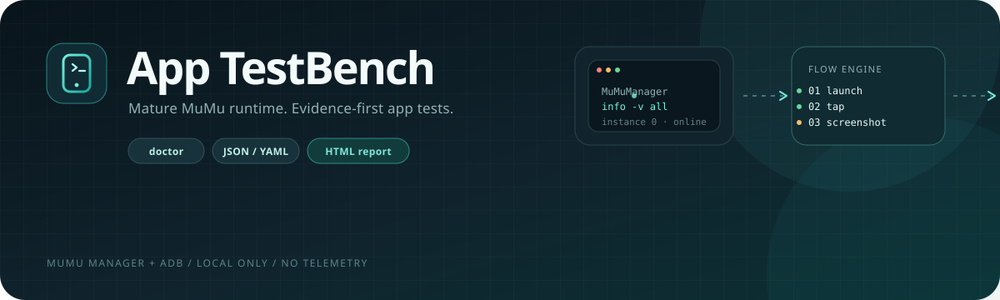
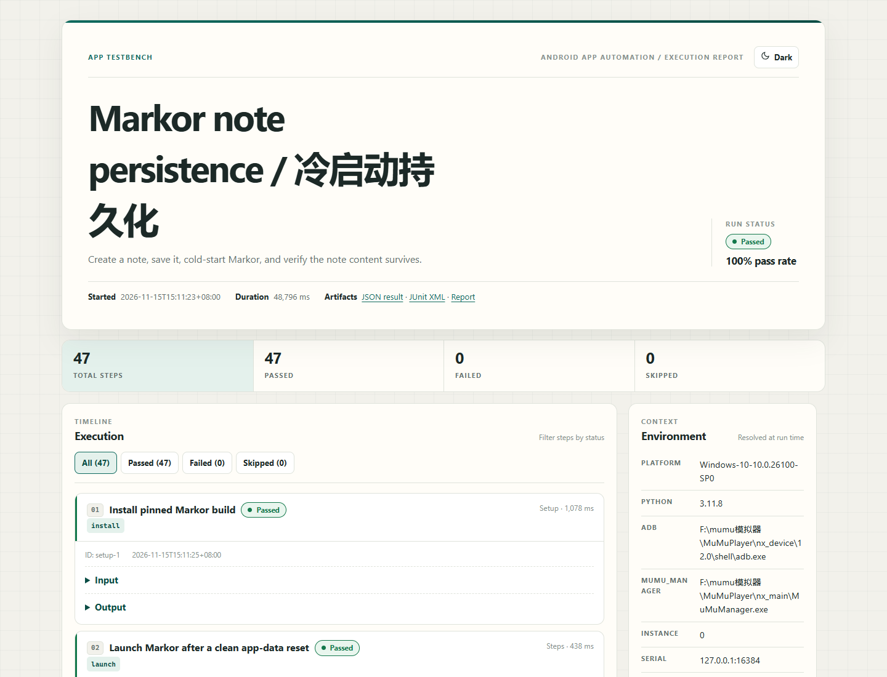
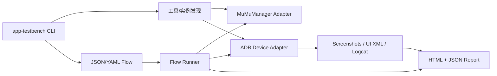

# App TestBench

[English](README.en.md) | **简体中文**



**成熟 MuMu 运行时，可重复的 App 测试，可交付的现场证据。**

不是用提示词临时拼一个“能跑就行”的安卓环境，而是把成熟模拟器、ADB、显式断言和原始证据串成可回归的 App 自动化流程。

App TestBench 用 Python 封装 `MuMuManager.exe` 与 `adb`，提供统一命令行、JSON/YAML 流程 DSL 和自包含 HTML 报告。它面向 App 自动化测试、回归验证、交付脚本，以及 Codex / 其他 AI Agent 的工具调用。


> 独立开源项目，与网易 / MuMu 官方无隶属关系。仅用于你有权测试的设备、应用和账号。

## v0.1.0 状态

- 首版聚焦 Windows 10/11 + MuMu Player + ADB。
- 自动化测试使用确定性的假 `adb` / `MuMuManager`，覆盖命令构造、流程、报告和失败语义。
- CI 通过不代表所有 MuMu 版本和所有 App 都已完成真实兼容性验证。
- 真实设备测试结果应在发布记录中明确标注，不用假后端结果冒充真机结论。
- 无遥测、无云端上传、无账号体系。

## 为什么默认运行在 MuMu 上

App 自动化不应该建立在一个“能启动就算成功”的临时安卓环境上。App TestBench 选择成熟的 MuMu Player 作为默认运行时，把可靠性建立在可检查的工程边界上：

- **成熟运行时**：复用 MuMu 的实例生命周期、Android 系统和 ADB 通道，而不是在测试工具内部临时拼一个不可控的黑盒环境；
- **确定性执行**：点击、输入、等待和断言都是显式命令或 JSON/YAML 动作，不依赖“看截图猜下一步”；
- **原始证据**：每一步保留状态、耗时、截图、UI 树和 logcat，失败后仍能复盘现场；
- **AI 可参与，但不负责判决**：AI / Codex 可以帮助编写 flow、解释失败和整理报告，pass/fail 仍由断言和证据决定；
- **本地优先**：没有云端黑盒和遥测，截图、日志和测试报告留在本机。

这里的“成熟”是架构选择：复用 MuMu 已有的实例、Android 系统和 ADB 能力，不代表所有 MuMu 版本都已通过本项目的真实兼容性测试。

AI 很重要，但 AI 不应该同时扮演运行环境、执行器和最终裁判。真实设备仍适合最终验收；本项目解决的是更靠前、更频繁、更需要可重复性的 App 冒烟和回归测试。

| 方案 | 优势 | 主要边界 |
| --- | --- | --- |
| 人工操作真机 | 最接近最终用户环境 | 重复成本高，截图和日志依赖人工整理 |
| AI 临时搭环境 / 纯视觉点击 | 演示速度快 | 环境和模型行为不确定，难以稳定回归 |
| 一次性 ADB 脚本 | 自动化成本低 | 流程、断言和失败证据通常不成体系 |
| App TestBench + MuMu | 成熟运行时有确定性 CLI、断言和完整证据 | 首版聚焦 Windows + MuMu，仍需真机终验 |

## 为什么不是“模拟器脚本合集”

多数脚本只把几条 ADB 命令拼在一起：能点，但不能稳定说明“发生了什么、哪一步失败、失败时界面和日志是什么”。

App TestBench 把执行过程拆成四层：

| 层 | 职责 |
| --- | --- |
| 工具发现 | 自动定位 MuMuManager、ADB、实例和 ADB 端口 |
| 设备操作 | 安装、启动、关闭、点击、滑动、输入、截图、UI 树、logcat |
| 流程编排 | JSON/YAML 动作、环境变量、等待/断言、setup/teardown |
| 证据输出 | 每步耗时、错误、截图、UI XML、日志、`result.json`、`report.html` |

最终产物是一个离线可读的执行报告，而不是终端里滚过去的一串日志。

## 适用场景（合规测试）

App TestBench 适合验证**你有权测试的 App、账号、设备和环境**：

- **Web 端功能不全**：产品能力只在原生 App 中提供，或 Web 与移动交互存在差异时，用 App 自动化验证原生端真实流程。
- **登录后的回归测试**：在隔离 MuMu 实例中使用专用测试账号正常登录，后续 flow 复用该测试态，验证已登录页面和权限。
- **环境与版本覆盖**：切换 MuMu 实例、安装包版本和启动状态，定位特定环境下的兼容性回归。
- **小团队冒烟测试**：用 JSON/YAML 描述关键路径，生成带截图、UI、logcat 和耗时的离线报告。
- **缺陷交付**：把失败现场打包成可复核证据，而不是只留一句“点到这里失败了”。
- **AI 辅助编写**：AI / Codex 可以生成 flow 和解释失败，最终 pass/fail 仍由显式断言和原始证据决定。

> 这些场景都要求合法授权。App TestBench 不用于绕过登录、验证码、反自动化、反爬、风控、限流、付费墙或地域限制，也不提供 Cookie/token 导出、会话伪造或未授权访问能力。

详细边界见 [`docs/use-cases.md`](docs/use-cases.md)。

## 功能

- `doctor`：检查 MuMuManager、ADB、实例状态、ADB 连接与版本信息
- `instance`：列出、启动、关闭、重启实例
- 应用操作：`install`、`launch`、`close`
- 交互操作：`tap`、`swipe`、`text`、`keyevent`
- 观测操作：`screenshot`、`dump-ui`、`logcat`
- JSON / YAML 流程：`validate`、`run`、`init`
- UI 断言：等待指定文本、断言存在/不存在
- 报告证据：步骤状态、耗时、错误、截图、UI 树、logcat、可选 JUnit XML
- 启动门禁：可等待 `sys.boot_completed` 后再执行流程
- 安装核验：安装后校验包名、versionCode 和 versionName
- 机器可读：所有命令支持 `--json`，并提供 result/CLI JSON Schema 契约
- Codex 集成：内置 `skills/app-testbench/SKILL.md`，并支持 `app-testbench skill-path`

## 环境要求

- Windows 10/11
- Python 3.10+
- 已安装并至少创建过一个 MuMu Player 实例
- 已开启该实例的 ADB 调试
- `MuMuManager.exe` 与 `adb.exe` 可被自动发现，或通过参数/环境变量显式指定

MuMuManager 常见位置：

```text
C:\Program Files\Netease\MuMuPlayer-12.0\shell\MuMuManager.exe
C:\Program Files\Netease\MuMuPlayer-12.0\nx_main\MuMuManager.exe
```

不同 MuMu 版本的目录结构不同；`doctor` 会按常见布局和注册表安装位置搜索。找不到时可显式传入路径或设置环境变量。

## 安装

源码安装：

```powershell
git clone https://github.com/albertwickous-droid/app-testbench.git
cd app-testbench

py -3.11 -m venv .venv
.\.venv\Scripts\Activate.ps1
python -m pip install -e .
```

如果 PyPI 包已发布，也可以使用：

```powershell
python -m pip install app-testbench
app-testbench --version
```

首次运行：

```powershell
app-testbench doctor
app-testbench instance list
```

自动发现失败时：

```powershell
app-testbench doctor `
  --mumumanager "C:\Program Files\Netease\MuMuPlayer-12.0\shell\MuMuManager.exe" `
  --adb "C:\Program Files\Netease\MuMuPlayer-12.0\shell\adb.exe" `
  --instance 0
```

环境变量覆盖：

```powershell
$env:APP_TESTBENCH_MUMU_MANAGER = "C:\path\to\MuMuManager.exe"
$env:APP_TESTBENCH_ADB = "C:\path\to\adb.exe"
$env:APP_TESTBENCH_INSTANCE = "0"
$env:APP_TESTBENCH_JSON = "1"
```

## 基础命令

> 全局参数既能放在子命令之前，也能放在子命令之后。

```powershell
# 安装、启动、关闭
app-testbench --instance 0 install .\app.apk
app-testbench --instance 0 install .\app.apk `
  --expected-package com.example.app --expected-version-code 42 --expected-version-name 1.2.3
app-testbench --instance 0 launch com.example.app
app-testbench --instance 0 close com.example.app

# 交互
app-testbench --instance 0 tap 540 1200
app-testbench --instance 0 swipe 540 1600 540 500 --duration-ms 500
app-testbench --instance 0 text "hello world"
app-testbench --instance 0 keyevent ENTER

# 证据
app-testbench --instance 0 screenshot --output .\artifacts\home.png
app-testbench --instance 0 dump-ui --output .\artifacts\home.xml
app-testbench --instance 0 logcat --output .\artifacts\logcat.txt --lines 2000

# 机器可读
app-testbench doctor --json
app-testbench instance list --json
```

`text` 使用 Android 原生 `input text`，第一版只支持可打印 ASCII。中文、日文等 Unicode 输入需要 ADBKeyboard 或剪贴板方案，当前会明确拒绝，避免静默丢字。

## 流程运行

生成模板：

```powershell
app-testbench init --output .\mumu-flow.yaml
```

示例：

```yaml
version: 1
name: login-smoke
device:
  instance: 0
  package: com.example.app
  wait_for_boot: true
  boot_timeout: 60

report:
  capture_screenshots: all
  collect_logcat: true

setup:
  - name: Install APK
    action: install
    apk: ./app.apk
    expected_version_code: 42
    expected_version_name: 1.2.3

steps:
  - name: Launch app
    action: launch

  - name: Wait for login screen
    action: wait_for_text
    text: Login
    timeout: 20
    interval: 0.5

  - name: Tap email field
    action: tap
    x: 540
    y: 620

  - name: Enter email
    action: text
    text: qa@example.com

  - name: Capture login screen
    action: screenshot
    label: login

  - name: Assert login button
    action: assert_ui_contains
    text: Sign in

teardown:
  - name: Close app
    action: close
```

字符串可以使用环境变量：

```yaml
device:
  package: ${APP_PACKAGE}
setup:
  - action: install
    apk: ${APK_PATH}
```

验证并执行：

```powershell
app-testbench validate .\mumu-flow.yaml
app-testbench run .\mumu-flow.yaml --output .\runs --junit-xml .\artifacts\junit.xml
app-testbench run .\mumu-flow.yaml --output .\runs --wait-for-boot --boot-timeout 60
```

默认输出：

```text
runs/20261111-153000-login-smoke/
├── report.html          # 自包含，截图已内嵌
├── result.json          # 机器可读结果
├── screenshots/
├── ui/
└── logs/
```

使用浏览器打开 `report.html` 即可离线查看。流程字段、全部动作与校验规则见 [`docs/flow-reference.md`](docs/flow-reference.md)。

### 报告预览



> 合成示意：使用虚构流程、占位账号和模拟截图，不代表真实应用数据。

## 给 Codex 使用

仓库内置 skill：

```text
skills/app-testbench/SKILL.md
```

安装到当前用户：

```powershell
Copy-Item -Recurse .\skills\app-testbench "$HOME\.codex\skills\" -Force
```

安装 pip 包后也可以查询打包副本：

```powershell
app-testbench skill-path
```

然后可以直接向 Codex 描述：

> 把 `app.apk` 安装到 MuMu 0 号实例，启动 `com.example.app`，走登录、首页、搜索和详情页，每步截图，失败时抓 UI 和 logcat，最后给我 HTML 报告。

Skill 会优先执行 `doctor`，使用 `--json` 获取结构化结果，再生成或修改流程，而不是盲猜坐标。

## 架构



设计取舍：

- **真实后端优先**：实例生命周期交给 MuMuManager，应用交互交给 ADB。
- **严格流程白名单**：只接受文档定义的动作和字段，拼写错误在执行前报错。
- **安全参数传递**：外部命令使用参数数组，不通过主机 shell 字符串拼接。
- **失败优先保留证据**：失败步骤自动尝试截图和采集 logcat。
- **报告自包含**：CSS、JavaScript、截图均内嵌，不依赖 CDN。

更多实现说明见 [`docs/architecture.md`](docs/architecture.md)。

## 错误码

| 退出码 | 含义 |
| --- | --- |
| `0` | 成功 |
| `1` | 执行失败，例如流程断言失败，或 ADB / MuMuManager 操作失败 |
| `2` | 参数或流程 JSON/YAML 配置错误，或必需工具未找到 / 不可用 |
| `130` | 用户中断 |

使用 `--json` 时，成功和失败都会输出结构化 JSON，便于 Agent 和 CI 解析。

## 安全与隐私

- **报告包含证据，也可能包含敏感数据。** 截图可能包含账号、聊天、订单或个人信息；logcat 可能包含 token、URL 和设备标识。
- 分享或提交 issue 前先检查 `runs/`、截图、UI XML 和日志。
- 工具没有遥测，不会把报告上传到任何服务器。
- 不要把真实账号、生产 token、cookie、APK 或个人数据提交到 Git。
- 不要在未经授权的设备、应用或账号上执行自动化。
- `instance stop`、`close`、`install` 会改变本机/模拟器状态，在流程中应显式声明。
- HTML 生成会转义用户文本，但报告本身仍是本地敏感文件，不是访问控制边界。

漏洞报告方式见 [`SECURITY.md`](SECURITY.md)。

## 已知边界

- 首版聚焦 **Windows + MuMu Player + ADB**；其他模拟器可复用 ADB 部分，但实例管理未验证。
- 不包含 OCR、图像模板匹配或视觉定位；坐标来自用户流程或 UI 树断言。
- Android 原生 `input text` 对 Unicode 支持有限，首版明确拒绝非 ASCII。
- MuMu 升级可能改变目录、端口或 MuMuManager 输出格式。
- `wait_for_text` 依赖 `uiautomator dump`；WebView、游戏引擎或自绘界面可能无法暴露可读文本。
- `launch` 默认使用 Launcher Intent；多 Activity 或特殊启动参数场景请传入 `--activity`。

## 开发与验证

```powershell
py -3.11 -m venv .venv
.\.venv\Scripts\Activate.ps1
python -m pip install -e ".[dev]"

python -m ruff check .
python -m ruff format --check .
python -m pytest -q
python -m build
python -m twine check dist/*
```

也可以运行：

```powershell
.\scripts\check.ps1
```

测试使用确定性的假 `adb` / `MuMuManager` 可执行文件，验证 CLI、流程、报告和子进程边界；真实 MuMu 集成测试需要一台运行实例，不能由 CI 伪造。

### 每日维护自动化（可选）

当前工作区使用 **Codex 原生 Scheduled**：每天 04:00 在本地项目运行维护任务，自动修复低风险问题并执行测试；新的功能构想只生成调研提案，不会自动加入项目。Windows Task Scheduler 的 `app-testbench-daily-optimizer` 仅作为 fallback 保留，当前已禁用，避免两个调度器并发修改同一工作树。

维护任务不会自动 commit、push、发布或操作其他应用。维护完成后会关闭 MuMu：05:00 前完成则等到 05:00 关闭，05:00 后完成则立即关闭；关闭证据写入 `cleanup.json`。原生 Scheduled 的提示词、fallback 的启用/禁用方式和产物路径见 [`docs/automation.md`](docs/automation.md)。

## 发布与宣传

首版发布方案、GitHub 设置、PyPI 手动发布和检查清单见：

- [`docs/publishing.md`](docs/publishing.md)
- [`docs/github-repository-setup.md`](docs/github-repository-setup.md)
- [`docs/releases/v0.1.0.md`](docs/releases/v0.1.0.md)
- [docs/promotion.md](docs/promotion.md)
- [docs/launch-copy.md](docs/launch-copy.md)
- [RELEASE_CHECKLIST.md](RELEASE_CHECKLIST.md)

## 支持与贡献

- 使用问题、Bug 和功能请求：[`SUPPORT.md`](SUPPORT.md)
- 贡献流程：[`CONTRIBUTING.md`](CONTRIBUTING.md)
- 行为准则：[`CODE_OF_CONDUCT.md`](CODE_OF_CONDUCT.md)
- 安全问题：[`SECURITY.md`](SECURITY.md)

## 法律、责任与使用边界

本项目按 **MIT License** 发布。完整权责说明如下：

- [`LICENSE`](LICENSE)：MIT 许可、无担保与责任限制
- [`DISCLAIMER.md`](DISCLAIMER.md)：免责声明、第三方关系与责任边界
- [`RESPONSIBLE_USE.md`](RESPONSIBLE_USE.md)：预期用途、不支持且不认可的用途与安全操作责任
- [`PRIVACY.md`](PRIVACY.md)：本地数据处理、敏感证据与保留责任
- [`THIRD_PARTY_NOTICES.md`](THIRD_PARTY_NOTICES.md)：第三方商标、依赖与非隶属关系
- [`SECURITY.md`](SECURITY.md)：漏洞报告与安全边界

软件按“现状”提供，不保证适配所有 MuMu、Android 或 App 版本。使用者应自行确认设备、账号、应用、数据和自动化行为的合法授权与合规性。

## License

MIT © 2026 App TestBench contributors

## 免责声明

MuMu Player、Android、ADB、Python、GitHub、OpenAI/Codex 及相关商标归各自权利人所有。App TestBench 是独立开源工具，不包含 MuMu 安装包、不绕过应用安全机制，也不提供对第三方账号或设备的未授权访问能力。

完整第三方关系和免责声明见 [`THIRD_PARTY_NOTICES.md`](THIRD_PARTY_NOTICES.md) 与 [`DISCLAIMER.md`](DISCLAIMER.md)。
