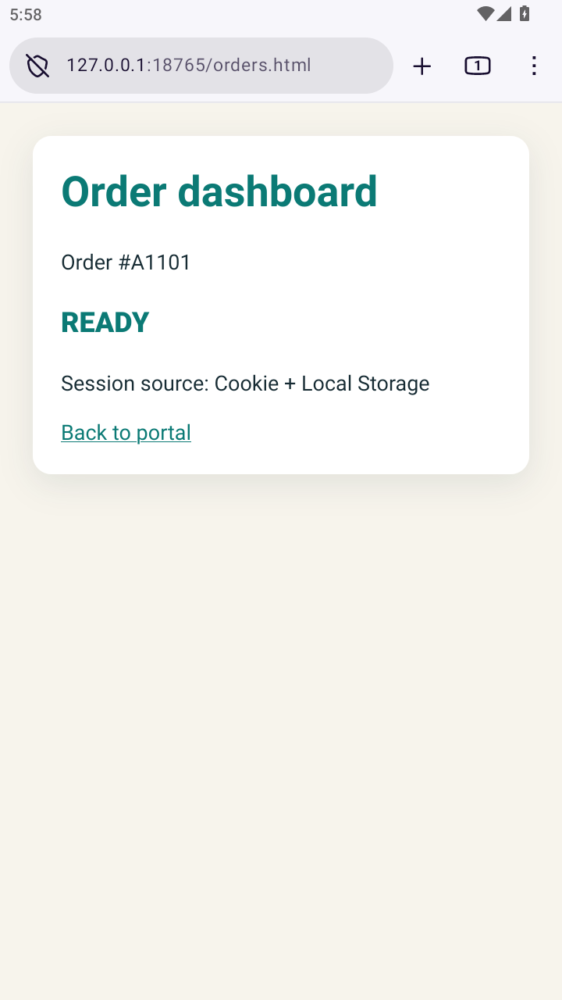
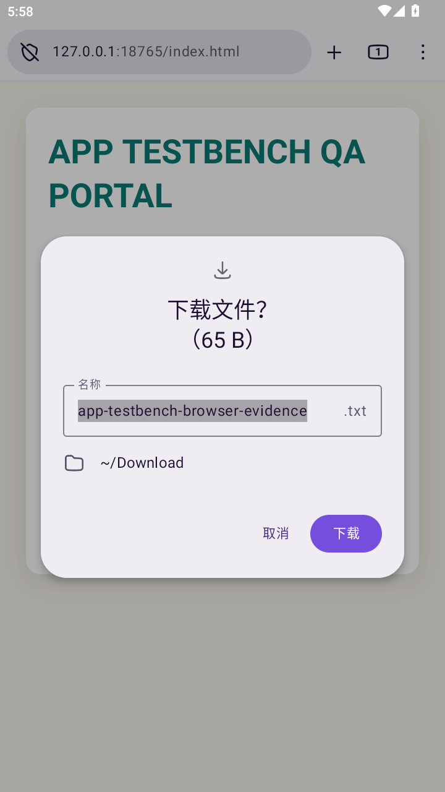
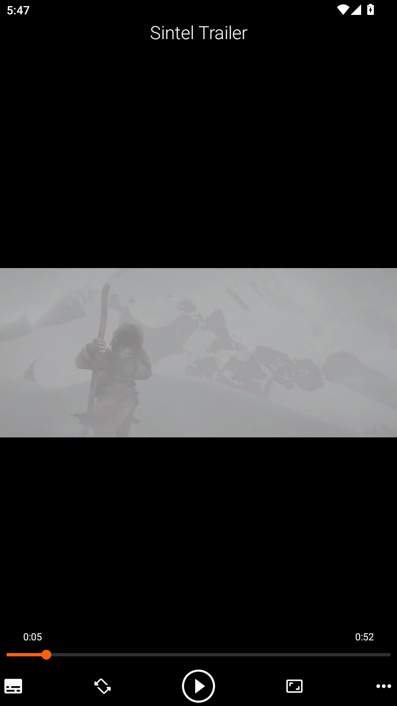
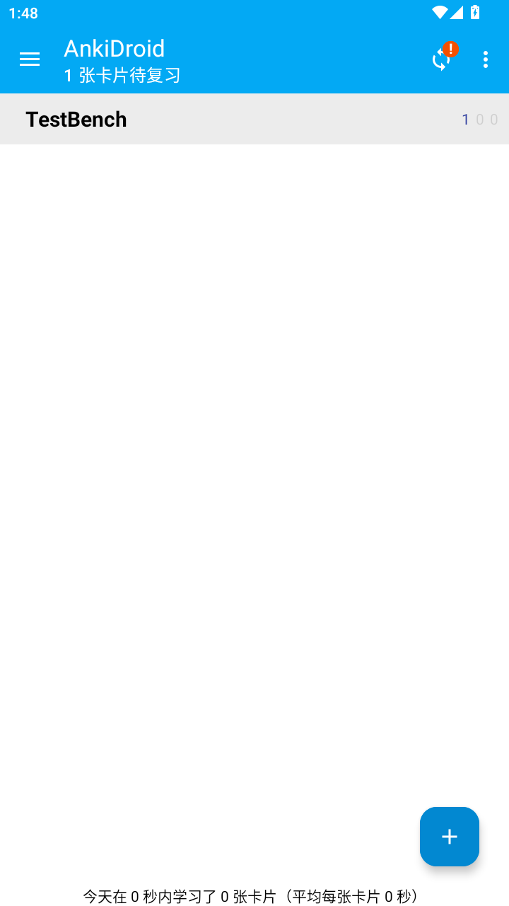
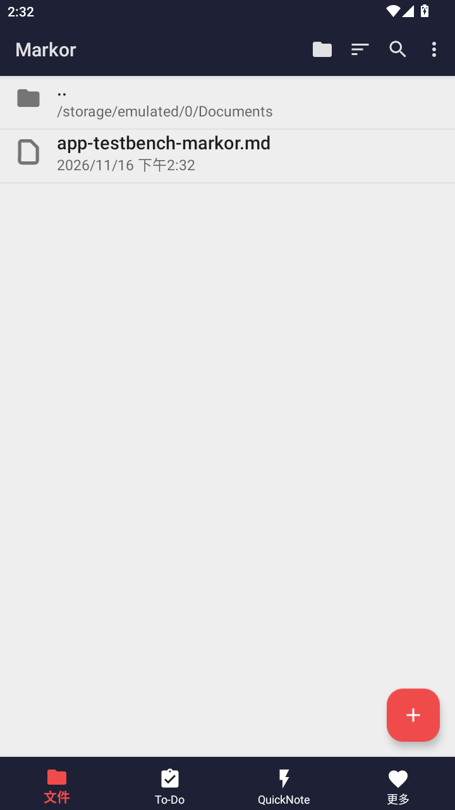
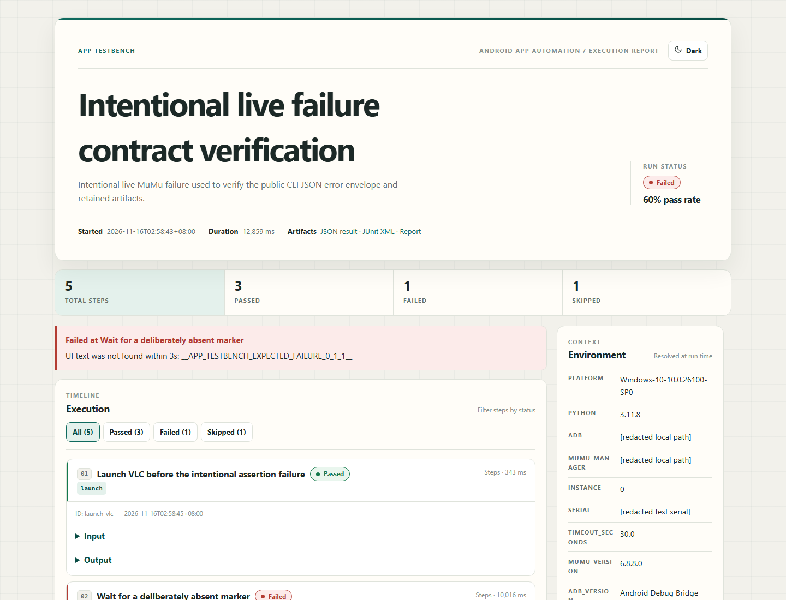

# 真实案例与公开证据 / Live Cases and Public Evidence

本页记录 App TestBench 当前 `main` 分支上的五个真实 MuMu 案例。截图来自实际 App 页面，不是生成图或重绘页；每个 APK、版本和 SHA256 都可核对。

This page records the five live MuMu cases on the current App TestBench `main` branch. Every screenshot comes from the actual app, not a generated mockup or redrawn page. APK versions and SHA256 values are pinned for reproduction.

> `v0.2.0` 继续保留这五个真实案例作为证据；本次维护门禁没有启动真实 MuMu，新增 suite、数据驱动和事件流能力由确定性 fake 后端测试覆盖。

> `v0.2.0` retains these five live cases as evidence. The maintenance gate for this release does not start MuMu; suite, data-driven, and event-stream behavior is covered by deterministic fake-backend tests.

## 结果总览 / Result summary

| Case | Live result | Duration | Main proof |
| --- | --- | --- | --- |
| Wikipedia | **63/63 passed** | 113.563 s | Network app, search, WebView article, saved-item cold-start persistence |
| Firefox/Fennec | **66/66 passed** | 143.016 s | Cookie + LocalStorage, download, tabs, cold-start restore |
| VLC | **43/43 passed** | 50.579 s | Player Activity, byte-range MP4, decoded frames, media logcat, orientation |
| AnkiDroid | **49/49 passed** | 75.203 s | Onboarding, deck/card creation, database persistence, reopened fields |
| Markor | **46/46 passed** | 80.203 s | Onboarding, note input, save, exact search, cold-start body recovery |

Real environment for the recorded runs:

```text
OS: Windows 10.0.26100
Python: 3.11.8
MuMu Player: 6.8.8.0
Android: 12
ADB: 1.0.41
Display: 720x1280 portrait unless a case records landscape
System language: Simplified Chinese
```

APKs, MP4 media, complete run directories, full logcat, UI XML, and virtual environments stay under ignored local storage. The repository publishes only selected, audited PNG evidence.

## 1. Wikipedia: search, article, and cold-start persistence

固定输入 / Pinned input:

```text
Package: org.wikipedia
Version: r/50616-r-2026-11-03
VersionCode: 50616
APK SHA256: d225e5d08fe461f12fa0af7b617e6e715f3112986165c34e0572a1a056129dd1
```

结果 / Result:

```text
Status: passed
Steps: 63 passed, 0 failed, 0 skipped
Duration: 113.563 seconds
```

覆盖 / Coverage:

1. Complete first-run onboarding and select English content.
2. Search for `Ada Lovelace` and open the real article WebView.
3. Create the `QA Reading List`, save the article, and assert its description.
4. Force-stop, cold-launch, reopen the saved tab, and verify the article still exists.
5. Retain screenshots, UI trees, logcat, HTML, JSON, and JUnit.

公开截图 / Public evidence:

| View | Image |
| --- | --- |
| Search results |  |
| Real WebView article |  |
| Saved item after cold start |  |

复现 / Reproduce:

```powershell
.\examples\wikipedia-research-session\run.ps1
```

已知限制 / Limits:

- The article and search results depend on live MediaWiki content and network availability.
- Selectors and coordinates are calibrated for the pinned app, language, and display.
- The case uses no account or paid service.

## 2. Firefox/Fennec: browser state, download, and tabs

固定输入 / Pinned input:

```text
Package: org.mozilla.fennec_fdroid
Version: 160.0.0
VersionCode: 1600020
APK SHA256: 43cf491bbc677244d7b56ba2e8ae20ccd802c9d8f6b44d6b6aff7eb1753eab1b
```

结果 / Result:

```text
Status: passed
Steps: 66 passed, 0 failed, 0 skipped
Duration: 143.016 seconds
```

覆盖 / Coverage:

1. Start a local QA fixture with no password field and synthetic identity `qa-runner`.
2. Verify Cookie + LocalStorage behavior through the browser UI.
3. Download `app-testbench-browser-evidence.txt` and verify its exact content through ADB.
4. Open two tabs, force-stop the browser, and cold-launch it.
5. Verify the session and tabs are restored.

公开截图 / Public evidence:

| View | Image |
| --- | --- |
| Scoped browser session |  |
| Orders fixture |  |
| Restored tabs |  |
| Verified download |  |

复现 / Reproduce:

```powershell
.\examples\firefox-webapp-session\run.ps1
```

已知限制 / Limits:

- This is a local QA fixture, not a production identity provider.
- It validates browser state mechanics, download verification, and tab restore for the pinned build.
- It does not claim compatibility with every browser version or Android image.

## 3. VLC: media playback, Activity, logcat, and orientation

固定输入 / Pinned input:

```text
Package: org.videolan.vlc
Version: 3.7.2
VersionCode: 13070208
APK SHA256: 727693d59c4d678c046386812a103209a25423460c9d22e38e12460f12402ab6
Media: W3C Sintel trailer, 4,372,373 bytes
Media SHA256: b670602fa00934ca27c4351bb0efe7ea7a07fae57284e44226025eeed7c51254
```

结果 / Result:

```text
Status: passed
Steps: 43 passed, 0 failed, 0 skipped
Duration: 50.579 seconds
Screenshots: 8 PNG
Activity assertions: player and post-rotation match
logcat assertions: media input = 1 match; android_audiotrack = 2 matches
```

覆盖 / Coverage:

1. Serve a short MP4 from a local byte-range HTTP server.
2. Open the media and wait for the native `VideoPlayerActivity`.
3. Complete the first-play tutorial and assert the player title.
4. Verify a decoded frame while playing and after resuming.
5. Rotate to landscape while the player Activity remains foreground.
6. Assert libVLC media input and `android_audiotrack` in bounded logcat.

公开截图 / Public evidence:

| View | Image |
| --- | --- |
| First-play tutorial |  |
| Paused player |  |
| Landscape playback |  |
| Resumed decoded frame |  |

复现 / Reproduce:

```powershell
.\examples\vlc-media-playback\run.ps1
```

已知限制 / Limits:

- The case covers a short MP4 over local byte-range HTTP. It is not a DRM, HLS/DASH, subtitle, or audio-track certification.
- Decoder output and Activity names can change with the app or Android image.
- Logcat is a bounded ring buffer; a very noisy device may require a larger buffer or tag filtering.

## 4. AnkiDroid: deck, card, and cold-start persistence

固定输入 / Pinned input:

```text
Package: com.ichi2.anki
Version: 2.25.3
VersionCode: 225033004
APK SHA256: c7056f611c66fc91a8e290e18268a0d708e813704f51c66e4af1534d468f6790
Deck: TestBench
Card front: Capital of France
Card back: Paris
```

结果 / Result:

```text
Status: passed
Steps: 49 passed, 0 failed, 0 skipped
Duration: 75.203 seconds
```

覆盖 / Coverage:

1. Install the pinned APK and reset only case-owned AnkiDroid state.
2. Complete first-run onboarding and wait for an empty collection.
3. Create the `TestBench` deck through the real dialog.
4. Enter `Capital of France` / `Paris` and verify the pending-card count.
5. Force-stop and cold-launch, then verify the deck and due count remain.
6. Reopen the saved card and assert both fields.
7. Retain screenshots, UI trees, logcat, HTML, JSON, and JUnit.

公开截图 / Public evidence:

| View | Image |
| --- | --- |
| Card fields entered |  |
| Deck and due count after cold start |  |
| Reopened saved card |  |

复现 / Reproduce:

```powershell
.\examples\ankidroid-deck-persistence\run.ps1
```

已知限制 / Limits:

- The flow creates harmless sample study data and clears app state at the start; do not run it on a personal collection.
- AnkiDroid's collection database and web-based card renderer can change between releases.
- The optional all-files permission branch is not claimed to appear on every device.

## 5. Markor: note save, search, and cold-start persistence

固定输入 / Pinned input:

```text
Package: net.gsantner.markor
Version: 2026.10.0
VersionCode: 164
APK SHA256: c29412e02d03e4f0511746a1bcef48c6b73fc1f70c1024fbf04903b0b3f4c485
Test file: app-testbench-markor.md
Body: App TestBench persistence check
```

结果 / Result:

```text
Status: passed
Steps: 46 passed, 0 failed, 0 skipped
Duration: 80.203 seconds
```

覆盖 / Coverage:

1. Install the pinned APK and complete Markor's multi-page onboarding.
2. Create a Markdown note, focus the editor, and enter the test body.
3. Assert the body is visible before saving.
4. Save, force-stop, and cold-launch Markor.
5. Find the exact filename and reopen the note.
6. Assert the body survived the restart.
7. Retain screenshots, UI trees, logcat, HTML, JSON, and JUnit.

公开截图 / Public evidence:

| View | Image |
| --- | --- |
| File present after cold start |  |
| Exact filename search |  |
| Reopened note body |  |

复现 / Reproduce:

```powershell
.\examples\markor-note-persistence\run.ps1
```

已知限制 / Limits:

- UI text and editor coordinates are calibrated for Markor `2026.10.0`, Simplified Chinese, and 720x1280.
- The editor body still needs a coordinate tap to receive focus.
- The `MANAGE_EXTERNAL_STORAGE` app-op is used only for preparation on an isolated test instance.
- `text` input remains printable ASCII only; the case deliberately uses an ASCII note body.

## 失败 JSON 与诊断证据 / Failure JSON and diagnostics

The public failure case is intentional: a live flow waits for a marker that does not exist. It verifies the failure contract without weakening a passing assertion.

```text
Exit code: 1
Envelope: ok=false + error.type=step_failure + complete data
Packaged cli-v1.schema.json: PASS
Failure screenshot: present
Failure UI tree: present
Final logcat: present
HTML: present and self-contained
JUnit: failure represented
```



The image is a capture of a real failed HTML report. A temporary pre-publication copy replaced local tool paths and the test ADB serial; the report layout, failed result, and trace were not redrawn or fabricated.

## 证据边界 / Evidence boundaries

- Committed PNGs come from real MuMu runs. No generated screenshots or manually redrawn app pages are used.
- Raw APKs, MP4 files, complete run directories, unfiltered UI XML/logcat, and virtual environments remain in ignored local storage.
- Public images show only test apps and test-created content. They contain no accounts, production cookies, tokens, API keys, private IPs, or ADB serials.
- A pass applies only to the pinned app, MuMu/Android image, display, language, and flow recorded here.
- CI uses deterministic fake ADB/MuMuManager backends. It verifies command construction, flow execution, reporting, and schemas, not every MuMu version behavior.
- Physical devices remain the final acceptance environment for hardware, OEM, and production-account behavior.
- The project does not bypass login, CAPTCHA, anti-automation, anti-scraping, risk controls, rate limits, paywalls, or access controls.
