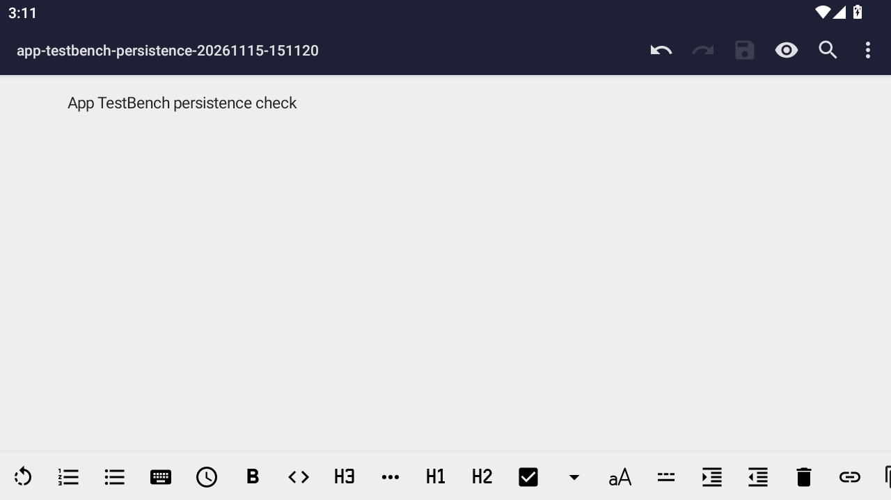
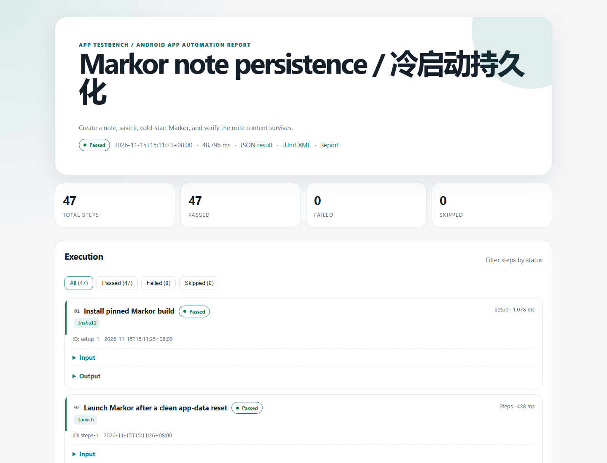
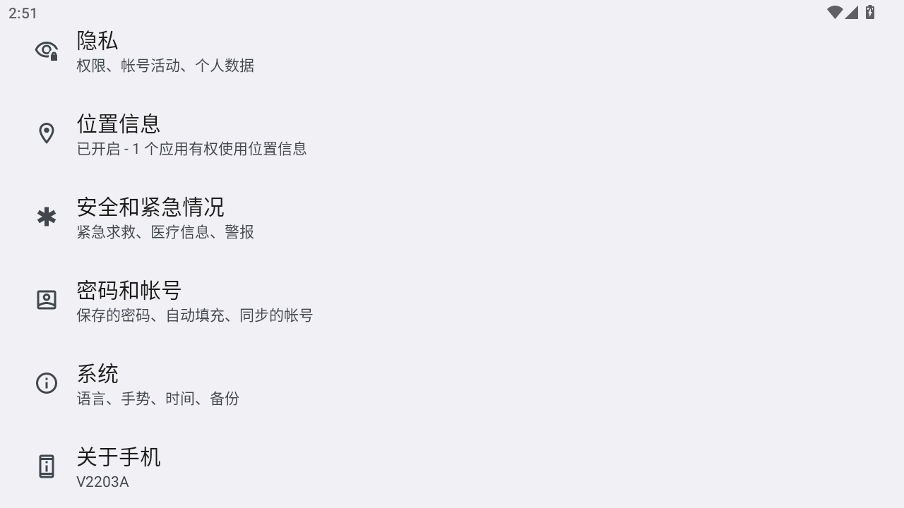
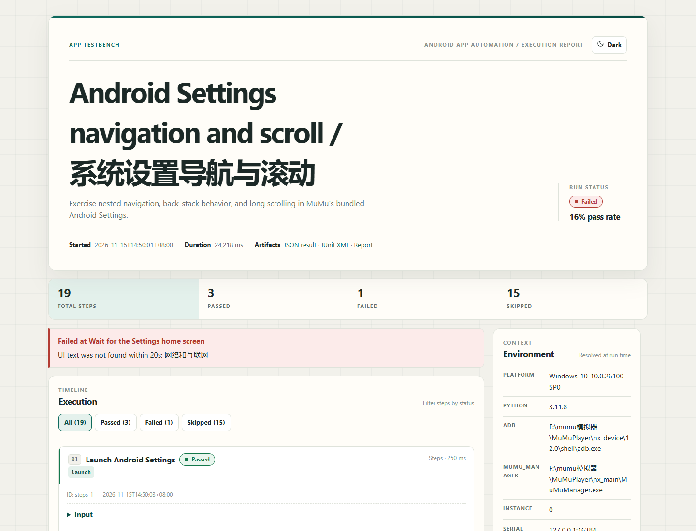

# 真实案例 / Real Cases

这一页只记录在真实 MuMu Android 实例上执行并通过的案例。截图来自实际运行，不是示意图；原始运行目录、完整 UI XML、logcat 和 APK 仍保留在本地 `runs/`，不进入 Git。

This page records cases that were actually executed on a live MuMu Android instance. The screenshots come from those runs, not mockups. Raw run directories, full UI XML, logcat, and APKs remain under the ignored local `runs/` directory.

## 环境 / Tested environment

| Item | Value |
| --- | --- |
| OS | Windows 10.0.26100 |
| Python | 3.11.8 |
| MuMu Player | 6.8.8.0 |
| Android | 12 |
| ADB | 1.0.41 |
| Display | 1280×720 |
| System language | Simplified Chinese |

## 案例总览 / Case index

| Case | App | What it adds | Live result |
| --- | --- | --- | --- |
| [Markor note persistence](../examples/markor-note-persistence/README.md) | Markor 2026.10.0 | Pinned APK, onboarding, text input, save, cold relaunch, persistence assertion, search | **47/47 passed** |
| [Settings navigation and scroll](../examples/settings-network-scroll/README.md) | AOSP Settings in MuMu image | Restored-state normalization, nested navigation, back stack, long scroll | **23/23 passed** |

## 1. Markor 笔记冷启动持久化 / Markor note persistence

这个案例不是只启动 App 截一张图。它安装固定版本的 Markor，完成首次引导，创建一条 Markdown 笔记，输入正文，保存后强制停止 App，再冷启动、搜索并重新打开该文件，最后断言正文仍然存在。

This case does more than launch the app and take a screenshot. It installs a pinned Markor build, completes onboarding, creates a Markdown note, enters body text, saves it, force-stops the app, cold-launches it, searches for the exact file, reopens it, and asserts that the body survived.

| Evidence | Image |
| --- | --- |
| Editor after save |  |
| Exact file search after relaunch |  |
| Reopened note with persisted body |  |
| Generated HTML report |  |

Observed run:

```text
Status: passed
Steps: 47 passed, 0 failed, 0 skipped
Duration: 48.796 seconds
Screenshots: 5 PNG, each 1280x720
UI trees: 17 XML files plus one labeled final UI tree
JUnit: 47 tests, 0 failures, 0 errors
HTML: 1,024,368 bytes with embedded images and no external page dependencies
```

Pin / 固定版本:

```text
Package: net.gsantner.markor
Version: 2026.10.0 (versionCode 164)
Source: https://f-droid.org/repo/net.gsantner.markor_164.apk
Size: 11,849,016 bytes
SHA256: c29412e02d03e4f0511746a1bcef48c6b73fc1f70c1024fbf04903b0b3f4c485
```

复现 / Reproduce:

```powershell
.\examples\markor-note-persistence\run.ps1
```

## 2. Android Settings 导航与滚动 / Android Settings navigation and scroll

第二个案例换了一种工程难点。系统设置会恢复上次的滚动位置，因此“App 启动后一定在首页顶部”是错误假设。提交的 flow 先用三次向下滑动把列表复位，再进入网络页面、返回、滚动到系统区域，并验证“关于手机”入口。

The second case covers a different failure mode. Settings restores its previous scroll position, so assuming that the app always opens at the top is incorrect. The committed flow normalizes the list position, enters the network page, returns, scrolls through the long list, and verifies that the About phone entry is reachable.

| Evidence | Image |
| --- | --- |
| Network and internet page |  |
| Scrolled system section |  |
| A real failure retained during development |  |

Observed pass:

```text
Status: passed
Steps: 23 passed, 0 failed, 0 skipped
Duration: 26.750 seconds
JUnit: 23 tests, 0 failures, 0 errors
```

失败报告保留了第一次运行时的真实错误：Flow 启动了 Settings，但 Android 恢复了上一次的滚动位置，预期的首页标题不在可见区域。修复方式不是放宽断言，而是在 flow 中显式归一化起始状态。

The failure report preserves the first run's real error: Settings restored the previous scroll position, so the expected home title was not visible. The fix was not to weaken the assertion; the flow now explicitly normalizes the starting state.

复现 / Reproduce:

```powershell
app-testbench run .\examples\settings-network-scroll\flow.yaml `
  --output .\runs\examples\settings-network-scroll `
  --junit-xml .\runs\examples\settings-network-scroll\junit.xml `
  --wait-for-boot --boot-timeout 60
```

## 选型说明 / Why these cases

- **Markor** 是官方 F-Droid 可下载的开源 App，不需要账号或付费，能覆盖安装、首次引导、输入、动态等待、文件搜索、冷启动和持久化。它比只能展示首页的案例更能证明执行层的价值。
- **Settings** 是 MuMu Android 镜像自带的 AOSP 系统 App，不依赖外部服务，能补足系统状态恢复、返回栈和长列表滚动。
- **Wikipedia** 也做过真实安装与首次启动调查，但当前网络能访问公共互联网，Wikimedia 端点在该实例中超时。把它写成成功搜索案例会造成不可复现的展示，所以没有把 Wikipedia 列为主案例。

- **Markor** is an open-source app available from the official F-Droid repository, with no account or payment requirement. It covers installation, onboarding, input, dynamic waits, file search, cold launch, and persistence.
- **Settings** is the AOSP system app bundled with the MuMu Android image and has no external service dependency. It adds restored-state handling, back-stack navigation, and long-list scrolling.
- **Wikipedia** was installed and launched during investigation, but Wikimedia endpoints timed out from the test instance even though general Internet access was available. It was not promoted to a showcase because a network-blocked search would not be reproducible.

## 已知边界 / Honest limits

- These cases were verified on one MuMu Player / Android 12 / 1280×720 / Simplified Chinese configuration. Coordinates and localized text need review when any of those change.
- The flows use explicit assertions and local UI hierarchy data; they do not use OCR or image matching.
- `text` remains printable ASCII only. The Markor case deliberately uses ASCII body text.
- Physical devices and additional Android versions remain necessary for broader compatibility claims.
- Public screenshots contain only the app UI and the generated report. Raw logs, UI XML, full reports, APKs, device identifiers, and local paths are not committed.
