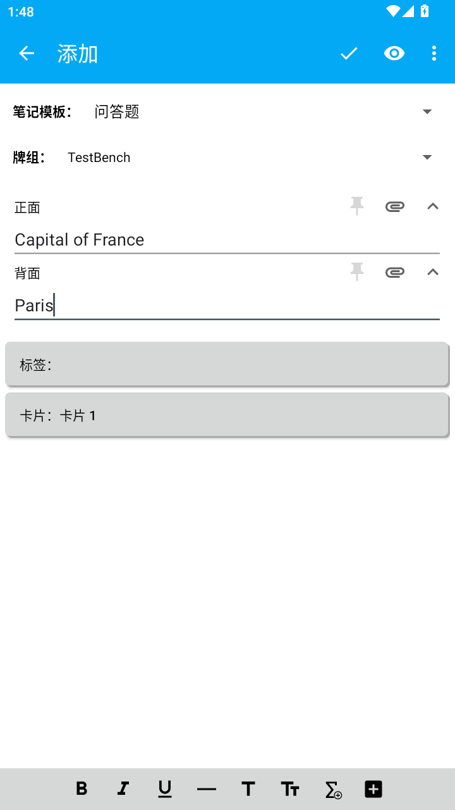
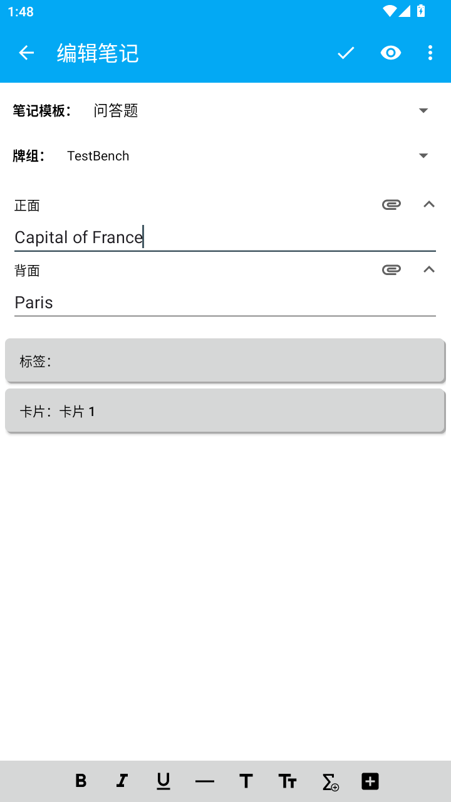
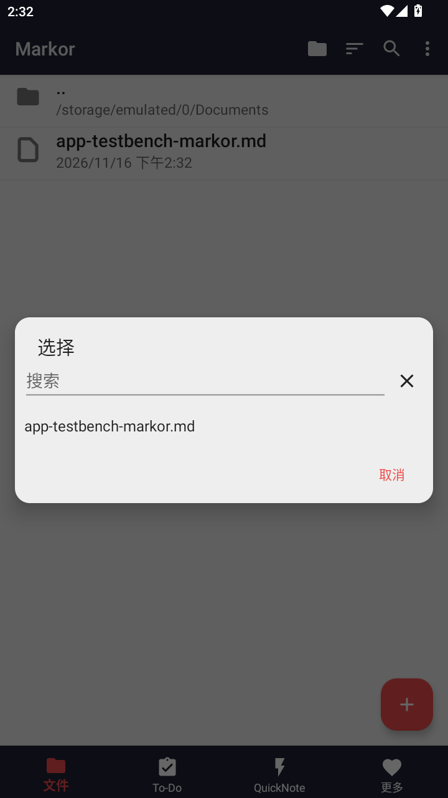

# 真实案例 / Live Cases

这些案例不是演示视频，也不是用生成式图片拼出来的界面。每一张公开截图都来自一次真实的 MuMu + Android + ADB 运行；每一步是否通过由 flow 中的 UI 断言决定。

These are not demo mockups or generated screenshots. Every published image comes from a real MuMu + Android + ADB run, and every pass/fail result is decided by explicit UI assertions in the flow.

## 测试环境 / Tested environment

| Item | Value |
| --- | --- |
| Date | 2026-11-16, Asia/Shanghai |
| Runtime | MuMu Player `6.8.8.0`, Android 12 |
| ADB | `1.0.41` |
| Display | `720x1280`, portrait, Simplified Chinese |
| Python | `3.11.8` |
| Result format | self-contained HTML, `result.json`, JUnit XML, screenshots, UI XML, logcat |

## 案例总览 / Case index

| Case | App type | Evidence |
| --- | --- | --- |
| AnkiDroid deck and card persistence | Study/card database app | 49/49 passed in 75.203 seconds |
| Markor note persistence | Markdown editor and file browser | 46/46 passed in 80.203 seconds |
| Failure contract | Deliberate UI assertion failure | Exit 1, schema valid, diagnostic artifacts retained |

## 1. AnkiDroid 牌组、卡片与冷启动持久化 / Deck, card, and cold-start persistence

### 为什么选它 / Why this case

- AnkiDroid is a mature, actively maintained open-source Android application with immutable F-Droid builds.
- The case needs no network account, paid service, or private user data.
- It exercises dialogs, text fields, dynamic waits, a local collection database, external-storage state, force-stop, cold launch, and post-restart content verification.

### 固定输入 / Pinned inputs

| Field | Value |
| --- | --- |
| Package | `com.ichi2.anki` |
| Version | `2.25.3` (`versionCode 225033004`) |
| APK source | <https://f-droid.org/repo/com.ichi2.anki_225033004.apk> |
| APK SHA256 | `c7056f611c66fc91a8e290e18268a0d708e813704f51c66e4af1534d468f6790` |
| Deck | `TestBench` |
| Card | `Capital of France` / `Paris` |

### 实际覆盖 / What the live flow does

1. Installs the pinned APK, verifies package name, version code, and version name.
2. Resets AnkiDroid app data, its all-files app-op, and the case-owned external collection directory.
3. Completes first-run onboarding and waits for the empty collection.
4. Creates the `TestBench` deck through the real Android dialog.
5. Opens the deck action menu and enters a question/answer card.
6. Verifies the card count and captures the card form.
7. Force-stops the app and cold-launches it again.
8. Verifies that `TestBench` and `1 张卡片待复习` remain.
9. Reopens the saved card and asserts both `Capital of France` and `Paris`.
10. Saves screenshots, UI trees, logcat, HTML, JSON, and JUnit.

### 真实结果 / Observed result

```text
Status: passed
Steps: 49 passed, 0 failed, 0 skipped
Duration: 75.203 seconds
Screenshots: 8 PNG at 720x1280
HTML: 1,853,536 bytes, self-contained
result.json: 37,973 bytes
JUnit: 14,630 bytes
```

### 公开截图 / Public screenshots

这些图按一条证据链排列：真实表单输入、冷启动后仍存在的牌组与待复习计数、以及重新打开后的卡片内容。其余本次运行截图保留在被 Git 忽略的原始运行目录中。

The images form one evidence chain: real form input, the deck and due-card count after a cold start, and the saved card reopened with both fields intact. Additional screenshots from the same run remain in ignored local artifact storage.

| View | Image |
| --- | --- |
| Real card input |  |
| Deck and due count after cold start |  |
| Saved card reopened |  |

### 复现 / Reproduce

```powershell
.\examples\ankidroid-deck-persistence\run.ps1
```

The script downloads the APK into ignored `runs/case-assets/`, verifies its SHA256, resets only the case-owned AnkiDroid state, and runs the 49-action flow with JUnit output.

### 已知限制 / Known limits

- Selectors and copy are calibrated for AnkiDroid `2.25.3`, Simplified Chinese, and a `720x1280` MuMu instance.
- A clean install may use an available collection path without showing the all-files permission screen on every device. The flow does not claim that branch always appears.
- AnkiDroid's web-based card renderer and collection database can change between releases. Recalibrate selectors after changing the pinned APK.
- Use a dedicated test instance. The script clears AnkiDroid state and removes only the case-owned external collection path.

## 2. Markor 笔记、文件搜索与冷启动持久化 / Note, search, and cold-start persistence

### 为什么选它 / Why this case

- Markor is a mature open-source Markdown/plain-text editor with an official F-Droid build.
- It covers a different product surface from AnkiDroid: a text editor, file browser, storage access, save action, filename search, and file reopening.
- The test uses visible text and accessibility descriptions for the main navigation instead of depending on a single screen resolution.

### 固定输入 / Pinned inputs

| Field | Value |
| --- | --- |
| Package | `net.gsantner.markor` |
| Version | `2026.10.0` (`versionCode 164`) |
| APK source | <https://f-droid.org/repo/net.gsantner.markor_164.apk> |
| APK size | `11,849,016` bytes |
| APK SHA256 | `c29412e02d03e4f0511746a1bcef48c6b73fc1f70c1024fbf04903b0b3f4c485` |
| Test file | `app-testbench-markor.md` |
| Body | `App TestBench persistence check` |

### 实际覆盖 / What the live flow does

1. Installs the pinned APK and verifies package, version, and SHA256.
2. Clears app data and removes only old `app-testbench-*.md` files under Markor's test directory.
3. Completes all five onboarding pages using accessibility selectors and closes the release-notes dialog.
4. Opens the create-file dialog, clears the seeded title, and enters `app-testbench-markor`.
5. Focuses the editor, enters the body, and asserts it is visible before saving.
6. Saves the note, force-stops Markor, and cold-launches it.
7. Verifies the file remains in the browser, opens filename search, and finds the exact `.md` file.
8. Reopens the note, waits for the body, and asserts it survived the restart.
9. Saves screenshots, UI tree, logcat, HTML, JSON, and JUnit.

### 真实结果 / Observed result

```text
Status: passed
Steps: 46 passed, 0 failed, 0 skipped
Duration: 80.203 seconds
Screenshots: 5 PNG at 720x1280
HTML: 1,086,790 bytes, self-contained
result.json: 37,658 bytes
JUnit: 14,828 bytes
```

### 公开截图 / Public screenshots

这三张图覆盖冷启动后的文件列表、按精确文件名搜索结果，以及重新打开后的正文。它们证明文件写入、索引和应用重启后的读取都属于真实 App 状态，而不是报告生成器里的占位内容。

The three images show the post-restart file list, the exact-filename search result, and the reopened note body. They demonstrate real app state across file write, discovery, and read-after-restart rather than placeholders in the report layer.

| View | Image |
| --- | --- |
| File present after cold start |  |
| Exact filename search result |  |
| Reopened note body |  |

### 复现 / Reproduce

```powershell
.\examples\markor-note-persistence\run.ps1
```

The script downloads the pinned APK into ignored `runs/case-assets/`, verifies its size and SHA256, removes only case-owned test notes, runs the flow, and uninstalls Markor by default. Use `-KeepInstalled` if you want to inspect the app after the run.

### 已知限制 / Known limits

- Markor prompts and file-layout coordinates are calibrated for `2026.10.0`, Simplified Chinese, and a `720x1280` Android 12 instance.
- `MANAGE_EXTERNAL_STORAGE` is granted only inside the isolated MuMu test instance and only for this case. Do not grant it blindly on a production device.
- The flow needs a writable `Documents/markor` directory and removes only files matching the `app-testbench-*.md` case-owned prefix.
- The body is printable ASCII because the CLI's native `text` action intentionally rejects non-ASCII input.

## 失败 JSON 与诊断证据 / Failure JSON and diagnostics

This failure is deliberate: the flow waits for text that does not exist. It verifies the failure path without weakening any passing assertion.

```text
Flow: cli-failure-contract-live
Exit code: 1
Envelope: ok=false + error.type=step_failure + complete data
Schema: packaged cli-v1.schema.json PASS
Steps: 3 passed, 1 failed, 1 skipped
Duration: 12.641 seconds
Failure screenshot: present
Failure UI tree: present
Final logcat: present
HTML report: present and self-contained
JUnit: 1 failure, 0 errors, 1 skipped
```

v0.1.0 produced `ok=false` plus `data` but no `error`, so the failure envelope did not match the published schema. v0.1.1 adds a structured error while preserving the complete run payload. See [validation.md](validation.md).


The public report image was rendered from a real failed HTML report. A temporary copy replaced local paths and the test ADB serial before rendering; it was not AI-generated or redrawn.

## 选型说明 / Selection rationale

- Both apps are public, mature, actively maintained open-source Android applications with immutable F-Droid builds.
- Neither case needs a paid account, a private production credential, or a network-dependent business workflow.
- AnkiDroid stresses structured dialogs, a local database, external storage state, and card-level content verification.
- Markor stresses editor input, file-system behavior, filename search, and reopening a saved file after a cold start.
- Both cases finish with explicit assertions and produce the same evidence bundle: screenshots, UI trees, logcat, HTML, JSON, and JUnit.

## 证据边界 / Evidence boundaries

- Committed PNGs come from real MuMu runs. No generated screenshots or manually redrawn app pages are used.
- Raw APKs, complete run directories, unfiltered UI XML/logcat, and virtual environments remain in ignored local storage.
- The public screenshots show only the test apps and test-created content. They do not contain the user's accounts, cookies, tokens, or production data.
- A pass proves only the pinned app version, MuMu/Android image, display size, language, and flow recorded here.
- Physical devices remain the final acceptance environment for hardware, OEM, and production-account behavior.
