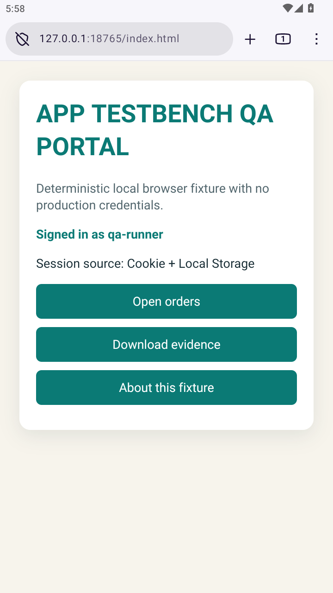
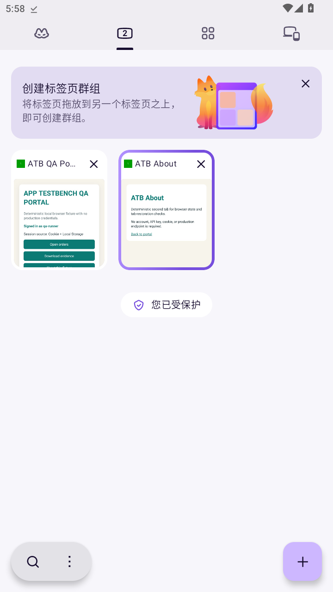
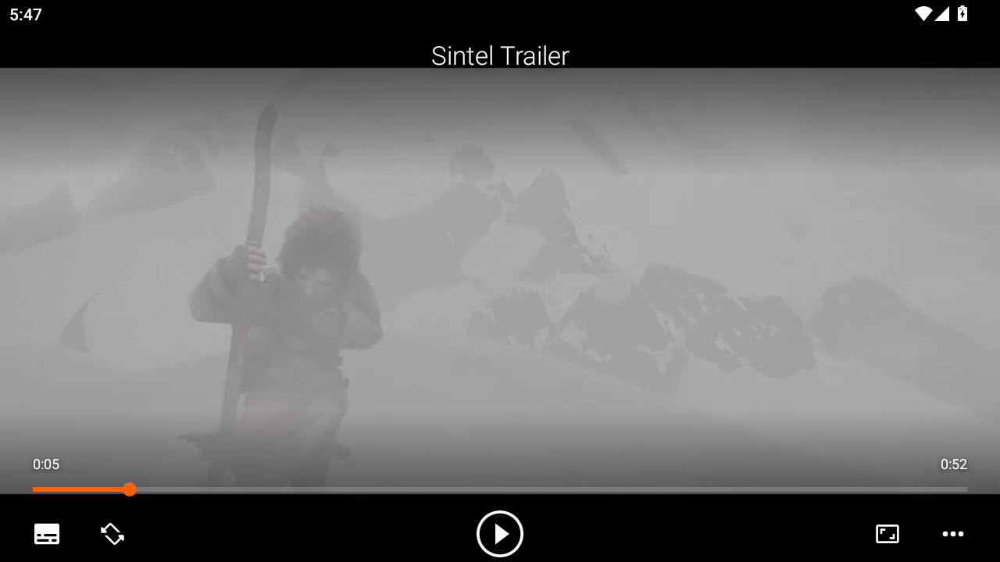

# 真实案例 / Live Cases

这些案例不是演示视频，也不是用生成式图片拼出来的界面。每张公开截图都来自真实的 MuMu + Android + ADB 运行；通过与否由 flow 中的 Activity、UI 或 logcat 断言决定。

These are not demo videos or generated interface mockups. Every public image comes from a real MuMu + Android + ADB run, and each verdict is decided by an explicit Activity, UI, or logcat assertion in the flow.

## 测试环境 / Tested environment

| Item | Value |
| --- | --- |
| Date | 2026-11-16, Asia/Shanghai |
| Runtime | MuMu Player `6.8.8.0`, Android 12 |
| ADB | `1.0.41` |
| Display | `720x1280` portrait; VLC also checks `1280x720` landscape |
| Python | `3.11.8` |
| System language | Simplified Chinese |
| Result formats | self-contained HTML, `result.json`, JUnit XML, screenshots, UI XML, logcat |

## 案例总览 / Case index

| Case | App type | Engineering coverage | Live result |
| --- | --- | --- | --- |
| [Wikipedia](#1-wikipedia-search-article-and-cold-start-persistence--搜索文章与冷启动持久化) | Network-backed encyclopedia app | Onboarding, English search, WebView article, saved list, force-stop, cold start | **63/63 passed**, `113.563 s` |
| [Firefox / Fennec](#2-firefox-fennec-browser-state-download-and-tabs--浏览器状态下载与标签页) | Android browser | Cookie + LocalStorage, download, two tabs, cold-start restore | **66/66 passed**, `143.016 s` |
| [VLC](#3-vlc-real-media-activity-and-logcat--真实媒体activity与logcat) | Native media player | Player Activity, byte-range MP4, decoded frames, codec/AudioTrack logs, orientation | **43/43 passed**, `50.579 s` |
| Failure contract | Diagnostic path | Exit 1, schema-valid error envelope, screenshots/UI/logcat/HTML/JUnit retained | **1 intentional failure** |

## 1. Wikipedia: search, article, and cold-start persistence / 搜索、文章与冷启动持久化

### 为什么选它 / Why this case

- Wikipedia is mature, widely used, and distributed through an immutable F-Droid build.
- It exercises a real network-backed search and article render instead of a local fixture.
- The journey combines first-run onboarding, language selection, a dynamically loaded result, a WebView body, local reading-list state, force-stop, and cold-start verification.
- No user account, paid service, or private business credential is required.

### 固定输入 / Pinned input

```text
Package: org.wikipedia
Version: r/50616-r-2026-11-03
VersionCode: 50616
Source: https://f-droid.org/repo/org.wikipedia_50616.apk
Size: 104,747,428 bytes
SHA256: d225e5d08fe461f12fa0af7b617e6e715f3112986165c34e0572a1a056129dd1
Test search: Ada Lovelace
Reading list: QA Reading List
```

### 实际覆盖 / What the live flow does

1. Installs the APK and verifies package, version code, and version name.
2. Completes first-run onboarding, privacy, language, and optional-interest pages.
3. Waits for the live Wikipedia home feed and opens search.
4. Searches `Ada Lovelace`, switches to English results, and waits for the exact article description.
5. Opens the article, allows the WebView to render, and saves it to `QA Reading List`.
6. Force-stops and cold-launches Wikipedia.
7. Reopens saved items and asserts the article and description survived the restart.
8. Stores 8 real screenshots, selected UI XML, logcat, HTML, `result.json`, and JUnit.

### 真实结果 / Observed result

```text
Status: passed
Steps: 63 passed, 0 failed, 0 skipped
Duration: 113.563 seconds
Screenshots: 8 PNG
HTML: 6,345,936 bytes, self-contained
result.json: 52,701 bytes
```

### 公开截图 / Public evidence

| View | Image |
| --- | --- |
| English search result |  |
| Real WebView article |  |
| Saved article after cold start |  |

### 复现 / Reproduce

```powershell
.\examples\wikipedia-research-session\run.ps1
```

### 已知限制 / Known limits

- Calibrated for the pinned app, Simplified Chinese system UI, and `720x1280`.
- Search depends on the live MediaWiki service and network availability.
- The public case does not use an account and does not claim Wikipedia cross-device sync.
- WebView content is verified through visible text and screenshots, not DOM access.

## 2. Firefox Fennec: browser state, download, and tabs / 浏览器状态、下载与标签页

### 为什么选它 / Why this case

- Fennec F-Droid is a mature Firefox build with a pinned public APK.
- The case tests what a native-only test cannot: Cookie plus LocalStorage state, a download, two tabs, tab switching, force-stop, and restore.
- The local fixture has no password field. It uses only the synthetic username `qa-runner` and a case-owned text file.
- It is representative of authorized mobile-browser validation where the browser or App-only surface is the actual product path.

### 固定输入 / Pinned input

```text
Package: org.mozilla.fennec_fdroid
Version: 160.0.0
VersionCode: 1600020
Source: https://f-droid.org/repo/org.mozilla.fennec_fdroid_1600020.apk
Size: 129,815,928 bytes
SHA256: 43cf491bbc677244d7b56ba2e8ae20ccd802c9d8f6b44d6b6aff7eb1753eab1b
Local fixture: 127.0.0.1:18765 through adb reverse
Synthetic identity: qa-runner
Downloaded file: app-testbench-browser-evidence.txt
```

### 实际覆盖 / What the live flow does

1. Completes Fennec first-run onboarding and declines the default-browser change.
2. Opens a deterministic local QA fixture with no password input.
3. Establishes a signed-in state backed by Cookie and LocalStorage.
4. Verifies that both browser storage mechanisms authorize the dashboard and orders page.
5. Downloads `app-testbench-browser-evidence.txt`; the wrapper reads it through ADB and verifies exact contents.
6. Opens a second tab, switches tabs, and captures the tab manager.
7. Force-stops and cold-launches Fennec.
8. Verifies the signed-in state and both restored tabs.
9. Retains 8 real screenshots, UI XML, logcat, HTML, `result.json`, and JUnit.

### 真实结果 / Observed result

```text
Status: passed
Steps: 66 passed, 0 failed, 0 skipped
Duration: 143.016 seconds
Screenshots: 8 PNG
HTML: 2,534,488 bytes, self-contained
result.json: 53,933 bytes
Download verification: exact content match
```

### 公开截图 / Public evidence

| View | Image |
| --- | --- |
| Authenticated browser state |  |
| Authorized order page |  |
| Two-tab manager |  |
| Case-owned download prompt |  |

### 复现 / Reproduce

```powershell
.\examples\firefox-webapp-session\run.ps1
```

### 已知限制 / Known limits

- Browser prompts, keyboard geometry, and tab UI are calibrated for the pinned build, Simplified Chinese, and `720x1280`.
- The local fixture tests browser state mechanics, not a production identity provider.
- The flow does not export or inspect cookies or tokens; it asserts visible state.
- A future Fennec build may change onboarding, download, or tab-restore behavior.
- Test only systems and accounts for which you have explicit authorization.

## 3. VLC: real media, Activity, and logcat / 真实媒体、Activity 与 logcat

### 为什么选它 / Why this case

- VLC is a mature open-source media app with a pinned F-Droid build.
- The decoded video surface exposes little useful text to accessibility services. A UI-only test cannot prove that the player Activity was reached, a real media input was opened, or an audio output module initialized.
- The case combines `wait_for_activity`, `wait_for_text`, screenshots, UI dumps, and `assert_logcat_contains`.
- It demonstrates that the execution layer can assert native transitions and subsystem logs beyond ordinary tap-and-text automation.

### 固定输入 / Pinned input

```text
Package: org.videolan.vlc
Version: 3.7.2
VersionCode: 13070208
APK source: https://f-droid.org/repo/org.videolan.vlc_13070208.apk
APK SHA256: 727693d59c4d678c046386812a103209a25423460c9d22e38e12460f12402ab6
Media source: https://media.w3.org/2010/05/sintel/trailer.mp4
Media size: 4,372,373 bytes
Media SHA256: b670602fa00934ca27c4351bb0efe7ea7a07fae57284e44226025eeed7c51254
Player Activity: org.videolan.vlc/.gui.video.VideoPlayerActivity
```

### 实际覆盖 / What the live flow does

1. Installs and verifies the pinned VLC build.
2. Completes first-run onboarding and opens the MP4 through a local byte-range HTTP server exposed by `adb reverse`.
3. Confirms `VideoPlayerActivity` is foreground.
4. Dismisses the first-play tutorial and captures real decoded frames.
5. Pauses playback and verifies the title `Sintel Trailer`.
6. Asserts logcat contains `Creating an input for 'sintel-trailer.mp4'`.
7. Asserts logcat contains the Android `android_audiotrack` module.
8. Checks portrait and landscape relayout while the player Activity remains foreground.
9. Retains 8 real screenshots, UI XML, logcat, HTML, `result.json`, and JUnit.

### 真实结果 / Observed result

```text
Status: passed
Steps: 43 passed, 0 failed, 0 skipped
Duration: 50.579 seconds
Screenshots: 8 PNG
HTML: 2,116,816 bytes, self-contained
result.json: 33,257 bytes
Activity assertions: player and post-rotation match
logcat assertions: media input = 1 match; android_audiotrack = 2 matches
```

### 公开截图 / Public evidence

| View | Image |
| --- | --- |
| First-play tutorial |  |
| Paused real player and title |  |
| Landscape player controls |  |
| Resumed decoded frame |  |

### 复现 / Reproduce

```powershell
.\examples\vlc-media-playback\run.ps1
```

### 已知限制 / Known limits

- Calibrated for VLC `3.7.2`, Simplified Chinese, and the recorded MuMu Android 12 display.
- The case covers a short MP4 over local byte-range HTTP; it does not claim DRM, adaptive streaming, subtitles, or audio-track switching.
- Logcat is a bounded ring buffer. The case stops unrelated log-heavy browser processes first, but very noisy devices may require a larger buffer or a future tag filter.
- This is not a codec certification or a substitute for physical-device acceptance testing.

## 失败 JSON 与诊断证据 / Failure JSON and diagnostics

The public failure case is intentional: a live flow waits for a marker that does not exist. It verifies the failure contract without weakening a passing assertion.

```text
Exit code: 1
Envelope: ok=false + error.type=step_failure + complete data
Packaged cli-v1.schema.json: PASS
Failure screenshot: present
Failure UI tree: present
Final logcat: present
HTML: present and self-contained
JUnit: failure represented
```

v0.1.0 emitted `ok=false` plus `data` but omitted the required `error` object. v0.1.1 fixes the producer rather than relaxing the published schema. See [validation.md](validation.md).


The image is a capture of a real failed HTML report. A temporary pre-publication copy replaced local tool paths and the test ADB serial; the report layout, failed result, and trace were not redrawn or fabricated.

## 选型说明 / Selection rationale

- The apps are mature open-source Android products with immutable F-Droid builds.
- The cases stress different layers: network content and state, browser storage/download/tab restore, and native media/Activity/logcat behavior.
- All three use public or case-owned test data only. None needs a production account, paid service, real cookie, token, or private endpoint.
- Each case produces the same delivery bundle: screenshots, UI trees, logcat, HTML, `result.json`, and JUnit.

## 证据边界 / Evidence boundaries

- Committed PNGs come from real MuMu runs. No generated screenshots or manually redrawn app pages are used.
- Raw APKs, MP4 files, complete run directories, unfiltered UI XML/logcat, and virtual environments remain in ignored local storage.
- Public images show only test apps and test-created content. They contain no accounts, production cookies, tokens, API keys, private IPs, or ADB serials.
- A pass applies only to the pinned app, MuMu/Android image, display, language, and flow recorded here.
- Physical devices remain the final acceptance environment for hardware, OEM, and production-account behavior.
