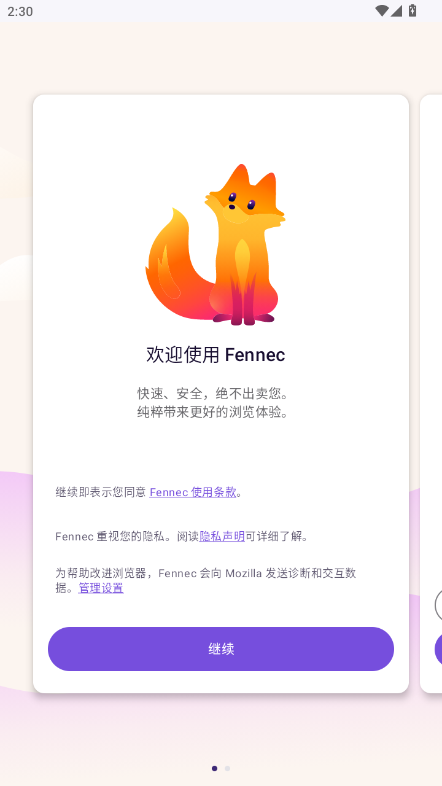
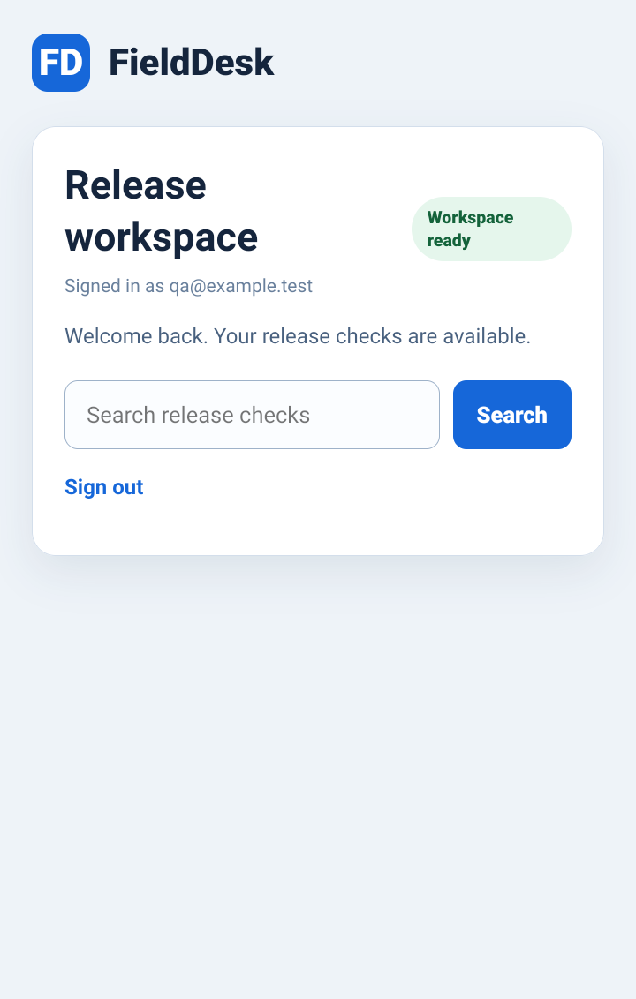
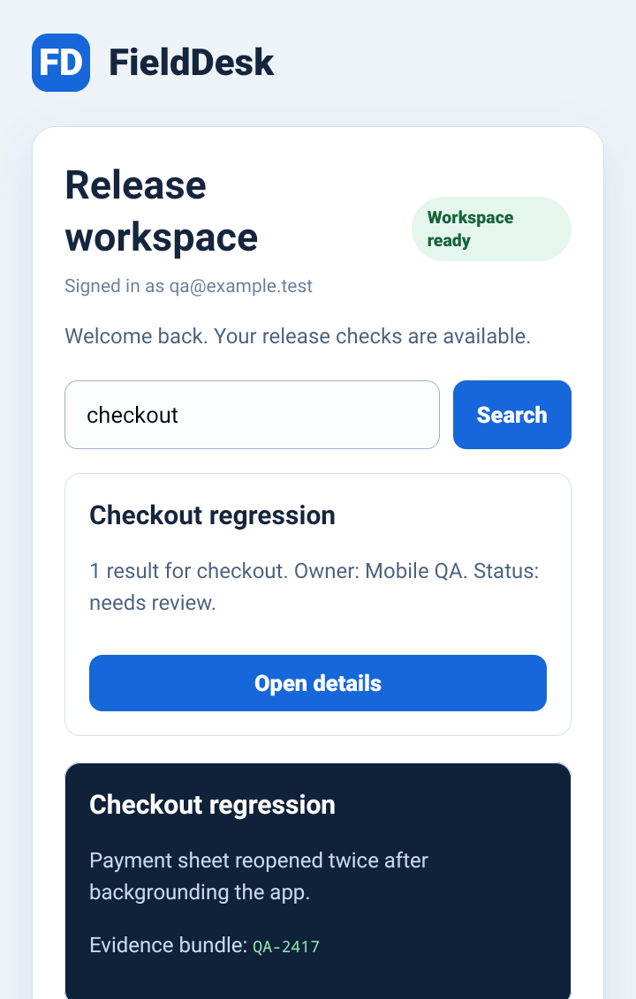
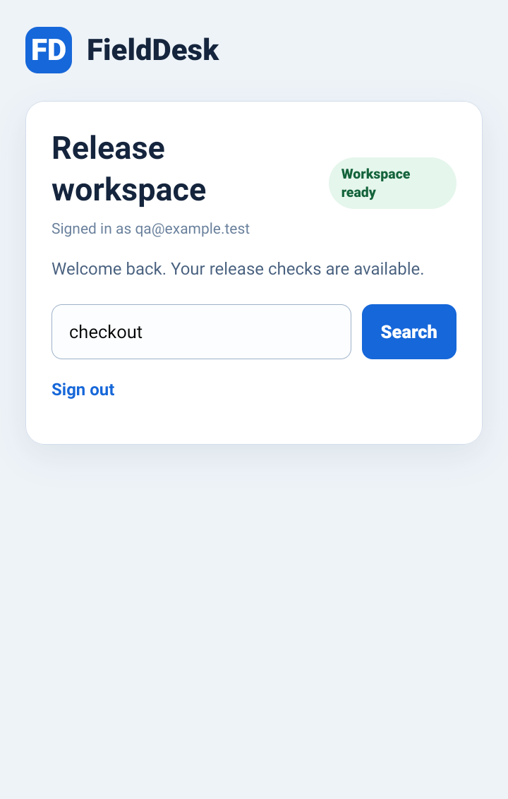
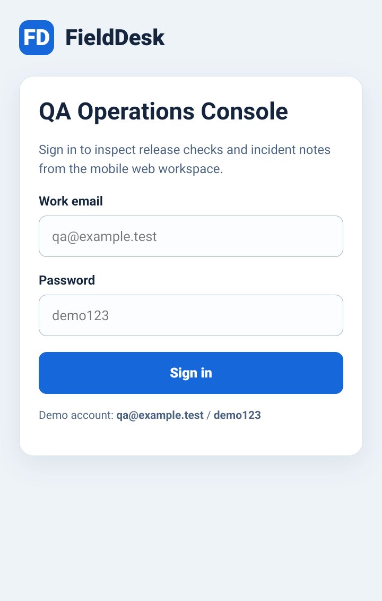
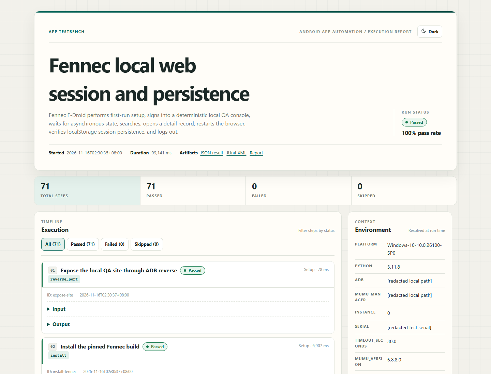
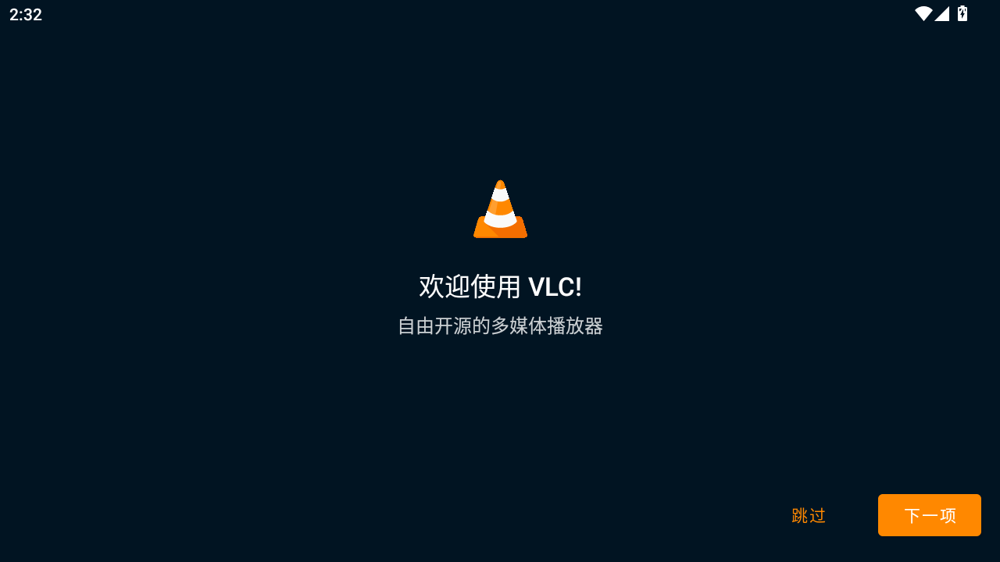
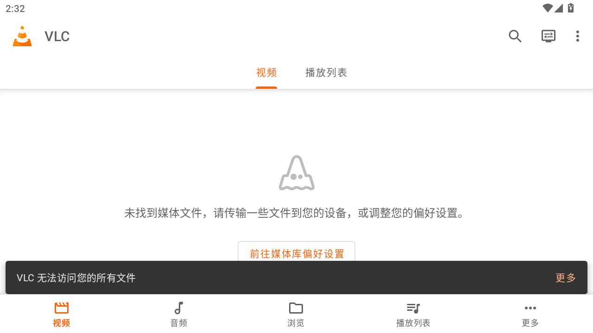

# 真实案例 / Live Cases

这一页只记录在真实 MuMu Android 实例上执行过的案例。截图来自实际运行，不是示意图；原始运行目录、APK、完整 logcat 和 UI XML 保留在本地被忽略的 `runs/`，不进入 Git。

This page records cases executed on a live MuMu Android instance. The screenshots come from those runs, not mockups. Raw run directories, APKs, full logcat, and UI XML remain under the Git-ignored `runs/` directory.

## 测试环境 / Tested environment

| Item | Value |
| --- | --- |
| Host OS | Windows 10.0.26100 |
| Python | 3.11.8 |
| MuMu Player | 6.8.8.0 |
| Android | 12 |
| ADB | 1.0.41 |
| Display | 1280×720 |
| System language | 简体中文 / Simplified Chinese |

## 案例总览 / Case index

| Case | App | Engineering focus | Live result |
| --- | --- | --- | --- |
| [Fennec local web session](../examples/fennec-local-web-session/README.md) | Fennec F-Droid 160.0.0 | Browser/WebView, onboarding, ADB reverse, async waits, login session, cold-start persistence | **71/71 passed** |
| [VLC HTTP playback](../examples/vlc-http-playback/README.md) | VLC for Android 3.7.2 | Orientation, byte-range HTTP, media tutorial, real playback, MediaCodec/logcat evidence | **30/30 passed** |
| Intentional failure contract | VLC runtime | Failure JSON schema, exit code, skipped steps, screenshot, UI tree, logcat, HTML, JUnit | **exit 1, schema valid** |

## 1. Fennec 本地 Web 会话与持久化 / Fennec local web session

这个案例使用真实浏览器打开本机 QA 站点。它不依赖第三方账号，也不访问生产系统；所有登录、搜索和详情行为都由仓库内的 FieldDesk 夹具提供。

This case uses a real Android browser against a repository-owned QA site. It does not depend on a third-party account or production system; login, search, and detail behavior come from the FieldDesk fixture in this repository.

### 为什么选它 / Why this case

- Fennec F-Droid 是持续维护的开源 Android 浏览器，能从 F-Droid 固定版本下载。
- 首次引导、默认浏览器提示、翻译面板、密码保存提示都是浏览器/系统真实 UI，不是自绘演示壳。
- 本地站点通过 `adb reverse` 暴露，异步搜索和 `localStorage` 状态可以确定复现。
- 强制停止后的冷启动验证，能证明工具保存并恢复的是真实浏览器会话，而不是内存里的页面状态。

### 固定输入 / Pinned inputs

| Input | Value |
| --- | --- |
| Package | `org.mozilla.fennec_fdroid` |
| Version | `160.0.0` (`1600020`) |
| APK source | `https://f-droid.org/repo/org.mozilla.fennec_fdroid_1600020.apk` |
| APK SHA256 | `43cf491bbc677244d7b56ba2e8ae20ccd802c9d8f6b44d6b6aff7eb1753eab1b` |
| Demo account | `qa@example.test` / `demo123` |
| Local origin | `http://127.0.0.1:18765/` |

APK 下载到 `runs/case-assets/fennec-local-web-session/` 并校验 SHA256；仓库不提交二进制。

The APK is downloaded into `runs/case-assets/fennec-local-web-session/` and verified by SHA256. No binary is committed.

### 实际覆盖 / What the live flow does

1. 下载/校验固定 APK，安装并核对 package、versionCode、versionName。
2. 清除该 App 数据，锁定竖屏，完成 Fennec 首次引导。
3. 处理默认浏览器和隐私引导页面。
4. 通过 `adb reverse tcp:18765` 打开本机 `FieldDesk QA Console`。
5. 处理翻译底部面板和系统密码保存提示。
6. 输入固定演示账号，等待异步 `Workspace ready`。
7. 搜索 `checkout`，等待 `Checkout regression`，打开 `QA-2417` 详情。
8. 强制停止 Fennec，冷启动，重新打开站点，断言查询和登录态恢复。
9. 登出，断言认证工作区消失。
10. 保存截图、UI 树、logcat、HTML、JSON 和 JUnit。

1. Download and verify the pinned APK, install it, and check package/version identity.
2. Clear app data, lock portrait, and complete Fennec first-run onboarding.
3. Handle the default-browser and privacy pages.
4. Expose the local `FieldDesk QA Console` through `adb reverse tcp:18765`.
5. Handle the translation bottom sheet and Android password-save prompt.
6. Enter the fixed demo account and wait for asynchronous `Workspace ready`.
7. Search for `checkout`, wait for `Checkout regression`, and open `QA-2417`.
8. Force-stop Fennec, cold-launch it, reopen the site, and assert that the query and login session were restored.
9. Log out and assert that the authenticated workspace is gone.
10. Retain screenshots, UI trees, logcat, HTML, JSON, and JUnit.

### 真实结果 / Observed result

```text
Status: passed
Steps: 71 passed, 0 failed, 0 skipped
Duration: 99.141 seconds
Screenshots: 11 PNG at 720x1280
UI trees: setup/step artifacts retained in the local run
JUnit: 71 tests, 0 failures, 0 errors
HTML: self-contained, 11 base64 PNG images, no external page dependency
Logcat: Fennec/Gecko process evidence retained in local logs
```

公开截图从这次运行中选择。浏览器地址栏/状态栏在发布图中被裁掉，避免公开本机回环端口；`first-run.png` 不含地址栏，保持原图。

The public screenshots were selected from this run. The browser URL/status bar is cropped from the web-content images to avoid publishing the local loopback port; `first-run.png` contains no address bar and is unchanged.

| Evidence | Image |
| --- | --- |
| First-run onboarding |  |
| Authenticated workspace |  |
| Async search result |  |
| Detail panel |  |
| Cold-start restored query/session |  |
| Logged-out state |  |
| Self-contained passed report |  |

### 复现 / Reproduce

```powershell
.\examples\fennec-local-web-session\run.ps1
```

手动运行和已知限制见 [`examples/fennec-local-web-session/README.md`](../examples/fennec-local-web-session/README.md)。

For the manual command and known limits, see [`examples/fennec-local-web-session/README.md`](../examples/fennec-local-web-session/README.md).

### 已知限制 / Known limits

- 坐标和中文系统提示依赖当前 720×1280 竖屏、Android 12、简体中文镜像。
- 测试使用浏览器 UI 树里的稳定文本；页面若把关键内容只画进 canvas，需要改用其他定位策略。
- 演示账号是仓库内公开测试数据，不是生产账号。
- 不导出、复制或伪造真实用户 Cookie/token。
- 授权的 App 测试可以覆盖正常登录与状态恢复，但不包含绕过认证、验证码或访问控制。
## 2. VLC HTTP 播放与解码证据 / VLC HTTP playback and codec evidence

这个案例验证的不只是“打开一个播放器”，而是从宿主 HTTP Range 服务、Android Intent、首次使用教程、真实视频解码到 logcat 证据的完整链路。

This case verifies more than opening a player: host-side HTTP Range serving, Android VIEW intent, first-use tutorial, real video decode, and logcat evidence.

### 为什么选它 / Why this case

- VLC 是成熟的开源媒体 App，有真实播放器生命周期、权限、方向和解码路径。
- 媒体通过独立 Range 服务器提供；运行脚本先验证 `206 Partial Content` 和固定 `Content-Range`，避免误连旧服务。
- H.264/AAC 是可公开测试的非 DRM 样本，适合验证 demux 和 MediaCodec。
- 截图同时包含真实画面与控件，不靠空 Activity 或桌面证明“可启动”。

### 固定输入 / Pinned inputs

| Input | Value |
| --- | --- |
| Package | `org.videolan.vlc` |
| Version | `3.7.2` (`13070208`) |
| APK source | `https://f-droid.org/repo/org.videolan.vlc_13070208.apk` |
| APK SHA256 | `727693d59c4d678c046386812a103209a25423460c9d22e38e12460f12402ab6` |
| Media URL | `https://media.w3.org/2010/05/sintel/trailer.mp4` |
| Media size / SHA256 | `4,372,373` bytes / `b670602fa00934ca27c4351bb0efe7ea7a07fae57284e44226025eeed7c51254` |
| Local media origin | `http://127.0.0.1:18766/` |

### 实际覆盖 / What the live flow does

1. 通过 `adb reverse` 暴露本机 Range 服务器。
2. 安装/校验 VLC，清数据，再以 `-g` 重新安装并恢复运行时权限。
3. 完成欢迎页、媒体扫描页，锁定横屏。
4. 使用 `ACTION_VIEW` 和 `video/mp4` 打开固定 MP4。
5. 处理首次播放教程，播放 5 秒。
6. 截图真实视频帧和播放控制条。
7. 收集 logcat，检查 HTTP、demux、H.264/AAC 和 MediaCodec 路径。

### 真实结果 / Observed result

```text
Status: passed
Steps: 30 passed, 0 failed, 0 skipped
Duration: 40.547 seconds
Screenshots: 5 PNG at 1280x720
JUnit: 30 tests, 0 failures, 0 errors
HTML: self-contained, 5 base64 PNG images, no external page dependency
Logcat: HTTP/range, demux, MediaCodec, H.264/AVC and AAC evidence retained
```

| Evidence | Image |
| --- | --- |
| VLC welcome page |  |
| VLC home |  |
| First-play tutorial |  |
| Real video with controls and timeline |  |

### 复现 / Reproduce

```powershell
.\examples\vlc-http-playback\run.ps1
```

手动运行和已知限制见 [`examples/vlc-http-playback/README.md`](../examples/vlc-http-playback/README.md)。

For the manual command and known limits, see [`examples/vlc-http-playback/README.md`](../examples/vlc-http-playback/README.md).

### 已知限制 / Known limits

- 坐标、中文教程和横屏布局依赖当前 1280×720、Android 12、简体中文镜像。
- 活跃视频期间 `uiautomator dump` 可能因 Surface 不稳定失败；本案例在引导/首页抓 UI 树，播放阶段以截图和 logcat 为主。
- 测试媒体是非 DRM H.264/AAC；DRM、自适应码率、字幕和音轨切换不在本案例内。
- 解码器名称随 MuMu/Android 镜像变化；本案例记录实际 logcat，不承诺所有镜像使用同一个 OMX 组件。

## 失败 JSON 与诊断证据 / Failure JSON and diagnostics

失败运行故意等待一个不存在的 UI 文本，以验证失败路径。它不是通过放宽断言得到的“失败”，而是预定的契约测试。

The failure run deliberately waits for absent UI text to verify the failure path. It is an intentional contract test, not a weakened assertion.

```text
Flow: cli-failure-contract-live
Exit code: 1
Envelope: ok=false + error.type=step_failure + complete data
Schema: packaged cli-v1.schema.json PASS
Steps: 3 passed, 1 failed, 1 skipped
Duration: 12.641 seconds
Failure screenshot: present
Failure UI tree: present
Final logcat: present
HTML report: 373,558 bytes, self-contained
JUnit: 5 tests, 1 failure, 0 errors, 1 skipped
```

v0.1.0 的真实失败 envelope 只有 `ok=false + data`，没有 `error`，与现行 Schema 不兼容。v0.1.1 增加结构化错误，同时保留完整 `data`。对照记录见 [`validation.md`](validation.md)。

The real v0.1.0 failure envelope contained `ok=false + data` but no `error`, so it did not satisfy the published schema. v0.1.1 adds the structured error while retaining complete `data`. See [`validation.md`](validation.md).


报告公开图来自真实失败 HTML；在截图前用临时脱敏副本替换了本机路径和测试 serial，未用 AI 生成或重画报告。

The public report image was rendered from the real failed HTML. A temporary copy replaced local paths and the test serial before rendering; the report was not AI-generated or redrawn.

## 选型说明 / Selection rationale

- 两个 App 都是公开、成熟、可从官方 F-Droid 仓库固定版本下载的开源应用。
- Fennec 覆盖真实浏览器/WebView、异步 JavaScript、首次引导、系统提示和冷启动持久化；这些问题用简单 Activity 启动或空壳模拟器测不出来。
- VLC 覆盖不同工程难点：HTTP Range、播放器生命周期、横屏、媒体解码和 logcat。
- 两条案例都需要动态等待、断言、截图、UI 树或日志，不只是“点点点”。
- 两条案例都不需要付费账号或生产凭据，适合公开复现。

## 证据边界 / Evidence boundaries

- 提交的 PNG 来自真实 MuMu 运行；没有生成式截图或手工重画页面。
- Fennec 公开图裁掉浏览器地址栏；报告图替换本机路径和 serial。
- 原始 APK、视频、run 目录、完整 logcat/UI XML 留在本地 `runs/`，不提交。
- HTML 证据只提交脱敏后的报告截图；不提交包含本机环境字段的完整报告。
- 真实结果不自动外推到其他 MuMu、Android、App、分辨率或语言版本。