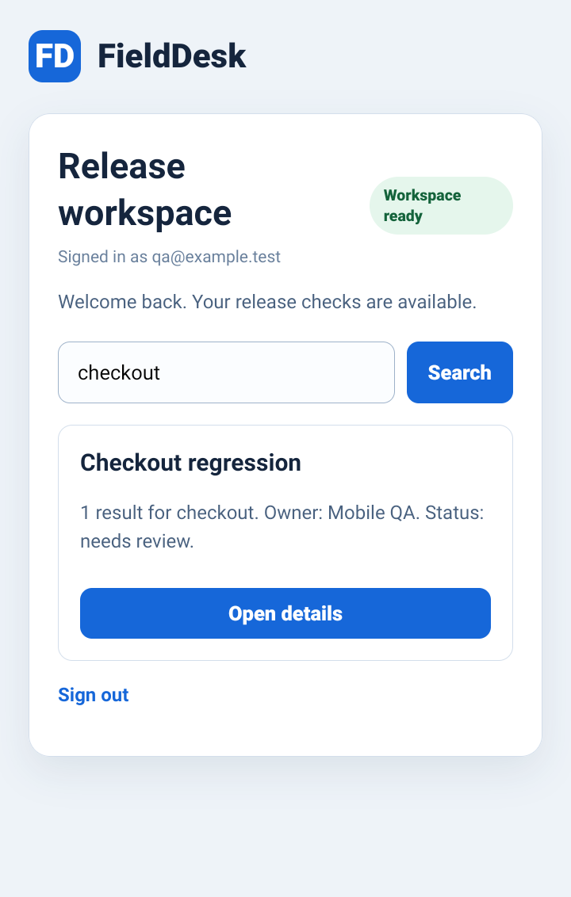
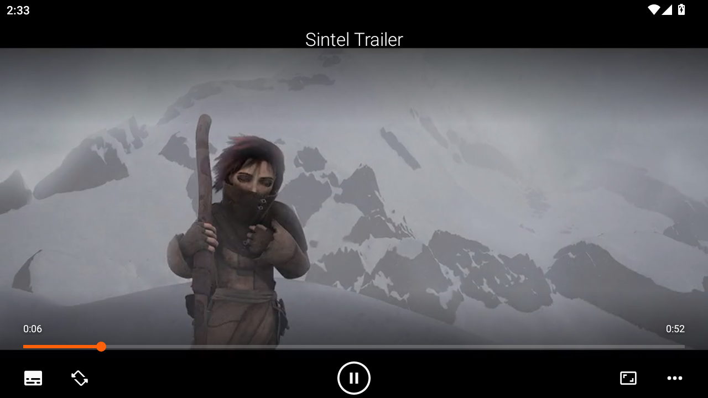

# App TestBench v0.1.1

**不只是模拟器控制器：两条真实 App 流程、可复现证据，以及符合公开 Schema 的失败结果。**

**Not just an emulator controller: two live app flows, reproducible evidence, and failure output that matches the published Schema.**

App TestBench v0.1.1 是 `v0.1.0` 的补丁版本。`v0.1.0` 标签保持不变。本版的重点是用真实 Android App 验证执行层能否完成多步流程、保留证据，并在失败时向 CI 和 Agent 返回稳定结果。

App TestBench v0.1.1 is a patch release after `v0.1.0`. The `v0.1.0` tag is unchanged. This release focuses on proving the execution layer with real Android app journeys: multi-step flows, retained evidence, and stable machine-readable failure output for CI and agents.

## 真实案例 / Live cases

### Fennec local web session



- Pinned open-source app: Fennec F-Droid `160.0.0` (`versionCode 1600020`).
- APK SHA256: `43cf491bbc677244d7b56ba2e8ae20ccd802c9d8f6b44d6b6aff7eb1753eab1b`.
- Completes onboarding, a real browser login form, asynchronous search, detail navigation, force-stop, cold launch, `localStorage` session/query restoration, logout, screenshots, UI trees, and logcat.
- Live result: **71/71 steps passed in 99.141 seconds**.
- Captured: 11 screenshots at 720×1280, JUnit with 71 tests, and a 2.6 MB self-contained HTML report.

[Flow and reproduction](../../examples/fennec-local-web-session/README.md)

### VLC HTTP playback



- Pinned open-source app: VLC for Android `3.7.2` (`versionCode 13070208`).
- APK SHA256: `727693d59c4d678c046386812a103209a25423460c9d22e38e12460f12402ab6`.
- Exposes a host byte-range server through `adb reverse`, handles the first-play tutorial, locks landscape, plays a fixed H.264/AAC MP4, and records HTTP, demux, codec, and MediaCodec logcat evidence.
- Live result: **30/30 steps passed in 40.547 seconds**.
- Captured: 5 screenshots at 1280×720, JUnit with 30 tests, and a 1.7 MB self-contained HTML report.

[Flow and reproduction](../../examples/vlc-http-playback/README.md)

## Fixed / 修复

### Failed `run --json` contract

Before v0.1.1, a live failed flow returned exit code `1` but emitted:

```json
{
  "ok": false,
  "data": { "status": "failed" }
}
```

That shape did not satisfy the published `cli-v1.schema.json`, which requires an `error` object when `ok=false`.

v0.1.1 now returns:

```json
{
  "ok": false,
  "error": {
    "type": "step_failure",
    "message": "Flow step '...' failed: ...",
    "hint": "Visible text: ..."
  },
  "data": {
    "status": "failed"
  }
}
```

The exit code remains `1`. Failed-step diagnostics, skipped steps, failure screenshots, UI trees, logcat, HTML reports, and JUnit output are preserved. A regression test validates the actual failed `run --json` envelope against the packaged Draft 2020-12 Schema. A second live MuMu failure run confirmed the same behavior.

### Transient UI dump retries

`wait_for_text` now retries temporary `uiautomator dump` errors such as `null root node returned by UiTestAutomationBridge` while the app is still starting. The timeout remains enforced, and the final error is retained if the text never appears.

## Added / 新增

- `open <uri>` and flow `open`, with HTTP(S), file, and content URI validation plus optional package and MIME restrictions.
- `reverse-port` for host-to-device service access, with add/remove flow support.
- `clear-data` and `orientation portrait|landscape|auto` for deterministic app state and layout setup.
- Two reproducible live-case directories with pinned download scripts, flow YAML, result expectations, and limits.
- Public screenshot provenance and SHA256 records under `docs/assets/cases/`.

## Changed / 变更

- `app-testbench init` defaults to `app-testbench-flow.yaml` / `.json`; explicit `--output` remains supported.
- README, English README, Agent runbook, Codex skill, flow reference, validation record, and case index now use the Fennec and VLC live evidence.
- Package and CLI versions are `0.1.1`.

## Evidence and limits / 证据与边界

- Live environment: Windows 10.0.26100, Python 3.11.8, MuMu Player 6.8.8.0, Android 12, ADB 1.0.41, 1280×720, Simplified Chinese system language.
- Public app screenshots come from real runs. Fennec browser images have the URL/status bar cropped; report images replace local paths and the test serial before rendering.
- Raw APKs, video, complete run directories, full logcat, and UI XML remain in ignored local storage and are not published.
- Coordinates and localized text are resolution-, locale-, and app-version-specific.
- Native `text` input remains printable ASCII only.
- Automated CI uses fake `adb` / `MuMuManager`; it verifies command construction and artifact behavior, not every real-device behavior.
- Physical devices remain the final acceptance environment.

## Install / 安装

From source:

```powershell
git clone https://github.com/albertwickous-droid/app-testbench.git
cd app-testbench
git checkout v0.1.1
python -m pip install .
app-testbench --version
```

PyPI publication is a separate manual channel and is not implied by this GitHub release.

## Documentation / 文档

- [Live cases and screenshots](../cases.md)
- [Fennec flow](../../examples/fennec-local-web-session/README.md)
- [VLC flow](../../examples/vlc-http-playback/README.md)
- [Validation record](../validation.md)
- [Flow reference](../flow-reference.md)
- [Security policy](../../SECURITY.md)
- [Responsible use](../../RESPONSIBLE_USE.md)

---

**Full changelog:** [CHANGELOG.md](../../CHANGELOG.md)