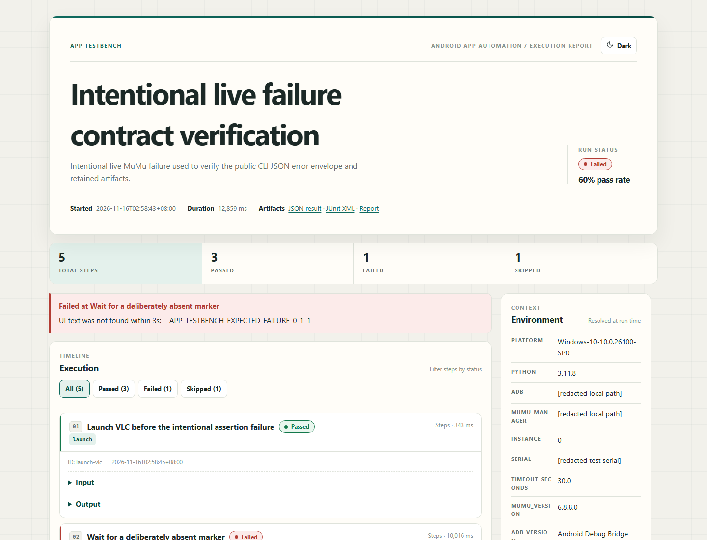

# App TestBench v0.1.1

**可重复的 Android App 测试，失败时保留可交接的证据。**
**Repeatable Android app testing with handoff-ready failure evidence.**

v0.1.1 把公开案例从简单持久化演示升级为三条真实工程链路：网络 App、Android 浏览器和原生媒体播放器。三个案例都在真实 MuMu Player 上跑通，固定 APK 版本与 SHA256，截图来自实际 App 页面。

v0.1.1 replaces the earlier simple persistence demos with three real engineering paths: a network-backed app, an Android browser, and a native media player. All three passed on real MuMu Player runs with pinned APKs, SHA256 verification, and screenshots captured from actual app pages.

## Live cases / 真实案例

| Case | Result | What it proves |
| --- | --- | --- |
| Wikipedia | **63/63 passed**, `113.563 s` | Live search, WebView article, reading list, force-stop, cold-start persistence |
| Firefox/Fennec | **66/66 passed**, `143.016 s` | Cookie + LocalStorage, download verification, two tabs, session restore |
| VLC | **43/43 passed**, `50.579 s` | Player Activity, byte-range MP4, decoded frames, codec/AudioTrack logs, orientation |


- Wikipedia `r/50616-r-2026-11-03` (`versionCode 50616`)
- APK SHA256: `d225e5d08fe461f12fa0af7b617e6e715f3112986165c34e0572a1a056129dd1`
- No account or paid service is used.
- Flow: [examples/wikipedia-research-session](../../examples/wikipedia-research-session/)


- Fennec F-Droid `160.0.0` (`versionCode 1600020`)
- APK SHA256: `43cf491bbc677244d7b56ba2e8ae20ccd802c9d8f6b44d6b6aff7eb1753eab1b`
- The local fixture has no password field and uses only synthetic identity `qa-runner`.
- The wrapper verifies `app-testbench-browser-evidence.txt` through ADB after the browser writes it.
- Flow: [examples/firefox-webapp-session](../../examples/firefox-webapp-session/)


- VLC `3.7.2` (`versionCode 13070208`)
- APK SHA256: `727693d59c4d678c046386812a103209a25423460c9d22e38e12460f12402ab6`
- Media: W3C Sintel trailer, `4,372,373` bytes, SHA256 `b670602fa00934ca27c4351bb0efe7ea7a07fae57284e44226025eeed7c51254`
- `wait_for_activity` proves the player component; `assert_logcat_contains` proves the media input and `android_audiotrack`.
- Flow: [examples/vlc-media-playback](../../examples/vlc-media-playback/)

## Added / 新增

- `wait_for_activity` polls the top/resumed Activity and reports the last observed component on timeout.
- `assert_logcat_contains` makes codec, media-input, audio-output, and other subsystem behavior testable through bounded logcat.
- Three self-contained live-case directories with preparation scripts, pinned hashes, expected results, known limits, and cleanup rules.
- Public screenshot provenance and SHA256 manifests under [`docs/assets/cases`](../../docs/assets/cases/).

## Fixed / 修复

Failed `run --json` previously emitted `ok=false` plus `data` but omitted the `error` object required by the published Schema.

v0.1.1 keeps the Schema unchanged and fixes the producer:

```json
{
  "ok": false,
  "error": {
    "type": "step_failure",
    "message": "Flow step '...' failed: ..."
  },
  "data": {
    "status": "failed"
  }
}
```

The exit code remains `1`. Failure screenshots, UI trees, logcat, HTML reports, and JUnit results are retained. A regression test validates the actual failed `run --json` envelope against the packaged Draft 2020-12 `cli-v1.schema.json`.



The screenshot is from a real failed MuMu run. Only local tool paths and the test ADB serial were replaced before rendering; the failed verdict, report structure, and retained evidence were not simulated.

## Install / 安装

From source:

```powershell
git clone https://github.com/albertwickous-droid/app-testbench.git
cd app-testbench
git checkout v0.1.1
py -3.11 -m venv .venv
.\.venv\Scripts\Activate.ps1
python -m pip install .
app-testbench --version
app-testbench doctor --json
```

PyPI publication is a separate channel and is not implied by this GitHub Release.

## Evidence and boundaries / 证据与边界

- Live environment: Windows 10.0.26100, Python 3.11.8, MuMu Player 6.8.8.0, Android 12, ADB 1.0.41, `720x1280`, Simplified Chinese system language.
- Public screenshots come from real runs and show only test apps, test-created content, and local fixtures.
- APKs, MP4 files, raw screenshots, full UI XML/logcat, and complete run directories remain in ignored storage and are not published.
- The cases are calibrated for pinned app versions, language, resolution, and the recorded MuMu/Android image.
- Native `text` input remains printable ASCII only.
- CI uses deterministic fake ADB/MuMuManager backends. Live results are recorded separately and are not implied for every MuMu/Android combination.
- Physical devices remain the final acceptance environment for hardware, OEM, and production-account behavior.
- The project does not bypass login, CAPTCHA, anti-automation, anti-scraping, risk controls, rate limits, paywalls, or access controls.

## Documentation / 文档

- [Live cases and screenshots](../cases.md)
- [Validation record](../validation.md)
- [Flow reference](../flow-reference.md)
- [Agent runbook](../agent-deployment.md)
- [Responsible use](../../RESPONSIBLE_USE.md)
- [Security policy](../../SECURITY.md)

---

**Full changelog:** [CHANGELOG.md](../../CHANGELOG.md)
