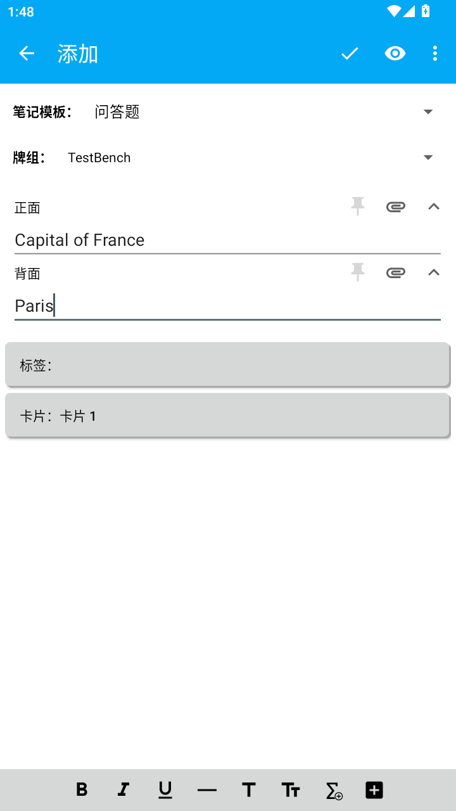
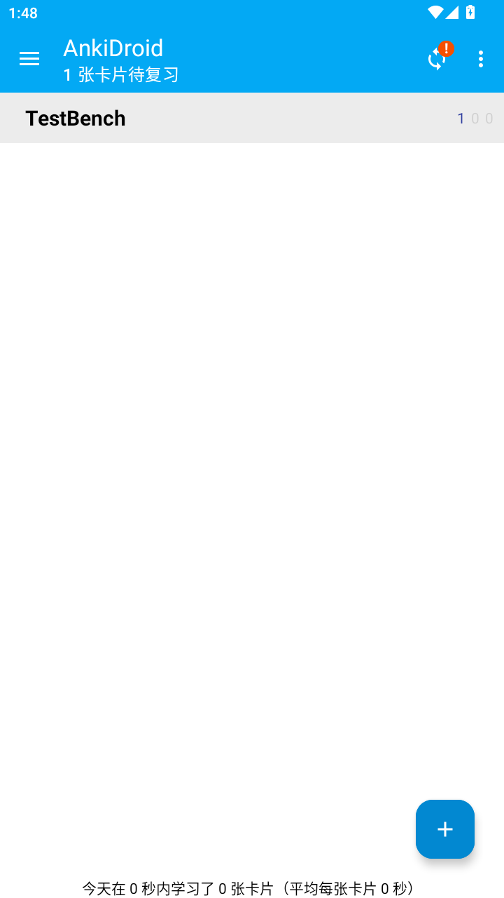
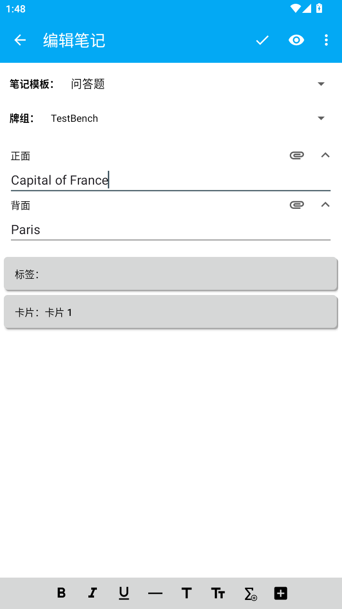

# AnkiDroid deck creation and cold-start persistence

This live case uses AnkiDroid's real first-run onboarding and collection UI to
create a deck and a question/answer card, then verifies the data survives a
force-stop and cold launch.

## Why this app

- AnkiDroid is a mature, actively maintained open-source Android application
  available from F-Droid with immutable versioned APK URLs.
- The case needs no network account, paid service, or private user data.
- It stresses enabled-state waits, dialog inputs, card-form navigation, local
  database persistence, and content verification after restart.

## Pinned input

| Input | Value |
| --- | --- |
| Package | `com.ichi2.anki` |
| Version | `2.25.3` (`versionCode 225033004`) |
| APK source | `https://f-droid.org/repo/com.ichi2.anki_225033004.apk` |
| APK SHA256 | `c7056f611c66fc91a8e290e18268a0d708e813704f51c66e4af1534d468f6790` |
| Deck | `TestBench` |
| Card front | `Capital of France` |
| Card back | `Paris` |
| Device profile | 720x1280, Android 12, Simplified Chinese |

The APK is downloaded into ignored `runs/case-assets/ankidroid/` storage and is
never committed.

## Run

```powershell
.\examples\ankidroid-deck-persistence\run.ps1
```

The script verifies the APK, runs `doctor`, executes the 49-action flow, and
writes a JUnit report. Before the flow, it also removes
`/storage/emulated/0/AnkiDroid` and resets AnkiDroid's all-files app-op. Those
steps are required because `pm clear` can preserve both the permission state and
an external collection from an earlier run. Use a dedicated MuMu test instance.

## What the flow verifies

1. Installs the exact package/version and starts from an empty collection.
2. Completes AnkiDroid's first-run onboarding.
3. Creates the `TestBench` deck through the real dialog.
4. Opens the deck's long-press action menu and adds a question/answer card with
   `Capital of France` and `Paris`.
5. Verifies the deck reports `1 张卡片待复习`.
6. Force-stops and cold-launches AnkiDroid, then verifies the deck name and card
   count are still present.
7. Reopens the card browser and verifies both saved fields.
8. Captures screenshots, UI trees, logcat, `result.json`, HTML, and JUnit.

## Expected result

All 49 actions pass in the recorded run: **49 passed, 0 failed, 0 skipped in
75.203 seconds**. The persistence screenshot must show `TestBench` and
`1 张卡片待复习`; the saved-card screenshot must show both the front and back fields.

## Public evidence

| View | Image |
| --- | --- |
| Real card input |  |
| Deck and due count after cold start |  |
| Saved card reopened |  |

## Known limits

- A clean AnkiDroid 2.25.3 install can use its available collection path without
  showing the all-files access screen. This case therefore does not claim that
  the optional permission branch runs on every device.
- AnkiDroid's collection database and web-based card renderer can change between
  releases. Recalibrate selectors after changing the pinned APK.
- The flow creates harmless sample study data and clears app data at the start;
  do not run it on a personal collection.
