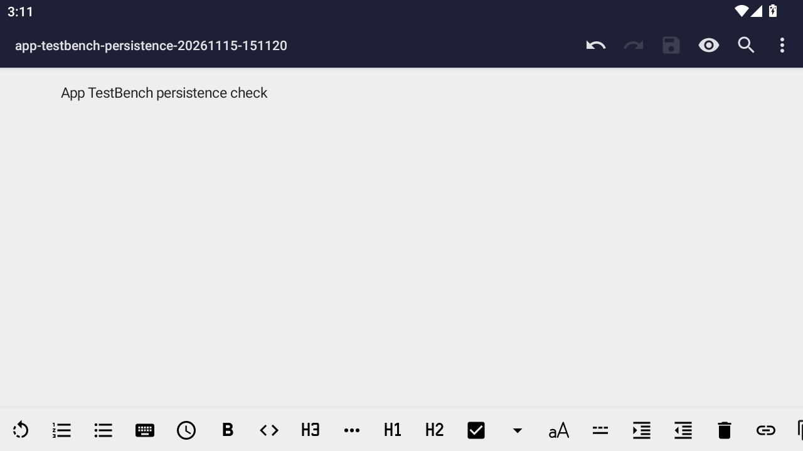
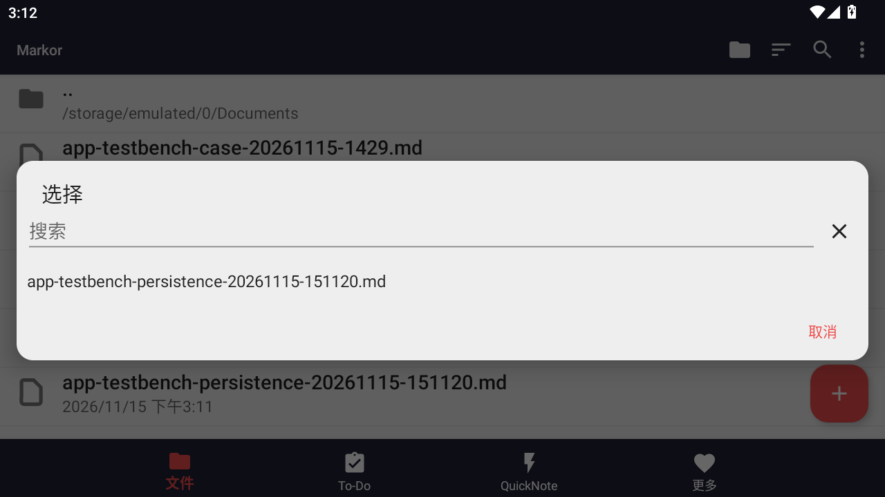
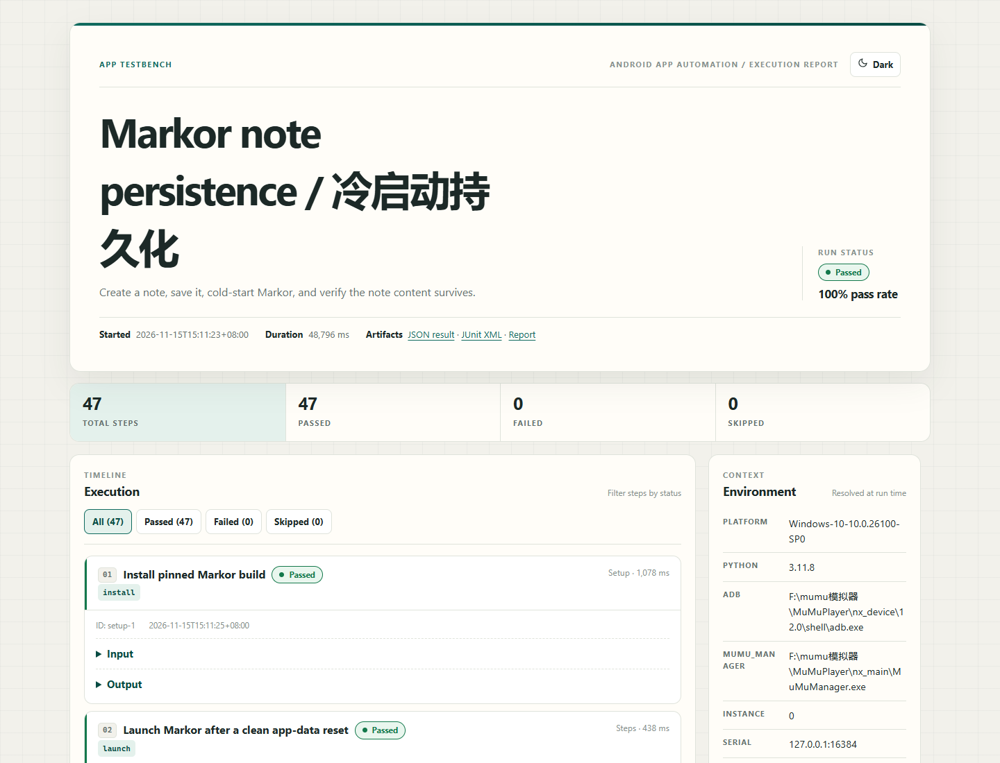
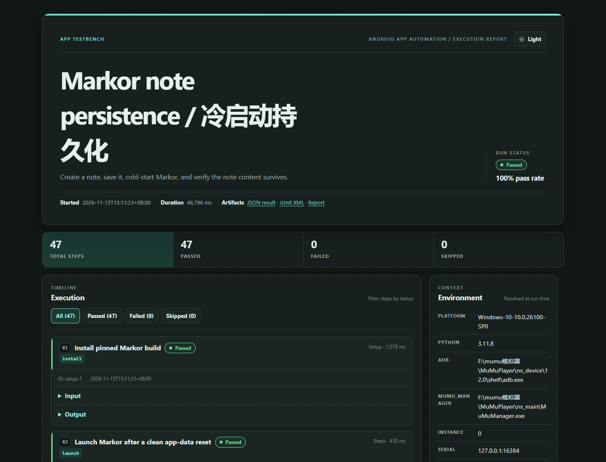

# Markor note persistence / Markor 笔记冷启动持久化

## 这个案例验证什么 / What this case proves

这条 flow 使用一个固定版本的开源 Android 笔记应用 Markor，完整执行：

1. 安装固定版本 APK，并核对包名、`versionCode` 和 `versionName`。
2. 完成首次启动引导，关闭版本说明弹窗。
3. 创建 Markdown 笔记，点击编辑器并输入正文。
4. 在保存前断言正文已经进入 UI。
5. 保存、关闭 App、重新启动。
6. 在文件列表中确认笔记仍在，再通过搜索重新打开。
7. 断言重启后正文仍然存在。
8. 收集截图、UI 树、logcat、`result.json`、自包含 HTML 报告和 JUnit XML。

This flow uses a pinned open-source Markor build to exercise installation, first-run onboarding, editor input, save, force-stop, cold relaunch, exact-file search, and post-relaunch content persistence. It also verifies package identity and exports screenshots, UI trees, logcat, JSON, a self-contained HTML report, and JUnit XML.

真实运行结果 / Live result: **47 passed, 0 failed, 0 skipped** on MuMu Player 6.8.8.0 / Android 12.



## 固定 APK / Pinned APK

| Field | Value |
| --- | --- |
| Package | `net.gsantner.markor` |
| Version | `2026.10.0` |
| Version code | `164` |
| Official source | <https://f-droid.org/repo/net.gsantner.markor_164.apk> |
| Size | `11849016` bytes |
| SHA256 | `c29412e02d03e4f0511746a1bcef48c6b73fc1f70c1024fbf04903b0b3f4c485` |

APK 不属于本仓库，也不会提交到 Git。`fetch-apk.ps1` 会依次尝试 F-Droid 官方站点和可信的 F-Droid 仓库镜像，但无论来源如何都会核对固定文件大小和 SHA256；不匹配就停止。

The APK is not part of this repository and is never committed. `fetch-apk.ps1` checks both size and SHA256 and stops on a mismatch.

## 运行 / Run

先按仓库 README 安装 App TestBench 和开发依赖，启动一个 MuMu 实例，然后从仓库根目录执行：

```powershell
.\examples\markor-note-persistence\run.ps1
```

脚本会：

- 从 F-Droid 下载固定 APK 到被 `.gitignore` 排除的 `runs/case-assets/`；
- 安装 Markor，清理该 App 的数据，授予测试所需的 `MANAGE_EXTERNAL_STORAGE` app-op；
- 生成唯一的笔记标题并运行 `flow.yaml`；
- 默认在结束后删除本次测试笔记并卸载 Markor；使用 `-KeepInstalled` 可保留安装。

The script downloads the pinned APK into ignored `runs/case-assets/`, installs Markor, clears its app data, grants the storage app-op needed by the test, runs the flow with a unique note title, and removes only the note it created. Markor is uninstalled by default; pass `-KeepInstalled` to keep it.

如果 MuMu 安装在其他位置，或者有多个 ADB 设备，可显式传入：

```powershell
$env:APP_TESTBENCH_SERIAL = "<serial reported by app-testbench doctor --json>"
.\examples\markor-note-persistence\run.ps1 `
  -AdbPath (Get-Command adb).Source `
  -Serial $env:APP_TESTBENCH_SERIAL `
  -Instance 0
```

运行结果写入 `runs/examples/markor-note-persistence/<timestamp>/`，该目录默认不进入 Git。

Artifacts are written under the ignored `runs/examples/markor-note-persistence/<timestamp>/` directory.

## 复现证据 / Captured evidence

| View | Image |
| --- | --- |
| Saved note |  |
| Note found after relaunch |  |
| Reopened note with persisted body |  |
| Passed HTML report, light theme |  |
| Passed HTML report, dark theme |  |

## 已知限制 / Known limits

- 坐标和中文 UI 文本基于 `1280x720`、简体中文系统环境的 Markor `2026.10.0`；更换分辨率、语言或 Markor 版本时需要重新确认坐标和文案。
- `text` 动作只输入可打印 ASCII。本案例刻意使用 ASCII 正文，避免把 Unicode 输入能力说成已经支持。
- `MANAGE_EXTERNAL_STORAGE` app-op 仅用于隔离模拟器中的测试准备。不要无条件把该权限授予生产设备上的应用。
- Markor 属于第三方项目。本仓库只引用其公开下载地址与校验值，不重新分发 APK，也不表示与 Markor 维护者存在隶属或背书关系。
