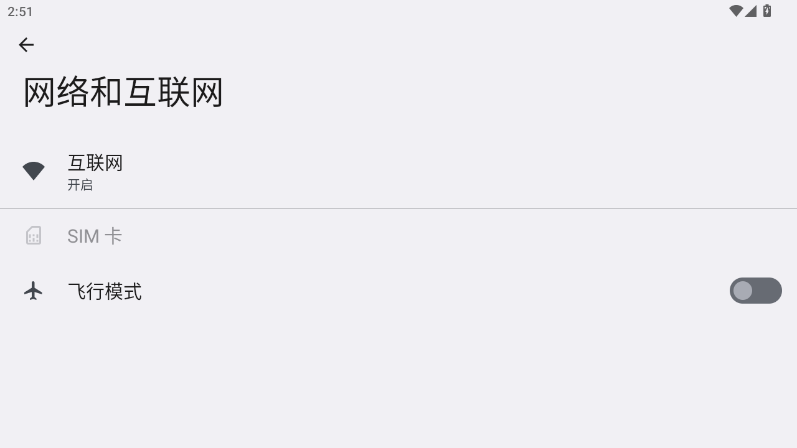
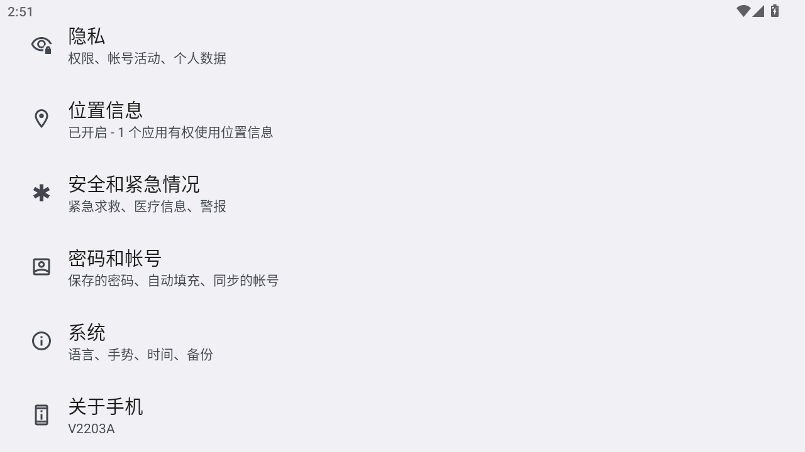
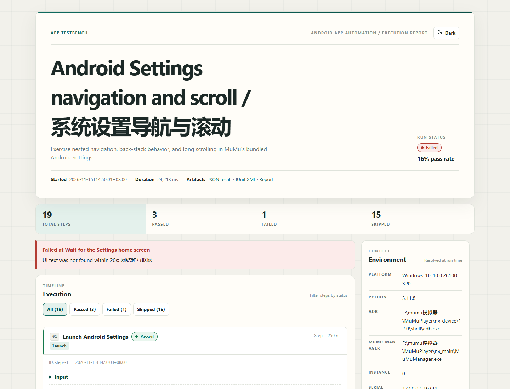
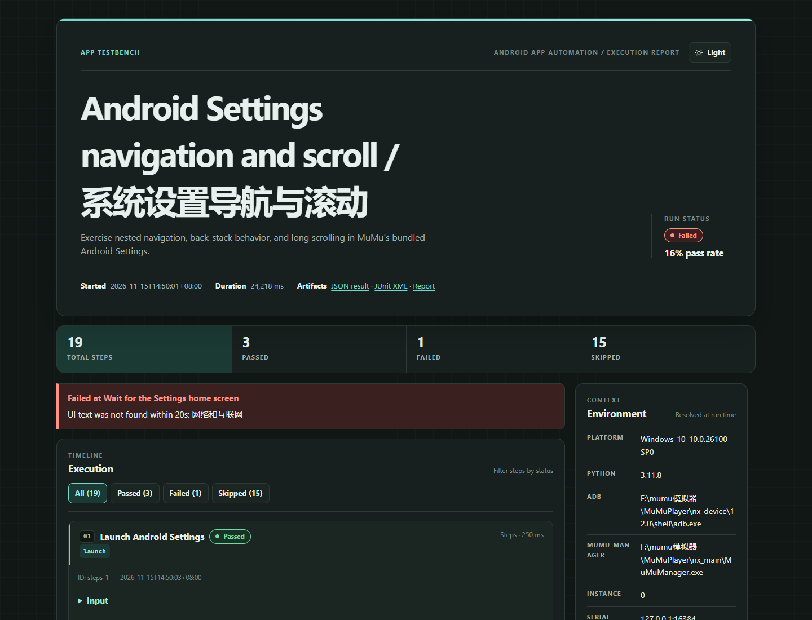

# Android Settings navigation and scroll / 系统设置导航与滚动

## 这个案例验证什么 / What this case proves

这条 flow 使用 MuMu Android 镜像自带的 AOSP Settings App，不依赖账号、外部 API 或 APK 下载：

1. 启动 Settings。
2. 先把继承自上次运行的滚动位置复位到顶部。
3. 进入“网络和互联网”，等待页面渲染并断言“飞行模式”可见。
4. 保存网络页截图和 UI 树。
5. 使用 `back` 返回，确认首页内容重新出现。
6. 连续执行 `swipe` 滚动到系统设置区域。
7. 等待并断言“关于手机”入口可见。
8. 关闭 App，收集最终 logcat、HTML、JSON 和 JUnit。

This flow uses the AOSP Settings app bundled with the MuMu Android image. It covers state restoration, nested navigation, back-stack behavior, long scrolling, dynamic text waits, screenshots, UI hierarchy capture, logcat, and JUnit output without accounts or external services.

真实运行结果 / Live result: **23 passed, 0 failed, 0 skipped** on MuMu Player 6.8.8.0 / Android 12.



## 运行 / Run

```powershell
app-testbench validate .\examples\settings-network-scroll\flow.yaml
app-testbench run .\examples\settings-network-scroll\flow.yaml `
  --output .\runs\examples\settings-network-scroll `
  --junit-xml .\runs\examples\settings-network-scroll\junit.xml `
  --wait-for-boot --boot-timeout 60
```

## 为什么选第二个案例 / Why this second case

Markor 覆盖 APK 安装、首次引导、输入和持久化。Settings 覆盖另一种工程问题：系统 App 会恢复上次滚动的状态，页面层级和返回栈也会改变后续动作的可达性。因此这条 flow 不假设 App 一定从首页打开，而是先用三次向下滑动复位，再开始验证。

Markor covers installation, onboarding, text input, and persistence. Settings exercises a different failure mode: Android may restore the previous scroll position, so the flow cannot assume the app starts at the top. It normalizes the initial state before navigation and then verifies back-stack and long-scroll behavior.

## 复现证据 / Captured evidence

| View | Image |
| --- | --- |
| Network page |  |
| Scrolled system section |  |
| Failure report, light theme |  |
| Failure report, dark theme |  |

失败报告来自本案例调试阶段的一次真实失败：Flow 启动时直接假设 Settings 位于顶部，但 Android 恢复了上次滚动位置。报告保留了失败步骤、可见文本、UI 树、logcat、HTML 和 JUnit。最终 flow 已修复为显式复位滚动位置。

The failure report came from a real debugging run. The first version assumed Settings opened at the top, but Android restored the previous scroll position. The report retained the failed step, visible text, UI tree, logcat, HTML, and JUnit. The committed flow fixes that assumption by normalizing scroll position first.

## 已知限制 / Known limits

- UI 文案和坐标基于 `1280x720`、简体中文 Android 12 镜像；改变语言、分辨率或系统版本后需要重新校准。
- Settings 的“关于手机”详情页在当前镜像中偶发 `uiautomator dump: could not get idle state`，所以本案例验证其入口可见，不把详情页 UI 树当成稳定契约。
- 不切换飞行模式、Wi-Fi 或任何网络状态；这条 flow 只读验证页面和文本。
